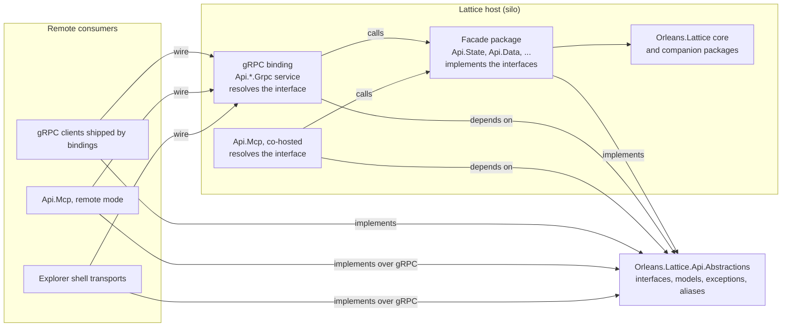

# Architecture

`Orleans.Lattice.Api.Abstractions` is the contract layer of the API surface. It declares what the facades offer - service interfaces, request / response models, typed exceptions and serialization aliases - and nothing that decides how a call is served. Every other API package meets at this assembly: the facades implement its interfaces in-process, the gRPC bindings expose those interfaces on the wire, and the remote clients, the MCP server and the Explorer consume them. The complete declaration inventory is in the [Public API](api.md).

## Where it sits

The dependency arrows only point at the contract. A facade references the contract and the core library; a gRPC binding references the contract and, with one exception, nothing else; the MCP server and the Explorer reference the contract and the bindings. No binding or consumer references a facade assembly, so the facade's implementation types stay `internal` and can change freely.

## The contract assembly

The assembly holds one namespace per facade (`Orleans.Lattice.Api.State`, `.Data`, `.Auth`, `.Backup`, `.Schema`, `.Replication`, `.Telemetry`, `.TreeAdmin`, `.TenantAdmin`, `.Apps`) plus two cross-cutting ones: `Orleans.Lattice.Api.Operations`, the shared accept-then-poll contract for long-running work, and `Orleans.Lattice.Api.Region`, region discovery. Each namespace is self-contained: its interfaces, its models, its exceptions, and one static alias class that names every serializable model in it.

It is not dependency-free. Its models reuse public types from the packages it references - the core `Orleans.Lattice` library, `Orleans.Lattice.Membership`, `Orleans.Lattice.Auth`, `Orleans.Lattice.Backup` and `Orleans.Lattice.Schema` - rather than redeclaring them, so a contract consumer takes those packages transitively. It references no facade, binding or transport package, and it registers nothing: it has no service-collection extension, no options and no background work.

Behaviour in the assembly is limited to what a model needs to be useful on its own: computed properties and small pure helpers on the models themselves, such as the terminal-state check on an operation status or the lookup on a telemetry query catalog, all listed in the [Public API](api.md).

## Serving a call in-process

A facade package implements the interfaces with internal types and registers each one in dependency injection as a singleton against its interface (for example `AddLatticeStateApi` registers `ILatticeStateQuery`, `ILatticeStateObserver` and `ILatticeStateMetricsObserver`). A co-hosted consumer resolves the interface directly; the facade validates the request, authorizes the caller, and delegates to the core library's seams. The contract carries no authorization of its own: every gate is enforced inside the implementing facade, which is why the facade, not this package, documents the exceptions a call can raise. Telemetry is the one facade whose implementing type, `LatticeTelemetry`, is itself public.

## Serving a call over the wire

A gRPC binding's server-side service takes the contract interface from dependency injection and dispatches each RPC to it. Because the binding references only the contract, it serves whatever implementation the host registered: register the facade on the same host, then add and map the binding. The binding owns transport concerns - credential bridging, its own transport authorizer, mapping each typed exception to a status code - and never replaces the facade's access gate. The replication binding is the one exception to the reference rule: it also references the core library and the replication engine package.

On the client side the same interface reappears. Several bindings ship a public gRPC client that implements the contract interface, so a remote caller programs against the interface it would use in-process - for example `LatticeReplicationStatusGrpcClient` implements `ILatticeReplicationStatus`, the apps binding's clients implement the five `Orleans.Lattice.Api.Apps` interfaces, and `LatticeTenantAdminApiGrpcClient` implements `ILatticeTenantDirectoryAdmin` and `ILatticeTenantPolicyAdmin`.

## The MCP server and the Explorer

`Orleans.Lattice.Api.Mcp` projects contract methods as MCP tools and reaches them in one of two ways. Co-hosted (`AddLatticeMcp`), it runs on the silo that exposes the facades and resolves each facade group's interface from dependency injection. In remote mode (`AddLatticeMcpRemote`), it registers its own internal adapters that implement the contract interfaces over the bindings' gRPC clients, so the same tool handlers run unchanged against a remote cluster, and it implements `ILatticeRegionCatalog` to report which regions and facade groups it can route to. The Explorer follows the remote pattern: its shell transports implement the contract interfaces over the bindings' gRPC clients, so its pages depend on the interfaces rather than on a transport.

## Long-running operations

The operation-tracking interfaces (`ILatticeBackupOperations`, `ILatticeSchemaOperations`, `ILatticeSchemaComplianceOperations`, `ILatticeTreeAdminOperations` and `ILatticeStorageUsageOperations`) extend `ILatticeOperations`, so every facade that starts tracked work exposes the same status, list and cancel verbs over the same `LatticeOperationStatus` shape. The backup, schema and tree-administration facades run that work on the core library's operation coordinator and convert its durable record into the public handle and status through one shared internal mapping that lives in this assembly and is visible only to those three facades, so the projection is written once rather than copied per facade. [Long-running operations](operations.md) describes the behaviour every adopter shares.

## Wire identity and evolution

Every serializable model carries a stable `[Alias]` from its namespace's alias class (for example `oio.` for operations and `oit.` for tree administration). The alias, not the CLR type's assembly, is its wire and persisted identity, which is what allowed the contract to move out of the facade assemblies without disturbing in-flight or persisted payloads, and it is why aliases are never renamed or removed. Namespaces were preserved for the same reason, so consumers compile unchanged.

Typed exceptions are mostly raised and handled in-process: a facade throws, and a binding maps the type to a distinct outcome such as a specific gRPC status. The two exceptions that derive from a BCL exception subclass rather than `System.Exception` ship a no-op same-silo copier beside them, which is the repository's rule for any such type that may cross a co-located grain boundary.

## Trusted system-origin calls

A co-hosted infrastructure consumer - one of the bundled bindings or the MCP server - that must run a trusted operation the access gate admits without a user identity, such as a read-only permission introspection on a caller's behalf, does not reach into a facade's or the core library's internals for it. It uses the public `LatticeSystemOrigin` seam in the core library, so the contract and that one seam remain the only coupling between the API packages. See the [package overview](README.md#core-properties).

## Source map

- [Package project](../../src/lattice.api.abstractions/Orleans.Lattice.Api.Abstractions.csproj) - references and the facades granted access to the shared operation mapping.
- [Operation contract](../../src/lattice.api.abstractions/Operations/ILatticeOperations.cs) and its [shared mapping](../../src/lattice.api.abstractions/Operations/LatticeOperationMapping.cs).
- [Region contract](../../src/lattice.api.abstractions/Region/ILatticeRegionCatalog.cs).
- One folder per facade namespace under [`src/lattice.api.abstractions/`](../../src/lattice.api.abstractions/), each with its interfaces (and, for some namespaces, result and exception types) at the top level and its models under `Model/`.

## Related

- [Package overview](README.md)
- [Public API](api.md)
- [Long-running operations](operations.md)
- [`Orleans.Lattice.Api.Mcp`](../lattice.api.mcp/README.md)
