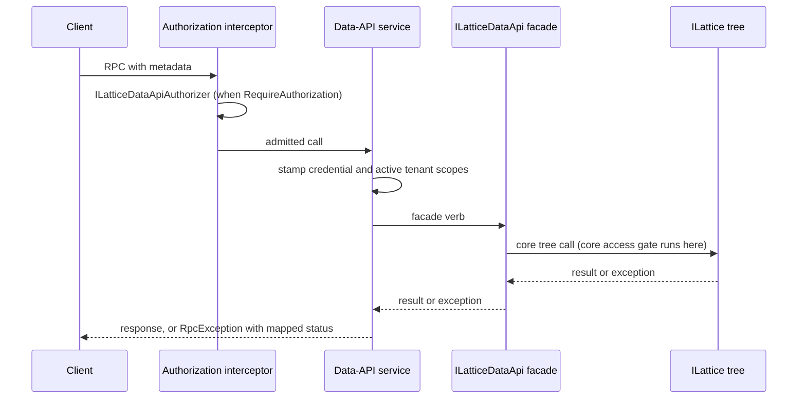

# Architecture

The binding projects the in-process `ILatticeDataApi` facade onto a code-first gRPC service. It adds transport concerns only - wire marshalling, a coarse admission check, identity and tenant bridging, and status mapping - and delegates every operation to the facade, which in turn calls the core `ILattice` surface. It holds no state between calls.

## Wire contract

The service is bound from C# definitions rather than a `.proto` file, under the gRPC service name `orleans.lattice.api.data`, so each method's path is `/orleans.lattice.api.data/<Rpc>`. All ten RPCs are unary. Every message is a `[GenerateSerializer]` record marshalled with the Orleans binary serializer; the server and `LatticeDataApiGrpcClient` build their method definitions from the same serializers resolved out of a service provider, so both ends use identical marshallers. Most RPCs carry this package's `Data*` and `Crdt*` records; `Get`, `ReadRange` and `DeleteRange` reuse the facade's records from `Orleans.Lattice.Api.Abstractions` unchanged. Wire aliases are pinned in `GrpcDataTypeAliases` and must never be renamed.

## Request path

1. **Admission.** A gRPC interceptor added to the host pipeline recognises calls under the `orleans.lattice.api.data` service and ignores every other service on the host. When `RequireAuthorization` is `true`, it builds a `LatticeDataApiAuthorizationContext` - the `ServerCallContext`, the `LatticeDataApiOperation` derived from the method name, and the target tree id taken from the request (`null` for a cross-tree batch, which spans several trees) - and asks `ILatticeDataApiAuthorizer`. A refusal ends the call with `PermissionDenied` before the request reaches the service; a cancelled check ends it with `Cancelled`.
2. **Identity and tenant.** The service asks `ILatticeDataApiCredentialBridge` for the caller credential and `ILatticeDataApiActiveTenantBridge` for an asserted tenant, and stamps each onto its ambient context for the duration of the call. A call with neither stamps nothing, so it runs as an anonymous caller in the default tenant.
3. **Dispatch.** The service unpacks the request and calls the matching facade verb. `CrdtWrite` and `CrdtRead` dispatch on the request's `CrdtWriteOp` or `CrdtKind` to the corresponding typed CRDT verb.
4. **Status mapping.** Exceptions from the facade or the core tree are translated to explicit gRPC statuses. A core authorization denial becomes `PermissionDenied` with the non-sensitive denial fields as `lattice-denied-*` trailers; an admission quota refusal becomes `ResourceExhausted` with `lattice-quota-*` trailers; a schema-policy rejection becomes `InvalidArgument` with payload-free `lattice-validation-*` trailers. Any unmapped exception is logged server-side and returned as `Internal` with a generic message. The full table is in the [status mapping](README.md#status-mapping).

## Two independent gates

The interceptor's authorizer is an endpoint-level switch: it decides whether a caller may reach the data API at all and sees only the operation and target tree. The fine-grained, per-tree and per-key rights check is the core access gate, which runs inside the tree with the identity the service stamped. Both must pass, and turning the interceptor off does not bypass the core gate. See the data facade's [security notes](../lattice.api.data/README.md#security).

## Source map

- [Registration](../../src/lattice.api.data.grpc/LatticeDataApiGrpcServiceCollectionExtensions.cs)
- [Service and status mapping](../../src/lattice.api.data.grpc/LatticeDataApiGrpcService.cs)
- [Method definitions](../../src/lattice.api.data.grpc/LatticeDataApiGrpcMethods.cs)
- [Authorization interceptor](../../src/lattice.api.data.grpc/Security/LatticeDataApiGrpcAuthInterceptor.cs)
- [Header credential bridge](../../src/lattice.api.data.grpc/HeaderLatticeDataApiCredentialBridge.cs)
- [Header active-tenant bridge](../../src/lattice.api.data.grpc/HeaderLatticeDataApiActiveTenantBridge.cs)
- [Client](../../src/lattice.api.data.grpc/LatticeDataApiGrpcClient.cs)

## Related

- [Public API](api.md)
- [Configuration](configuration.md)
- [Data facade architecture](../lattice.api.data/architecture.md)
