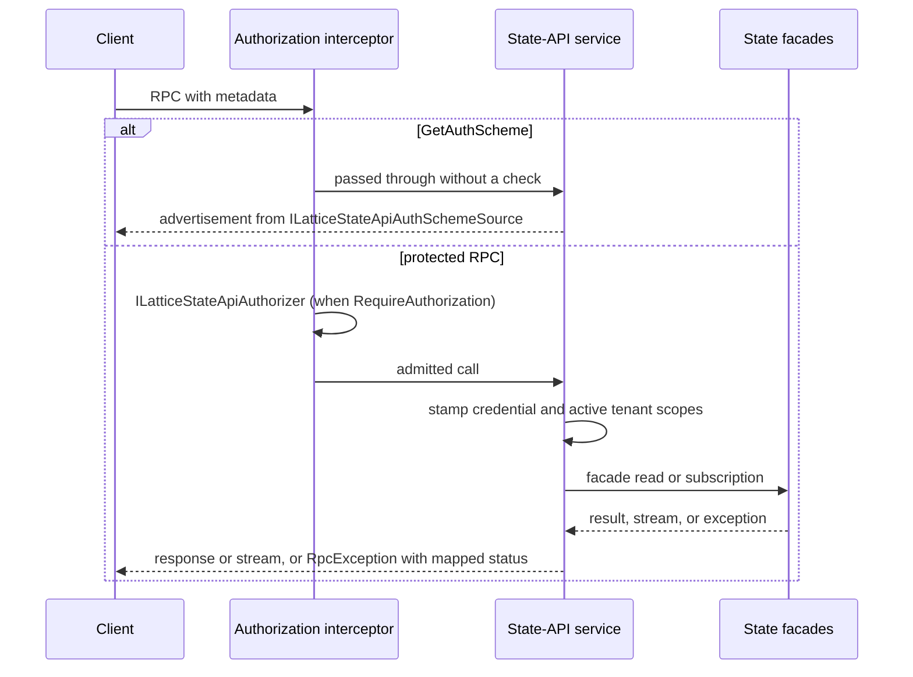

# Architecture

The binding projects the three in-process state facades - `ILatticeStateQuery`, `ILatticeStateObserver` and `ILatticeStateMetricsObserver` - onto one code-first gRPC service. It adds transport concerns only: wire marshalling, a coarse admission check, identity and tenant bridging, the auth-scheme advertisement, and status mapping. Every read is answered by the facades, which in turn read the core grain surface; the binding holds no state between calls and writes nothing.

## Wire contract

The service is bound from C# definitions rather than a `.proto` file, under the gRPC service name `orleans.lattice.api.state`. It has unary RPCs for the query surface, the metrics snapshot, cluster info, the dead-letter reads and `GetAuthScheme`, and two server-streaming RPCs, `ObserveChanges` and `ObserveMetrics`. Every message is a `[GenerateSerializer]` record marshalled with the Orleans binary serializer; the server and `LatticeStateApiGrpcClient` build their method definitions from the same serializers resolved out of a service provider. Most messages are the facade's own records; binding-owned envelopes wrap scalar arguments or add a status. The full RPC table is in the [gRPC contract](../lattice.api.state/grpc-contract.md).

## Request path

1. **Admission.** A gRPC interceptor added to the host pipeline recognises calls under the `orleans.lattice.api.state` service and ignores every other service on the host. `GetAuthScheme` is exempt, so a client can discover how to sign in before it holds a credential. For every other method, a call that presents a credential the cluster refuses - one a registered authenticator recognises and rejects, such as a wrong password, as reported by `LatticeCredentialVerification` - ends with `Unauthenticated` before the authorizer runs, whatever `RequireAuthorization` says; a refused caller is never answered as an anonymous one or as a signed-in caller with no grants. A call with no credential, an accepted one, or one no authenticator recognises (or a host with no membership context) continues unchanged. Then, when `RequireAuthorization` is `true`, the interceptor builds a `LatticeStateApiAuthorizationContext` - the `ServerCallContext`, the `LatticeStateApiOperation` mapped from the method name (`Unknown` for an unmapped one), and the target tree id taken from the request - and asks `ILatticeStateApiAuthorizer`, before the first streamed message is produced for a streaming RPC. A refusal ends the call with `PermissionDenied`. Which tree each operation presents is listed in [Security](../lattice.api.state/security.md#the-authorization-seam).
2. **Identity and tenant.** The service asks `ILatticeStateApiCredentialBridge` for the caller credential and lifts any asserted active tenant from the `ActiveTenantHeaderName` header, stamping each onto its ambient context for the duration of the call (or of the stream). A call with neither runs as an anonymous caller in the default tenant.
3. **Dispatch.** Unary RPCs call the matching facade verb and, where the wire shape differs, wrap the result in the binding's envelope. The streaming RPCs enumerate the facade's change or metrics stream and write each item to the response stream until the caller cancels.
4. **Status mapping.** Facade exceptions become explicit gRPC statuses - for example an expired change-feed resume token becomes `FailedPrecondition`, a saturated tree `ResourceExhausted`, and a bootstrapping replica `Unavailable`. Any unmapped exception is logged and returned as `Internal` with a generic message. Cancellation ends a stream cleanly. The full table is the [status mapping](../lattice.api.state/grpc-contract.md#status-mapping).

## Two independent gates

The interceptor's authorizer decides whether a caller may reach a state-API operation at all. What an admitted caller may then see is decided inside the facade: per-entry reads flow through the core access gate with the stamped credential, and catalog, structure and summary reads are pruned by the facade's auth-backed read visibility. A bridge that returns no credential leaves the caller anonymous, which read visibility denies. Turning the interceptor off does not disable either inner check. See the [state facade architecture](../lattice.api.state/architecture.md#read-visibility).

## Turnkey credential authorizer

`EnvVarCredentialAuthorizer`, installed by `AddEnvVarCredentialAuthorizer`, is one implementation of the admission seam. It decodes a `Basic` `authorization` header, looks up the user's stored `LatticePasswordHash` through `IEnvironmentVariableReader`, verifies it in constant time, and applies a per-username failed-attempt lockout. It is an endpoint-level front door: it does not inspect the operation or target tree, and because it reads a credential off the wire it must run behind TLS. See [Configuration](configuration.md#envvarcredentialauthorizeroptions).

## Source map

- [Registration](../../src/lattice.api.state.grpc/LatticeStateApiGrpcServiceCollectionExtensions.cs)
- [Service and status mapping](../../src/lattice.api.state.grpc/LatticeStateGrpcService.cs)
- [Method definitions](../../src/lattice.api.state.grpc/LatticeStateGrpcMethods.cs)
- [Authorization interceptor](../../src/lattice.api.state.grpc/Security/LatticeStateApiGrpcAuthInterceptor.cs)
- [Header credential bridge](../../src/lattice.api.state.grpc/HeaderLatticeStateApiCredentialBridge.cs)
- [Auth-scheme source](../../src/lattice.api.state.grpc/Security/OptionsLatticeStateApiAuthSchemeSource.cs)
- [Credential authorizer](../../src/lattice.api.state.grpc/Security/EnvVarCredentialAuthorizer.cs)
- [Client](../../src/lattice.api.state.grpc/LatticeStateApiGrpcClient.cs)

## Related

- [Public API](api.md)
- [Configuration](configuration.md)
- [State facade architecture](../lattice.api.state/architecture.md)
- [gRPC contract](../lattice.api.state/grpc-contract.md)
