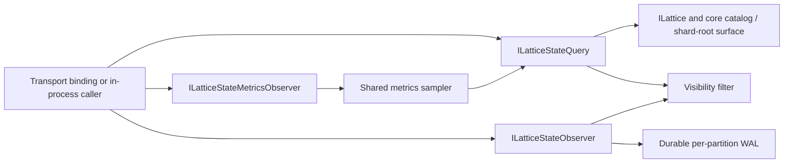

# Architecture

The state API is a read-only, transport-agnostic projection of a running cluster. `AddLatticeStateApi` installs three stateless silo-singleton facades over the core grain surface - a query facade, a change-observation facade and a metrics-observation facade - plus one shared metrics sampler. Nothing in the package writes tree data, and nothing runs until a caller asks: there are no hosted services, and a cluster with no metric subscribers samples nothing. Remote callers reach the facades through a transport binding such as [`Orleans.Lattice.Api.State.Grpc`](../lattice.api.state.grpc/architecture.md); an in-process caller resolves the interfaces directly.

## Common entry steps

Every verb that names a tree runs the same steps before it reads anything:

1. **Tenant resolution.** The caller's tree name is composed through `ITenantContextResolver` into its effective id. That one id drives the visibility decision, the registry lookups and the grain calls, so a verb cannot authorize one tree and read another. With tenancy off the resolver returns the bare name unchanged, synchronously.
2. **View source resolution.** A materialised-view tree (`view-*`) is authorized against the source tree its rows come from, not against the view id. The source is resolved from the silo's local view catalog, falling back to the durable cluster-wide view registry for a runtime view created on another silo. A view whose source cannot be resolved is hidden.
3. **Visibility.** When read visibility is active (see below), trees the caller cannot read are omitted from catalogs and reported as not found by tree-scoped reads.

## Query facade

`ILatticeStateQuery` answers discovery, structure, entry, history, dead-letter and cluster-info reads:

- **Catalogs** (trees, views, tag indexes, tag values, covered trees) are deterministic, ordinal, continuation-paged lists. When no post-ordering filter can thin the candidates, the facade keeps only the page it is about to return (plus one look-ahead entry to decide the next token) instead of buffering and sorting the whole candidate set; with visibility or source filtering in play it falls back to the full ordering so a filtered page is still full.
- **Structure and summaries** read the shard roots and internal nodes of a tree, bounded by the request's depth and node budget, and the per-shard summaries the shard roots already maintain. A truncated walk says so rather than returning a partial graph as if complete.
- **Entry scans and reads** go through the public `ILattice` cursor surface, so the core access gate filters them per key with the caller's ambient credential. Scans are page-bounded by `MaxScanPageSize` and preview-bounded by the scan value-preview budgets; a single-entry read uses the larger `SingleEntryValuePreviewBytes` budget.
- **Per-key history** reads the durable history substrate for one key, bounded by the history page and preview limits, and reports whether the timeline is complete.
- **Dead letters** count and page the strict-mode schema-enforcement dead-letter queue as read-only state.
- **Cluster info** returns the Orleans cluster id and service id.

## Change-observation facade

`ILatticeStateObserver` tails the requested tree's durable write-ahead log directly, one cursor per WAL partition, and maps each observable record onto a `StateChangeNotification`. Each drain cycle reads at most `ChangeObservationPageSize` entries per partition (floored at `1`); once every partition is drained it waits `ChangeObservationPollInterval` (a non-positive value falls back to 250 ms) before polling again. Maintenance rewrites are skipped unless the request opts in.

Because the feed reads the durable log by cursor rather than buffering in memory, there is no per-subscription buffer to overflow and a writer is never blocked by an observer. A subscriber that resumes from a cursor the WAL has already trimmed receives `LatticeStateCursorExpiredException` instead of a silent gap. Notifications echo the caller's own tree name, never the tenant-composed id.

## Metrics-observation facade

`ILatticeStateMetricsObserver` serves both a one-shot `SampleAsync` and a live `ObserveAsync` feed. All requests funnel through one shared, reference-counted sampler: concurrent subscribers with the same request signature share a single sampling loop, which reads already-maintained per-tree aggregates through the query facade on the `MetricsSampleInterval` cadence (or the request's override). Each subscriber then diffs consecutive samples locally, so the live feed carries only what changed. Cancelling the last subscriber detaches the loop with no residual timer. When a tree reports WAL saturation the sampler skips its fresh per-shard walk for that tick. See [Efficiency](efficiency.md).

## Read visibility

The catalog, structure and summary reads do not flow through the gated `ILattice` data plane, so the facade applies its own tree-level visibility decision there. `LatticeApiStateOptions.ReadVisibility` selects the posture:

- With no real access gate registered, or with `Disabled`, no caller subject is resolved and no filtering happens.
- With a real gate (`Auto` or `Enforced`), the caller's subject is resolved from the ambient credential and each tree is checked for read permission; an anonymous caller is denied every read, so catalogs are empty and tree-scoped reads report not found.

Topology reads require an unfiltered tree (or view-source) grant because split keys cannot be safely pruned. Change feeds refresh their subject and grant after every WAL page read and before processing subsequent buffered entries, so a resumed consumer cannot retain an earlier authorization verdict.

This filter runs after, and independently of, any transport-level authorizer: the transport gate decides whether a call may run at all, and this filter prunes what an admitted call can see. See [Security](security.md#visibility-boundaries).

## Source map

- [Registration](../../src/lattice.api.state/LatticeApiStateServiceCollectionExtensions.cs)
- [Options](../../src/lattice.api.state/LatticeApiStateOptions.cs)
- [Query facade](../../src/lattice.api.state/LatticeStateQuery.cs)
- [Change-observation facade](../../src/lattice.api.state/LatticeStateObserver.cs)
- [Metrics-observation facade](../../src/lattice.api.state/LatticeStateMetricsObserver.cs)
- [Shared metrics sampler](../../src/lattice.api.state/SharedMetricsSampler.cs)
- [Visibility filter](../../src/lattice.api.state/LatticeStateVisibilityFilter.cs)
- [View source resolution](../../src/lattice.api.state/LatticeStateViewSource.cs)
- [Catalog page selection](../../src/lattice.api.state/CatalogTopSelector.cs)

## Related

- [Public API](api.md)
- [Configuration](configuration.md)
- [Surfaces](surfaces.md)
- [Efficiency](efficiency.md)
- [Security](security.md)
- [gRPC binding architecture](../lattice.api.state.grpc/architecture.md)
