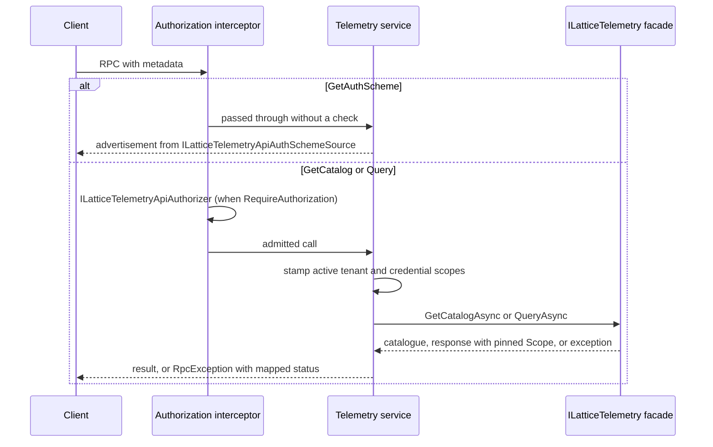

# Architecture

The binding projects the in-process `ILatticeTelemetry` facade onto a code-first gRPC service for remote heads such as the Explorer. It relays: it adds wire marshalling, a coarse admission check, credential and active-tenant bridging, the auth-scheme advertisement and status mapping, but it derives no tenant, adds no query text, and returns the facade's pinned scope unchanged. It depends only on the shared contract, so it resolves on a host that registers nothing but an `ILatticeTelemetry` implementation.

## Wire contract

The service is bound from C# definitions under the gRPC service name `orleans.lattice.api.telemetry` and has three unary RPCs: `GetCatalog`, `Query` and `GetAuthScheme`. Messages are Orleans-serialized records; the server and `LatticeTelemetryApiGrpcClient` build their method definitions from the same serializers. `Query` carries the contract's own request and response unchanged, so the wire has no field through which query text or a second tenant assertion could arrive.

## Request path

1. **Admission.** The interceptor acts only on methods under the `orleans.lattice.api.telemetry` service and exempts `GetAuthScheme`. When `RequireAuthorization` is `true` it builds a `LatticeTelemetryApiAuthorizationContext` - the `ServerCallContext`, the `LatticeTelemetryApiOperation` (`GetCatalog`, `Query`, or `Unknown` for an unrecognised method), and a `TargetId` that is the requested query id for `Query` and `null` for `GetCatalog` - and asks `ILatticeTelemetryApiAuthorizer`. A refusal ends the call with `PermissionDenied`.
2. **Identity and tenant.** The service lifts any asserted tenant from the `ActiveTenantHeaderName` header and the caller credential through `ILatticeTelemetryApiCredentialBridge`, stamping each onto its ambient context for the call. Neither is interpreted here: the facade resolves the caller's subject and derives the effective tenant.
3. **Dispatch.** `GetCatalog` calls `GetCatalogAsync`; `Query` forwards the request, including `RequestedVisibility` and `RequestedTenantId`, verbatim to `QueryAsync` and returns the response untouched, so `Scope.WasDowngraded` and `Scope.IsCrossTenant` reach the client.
4. **Status mapping.** Facade exceptions become explicit gRPC statuses: an unknown or unoffered query is `NotFound`, a refused window `OutOfRange`, a backend fault `Unavailable`, an authorization or tenant refusal `PermissionDenied`. A backend fault is logged server-side and the caller receives a fixed detail naming only its query id, because the fault's own message can carry the backend's host and port. Any unmapped exception is returned as `Internal` with the original message suppressed. See the [status mapping](README.md#status-mapping).

## Two independent gates

The interceptor's authorizer decides whether a caller may reach the telemetry service at all. The facade then applies the cluster-wide `Telemetry` capability check and derives the tenant scope from the stamped identity, regardless of what the interceptor admitted. Admitting a call can therefore never widen the scope of its answer. See the [facade architecture](../lattice.api.telemetry/architecture.md).

## Source map

- [Registration](../../src/lattice.api.telemetry.grpc/LatticeTelemetryApiGrpcServiceCollectionExtensions.cs)
- [Service and status mapping](../../src/lattice.api.telemetry.grpc/LatticeTelemetryGrpcService.cs)
- [Method definitions](../../src/lattice.api.telemetry.grpc/LatticeTelemetryGrpcMethods.cs)
- [Authorization interceptor](../../src/lattice.api.telemetry.grpc/Security/LatticeTelemetryApiGrpcAuthInterceptor.cs)
- [Header credential bridge](../../src/lattice.api.telemetry.grpc/HeaderLatticeTelemetryApiCredentialBridge.cs)
- [Auth-scheme source](../../src/lattice.api.telemetry.grpc/Security/OptionsLatticeTelemetryApiAuthSchemeSource.cs)
- [Client](../../src/lattice.api.telemetry.grpc/LatticeTelemetryApiGrpcClient.cs)

## Related

- [Public API](api.md)
- [Configuration](configuration.md)
- [Telemetry facade architecture](../lattice.api.telemetry/architecture.md)
