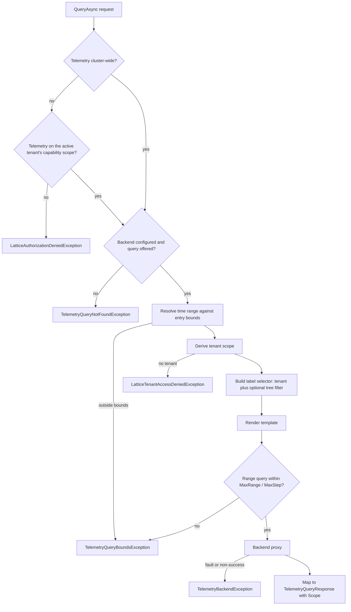

# Architecture

The telemetry facade answers a curated catalogue of named queries over a Prometheus-compatible backend. It is the only path between a client head and the backend: a caller names a query id, the server derives the tenant scope from the caller's identity, renders the server-authored PromQL template, and runs it through a backend proxy that holds the backend credential. No caller-supplied query text is ever evaluated. The facade is stateless apart from the catalogue and access policy it compiles once at construction.

## Components

| Component | Public type | Role |
|---|---|---|
| Facade | `LatticeTelemetry` (`ILatticeTelemetry`) | Orchestrates discovery and query execution. |
| Catalogue | `LatticeTelemetryQueryCatalog` | The deployment's offered subset of the query definitions, filtered once against the metric allow-list. |
| Capability check | `TelemetryAccessAuthorizer` | Asks the registered access gate for the `Telemetry` capability, cluster-wide or on one tenant's capability scope; also answers whether the caller is a platform operator. |
| Tenant scope | `TelemetryTenantScopeResolver` | Composes the capability decision into a `TelemetryAccessGrant` (cluster-wide, or confined to the validated active tenant), and derives the effective tenant scope from the caller's identity, treating any requested scope as a preference only. |
| Metric access policy | `TelemetryMetricAccessPolicy` | The compiled `MetricAccess` / `AllowedMetrics` posture. |
| Backend proxy | `IPrometheusQueryClient` (default `PrometheusQueryClient`) | Read-only HTTP client for the backend that stamps the configured backend credential on each request. |

## Discovery

`GetCatalogAsync` returns the empty catalogue, never an exception, when no backend is configured or the caller holds the `Telemetry` capability neither cluster-wide nor on its active tenant's capability scope; otherwise it returns the deployment's catalogue. It does not contact the backend, so a backend outage cannot make discovery fail. That degradation is a published contract that clients rely on; see [`GetCatalogAsync` degrades; it does not fail](README.md#getcatalogasync-degrades-it-does-not-fail).

## Query execution

1. **Capability.** The cluster-wide `Telemetry` capability is checked first, against the cluster-wide scope. With no access gate registered, or with the core no-op gate `AddLattice` registers, every caller is admitted; an allow that carries a key filter is refused, because cluster telemetry is not attached to a key. A caller refused there is checked for `Telemetry` on its validated active tenant's capability scope (`LatticeScope.TenantCapability`, never the default tenant); an allow there confines the caller to that tenant for the rest of the request. A caller refused on both receives the cluster-wide refusal.
2. **Offer.** An unknown id, an id filtered out by the allow-list, and any id on a deployment with no backend are all reported as `TelemetryQueryNotFoundException`, indistinguishably.
3. **Time range.** An instant entry is normalised to a single instant. A range entry takes the requested end (or now), clamps the requested step into the entry's step budget, and, when no start is supplied, derives a default window from the entry's point budget capped by the entry's and the deployment's `MaxRange`. The resulting window is then validated against the entry's declared bounds; a violation is refused, never narrowed.
4. **Scope.** The tenant-scope resolver pins the answer to the caller's own tenant unless the caller is a platform operator; a narrowed request is reported as downgraded in the response's `Scope`. A tenant-confined grant is pinned to its tenant whatever was asked, without platform-operator validation. A caller that cannot be attributed to any tenant is refused.
5. **Selector and template.** The selector always carries the tenant matcher when the scope names a tenant, plus the tree filter when the entry accepts one (a tree id containing a control character is refused with `ArgumentException`); the tree filter can therefore narrow but never widen the query. The template is rendered with a rate window derived from the step.
6. **Guardrails and backend.** A range query is checked against the deployment-wide `MaxRange` / `MaxStep` guardrails before the backend call. Any backend fault, or a response whose status is not `success`, becomes `TelemetryBackendException`; a caller-initiated cancellation propagates as cancellation.
7. **Mapping.** The backend's result is mapped onto typed time series and returned with the effective scope and the resolved range.

## Allow-list enforcement

Under `DenyAllExceptAllowed` the catalogue is filtered once, when it is built: each entry's footprint of exposition names must be fully admitted, or the entry is left out and behaves as an unknown id. For bindings that evaluate caller-supplied PromQL, `TelemetryQueryAuthorizer` and `PromQlMetricExtractor` apply the same allow-list to the metric names a query will evaluate, failing closed on anything they cannot resolve. The extractor's rules are in [The allow-list is enforced on extracted names](README.md#the-allow-list-is-enforced-on-extracted-names-not-on-the-raw-string).

## Source map

- [Registration](../../src/lattice.api.telemetry/LatticeApiTelemetryServiceCollectionExtensions.cs)
- [Facade](../../src/lattice.api.telemetry/LatticeTelemetry.cs)
- [Catalogue](../../src/lattice.api.telemetry/Catalog/LatticeTelemetryQueryCatalog.cs)
- [Built-in query definitions](../../src/lattice.api.telemetry/Catalog/LatticeTelemetryQueries.cs)
- [Capability check](../../src/lattice.api.telemetry/TelemetryAccessAuthorizer.cs)
- [Tenant scope](../../src/lattice.api.telemetry/TelemetryTenantScopeResolver.cs)
- [Access grant](../../src/lattice.api.telemetry/TelemetryAccessGrant.cs)
- [Backend proxy](../../src/lattice.api.telemetry/PrometheusQueryClient.cs)
- [Range guardrails](../../src/lattice.api.telemetry/TelemetryRangeGuardrails.cs)
- [PromQL metric extraction](../../src/lattice.api.telemetry/PromQlMetricExtractor.cs)

## Related

- [Public API](api.md)
- [Configuration](configuration.md)
- [gRPC binding architecture](../lattice.api.telemetry.grpc/architecture.md)
