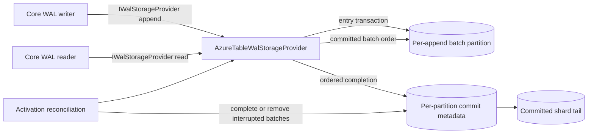

# Architecture

`Orleans.Lattice.Storage.AzureTable` is a durable implementation of the core `IWalStorageProvider` seam. The core WAL grain decides what to append, when to trim, and how consumers read; the Azure Table provider decides how those append, read, trim, and reconcile calls are represented in Azure Table Storage.

For the core WAL contract and placement model, see [WAL Storage Providers](../lattice/wal-storage-providers.md). For replication consumption of the WAL, see [Replication WAL](../lattice.replication/wal.md).

## High-level pipeline

The provider keeps each tree/WAL-partition stream ordered while allowing append payloads to land in per-batch storage partitions. Each commit writes the metadata of the batches pending at that moment in ascending start-offset order, and the stored partition tail is the high-water mark of the batches committed so far, so it never moves backward.

## Storage layout

The table is split by behaviour, not by public .NET type:

| Stored data | Behaviour |
|---|---|
| Entry rows | Store one retained WAL entry payload and its offset. Rows for one append batch are written together in one Azure Table transaction. |
| Batch partition | Groups the entry rows for one append batch. Separate batches use separate partitions so concurrent shard work is not forced through one storage partition for the entry payloads. |
| Commit metadata | Records that a batch is committed and the inclusive offset range it covers. Reads enumerate committed metadata in offset order before fetching entry rows. |
| Tail metadata | Stores the highest committed offset for a shard. Highest-offset recovery is a point read rather than a scan over all entries. |
| Trim watermark | Records the highest offset a trim has covered for a shard, so a reader can tell a trimmed range from a hole. It is written durably before a trim deletes any entry and never lowered. |
| Recovery markers or discoverable batch state | Lets reconciliation find interrupted appends after a crash and either complete the contiguous prefix or remove non-contiguous leftovers. |

Tree ids are encoded for Azure Table key safety. The table is created on first use. Use a non-default `TableName` when multiple deployments share one storage account.

## Transactional batch contract

Every append preserves the public WAL invariants:

1. The supplied offsets must be dense within each batch; across batches the producer allocates them densely, in allocation order.
2. Entry payload rows for one batch are committed atomically by Azure Table Storage.
3. Each commit writes the pending batches' metadata in ascending start-offset order.
4. The stored tail never moves backward. Batches whose entry writes finish out of order can commit out of order, so the tail can pass a lower batch that is still in flight; if that batch then fails, its offsets stay an honest gap beneath the tail, as the core WAL contract permits.
5. A failed append does not expose a partial visible batch.
6. Trim can remove old retained rows, but it never moves the committed tail backward.

Azure Table transactions are limited to 100 entities and a 4 MiB total payload. The provider exposes `AzureTableWalStorageProvider.MaxEntriesPerBatch = 100`, and the core WAL batch defaults use the same figures: `LatticeOptions.WalMaxBatchEntries` defaults to 100 entries and `WalMaxBatchBytes` to 4 MiB of encoded payload, measured before compression. For throughput and pending-depth tuning, see [WAL tuning](../lattice/wal-tuning.md).

A single entry has a much smaller limit. Each entry is stored as one entity whose whole encoded record - after compression, when it applies - is a single binary property, and the Azure Table service data model limits a binary property to 64 KiB (and an entity to 1 MiB). The provider neither splits a payload across properties or rows nor checks its size, so an entry whose stored payload exceeds 64 KiB is rejected by the service. Because a batch commits in one transaction, the whole append fails with it, including every other entry in the same batch, and the rejection is not a transient fault, so it is not retried in place. Compression can bring a compressible payload under the limit; an incompressible payload, or any payload with `Compression` set to `LatticeCompression.None`, is stored verbatim.

## Commit pipeline

A normal append has three behavioural stages. The first two run concurrently, and the third starts only once both have landed:

1. **Prepare recovery state.** The provider records enough information to distinguish an interrupted append from a committed append during the next reconciliation pass. With `EliminateCandidateRowOnHotPath = true`, the normal path skips an extra recovery-marker write and relies on discoverable batch state plus the committed tail.
2. **Write entries.** Entry payload rows are written in a single Azure Table transaction for that batch.
3. **Complete in offset order.** Each commit writes the metadata of the completions pending at that moment in ascending offset order and raises the shard tail to the highest end offset committed so far; the tail never moves backward. Under load, multiple completions can be coalesced into one transaction, bounded by Azure Table transaction limits.

`PipelinePhaseTwoCommits = true` lets a caller return after durable entry write and observation of the previous pending completion for the shard. It does not change ordering, recovery, or all-or-nothing durability; it changes which append observes a completion fault, and it introduces a bounded read visibility lag. `PipelinedPhaseTwoFaultHandler` exists so an idle shard can still report a completion fault for observability.

### Read visibility lag under pipelining

The read path is derived from the commit metadata written in stage 3, so a batch becomes readable when its completion lands rather than when its append returns. Under `PipelinePhaseTwoCommits = true` the trailing batch on a shard is therefore durable but not yet readable for a short interval, and a read can omit it.

The reported highest offset does **not** share that lag. `GetHighestOffsetAsync` folds the contiguous run of already-durable batches the shard's live completion worker has accepted over the stored tail, so an offset returned by a completed append is never reported back as though it did not exist. The fold walks upward from the stored tail and stops at the first gap, which is exactly the run reconciliation would roll forward, so it can never claim a batch whose lower neighbour is still in flight. It degrades to the stored tail alone when this provider instance has no live worker for the shard - a fresh activation or another silo. With `PipelinePhaseTwoCommits = false` the worker is still live, but every append waits for its own completion, so the fold can add only batches whose appends have not yet returned. The stored tail keeps its former meaning everywhere else, including on the reconciliation path.

Nothing is lost. The entries are durable before the append returns, and reconciliation rolls the batch forward if the process restarts first. WAL consumers poll, and the core WAL grain tracks its next offset in memory rather than re-reading the tail, so the read lag is invisible on the canonical replication path.

A caller that genuinely needs read-after-write - a controlled hand-off, an operator consistency probe, or a test - awaits the provider's phase-two flush barrier, which drains the completions outstanding at the moment of the call and then rethrows any that failed. Prefer that barrier over sleeping or polling for an expected count.

`PhaseTwoCoalescingWindow` controls how long completion waits for more pending work before sending the coalesced transaction. `PhaseTwoCommitTimeout` bounds a wedged completion transaction so later work is not blocked indefinitely. The deadline abandons only the worker's wait, not the transaction: an abandoned submit stays fenced on its partition until it actually completes - or until the provider cancels it, 60 seconds after abandoning it, so the fence cannot be held forever - and the post-failure reconcile and tail read wait for that fence, so a late-landing transaction can never be overwritten by a resync that read the partition before it landed.

A completion transaction can also land and still fail: the Azure SDK resends a transaction whose response was lost, and the resend collides with the metadata the first attempt wrote (`409 EntityAlreadyExists` on the metadata row, `404` on a deleted recovery marker, or `412 PreconditionFailed` on the fenced tail write). The worker then reads the transaction's effects back. When every one is in storage (each metadata row with the same end offset and byte count, each recovery marker deleted, and the tail at least as high), the completion is treated as committed and counted on `orleans.lattice.provider.idempotent_replays` with `phase=phase2` (issue #5520). Otherwise, for example when a metadata row records a different batch, the original fault surfaces, and nothing is overwritten.

### Overlap rejection

Every batch is stored in its own partition, keyed by its first offset, so storage on its own would accept a batch that starts inside one already written, and a read would then return the shared offsets twice. The provider rejects that batch with `InvalidOperationException` before writing anything, as the `IWalStorageProvider` contract requires.

The check costs nothing on the steady-state path. The provider keeps, per WAL partition, an upper bound on the offsets that may be written, and an append starting above it is admitted with no storage call; the core WAL grain always appends above it. Any other append, such as an out-of-order arrival or a retry, is checked against the batches in motion on this instance and then with one query over the few storage partitions that could hold an overlapping entry. The first append on a WAL partition reads the bound from the stored tail and any uncommitted batches above it. Reconciliation re-establishes it.

A re-append that starts at the same offset as a written batch is not rejected here: it collides on the batch's own rows and is resolved by the idempotent-replay check, which accepts an identical retry and fails anything else. The bound covers only what this instance has written or read, so it cannot see a batch another writer adds afterwards; the [commit fence](#commit-fence) is what stops such a batch from ever becoming visible over this instance's committed offsets, or this instance's over another's. The storage check looks for stored entry rows, so an offset whose rows a trim has already deleted is not detected either: an append that reuses only trimmed offsets is accepted.

### Commit fence

Overlap rejection sees one provider instance only, and two instances can write the same WAL partition at once: a predecessor activation on a silo the cluster has declared dead but which keeps running, or one still writing after its WAL partition moved. Each admits its own appends against its own bound, and the entry rows of two batches that start at different offsets never collide. Without a further check a stale writer's batch could commit over offsets another writer had already acknowledged, so a read would return those offsets twice, and its completion could lower the stored tail, after which a recovering writer would resume inside committed offsets and store them twice as well (issue #5810).

The completion transaction is therefore the shard's commit fence. Each provider instance holds the tail row's ETag as it last observed or wrote it, and every completion transaction writes the tail conditionally on that ETag and never below the value it was observed with. Completions on a shard are thereby totally ordered: one lands only if no other writer has moved the tail since this instance last saw it. A stale writer's completion fails with `412 PreconditionFailed` (`409` when it last saw no tail row), writes nothing, and fails its append; the core WAL grain then resyncs from storage. Any failed or abandoned completion also discards the held ETag and refuses, without sending them, the completions of every batch admitted before the failure, so nothing admitted against a bound the failure may have made stale can commit. A completion resolved as a replay of an attempt that had already landed discards the ETag too, because the response that would have carried the ETag of that landing was lost, and a read of the tail cannot tell this instance's landing from another writer's: the retry stays correct, at the cost of refusing the batches admitted behind it and one resync. The next read of the tail fills the fence again, and raises the overlap bound to cover what it read.

A refused or failed completion leaves its batch's entry rows behind with no metadata row. They are never read, since reads follow the metadata rows, but they still occupy storage, and when another writer has committed past them they sit below the tail, where reconciliation's scan for interrupted batches does not look. The provider therefore records each batch whose completion failed, and the reconciliation that the failure triggers deletes the entry rows of every recorded batch that starts at or below the resulting tail and has no metadata row. Reconciliation never rolls such a batch forward, so it can never become visible; a recorded batch that reconciliation rolled forward has a metadata row and is kept. The record exists only after a failure, so the steady path pays nothing for it. It is held in memory, so a process that stops before its next reconciliation takes it with it; those rows are reclaimed instead by the next trim that covers them, whose sweep reaches every batch partition at or below the tail (see [Trim and the sweep](#trim-and-the-sweep)).

The fence adds no round trip to the steady path. The tail write rides in the completion transaction that already exists, whose 100-action budget always reserved an action for it, and the ETag is refreshed from that transaction's own response and from reads the provider already makes: the overlap bound read and `GetHighestOffsetAsync`. An append in allocation order still makes one entry transaction and one completion transaction, and reads nothing. Reconciliation writes the tail with its own conditional write and resets the fence afterwards.

#### Releases affected

Every released `Orleans.Lattice.Storage.AzureTable` up to and including 10.2.0 is exposed: releases with the overlap rejection above check within one provider instance only, and earlier releases do not check at all. Exposure needs two writers on one WAL partition at the same time, which the WAL grain's single activation normally prevents, so it arises only around a silo failure or a WAL placement move. Its effects are an offset read back twice with two different records, so replicas that apply different ones can diverge, and, after a lowered tail, a recovering writer storing committed offsets a second time. No configuration avoids it; upgrade.

#### Rolling upgrade

The fence changes no stored shape. The tail row keeps its schema and only the way it is written changes, so 10.2.0 silos and newer ones read and write the same table in both directions during a rolling upgrade. A 10.2.0 silo still writes the tail unconditionally, however, so it is not fenced: a newer silo's completion is refused once a 10.2.0 silo has moved the tail, but nothing refuses a stale 10.2.0 writer's completion. Finish the roll before relying on the fence.

## Recovery and downgrade safety

On activation, and again after a failed flush, the core WAL grain calls the provider reconciliation hook. The provider compares the committed tail with interrupted append evidence and applies these rules:

- If an interrupted batch contiguously extends the committed tail, reconciliation completes it and advances the tail.
- If an interrupted batch is below the tail or above a gap, reconciliation removes it so the next append can use the correct next offset.
- A batch whose manifest row already exists is committed, even when the stored tail has not caught up with it. Reconciliation keeps it and re-anchors the tail on it; it never rolls a committed batch back.
- Reconciliation never lowers the stored tail. The tail write is conditional on the tail it read, so a concurrent commit makes the pass retry rather than overwrite. A rollforward larger than one transaction (more than 49 batches) writes the tail in every transaction, each conditional on the ETag the previous one left, so once another writer moves the tail no further transaction of the pass adds a metadata row.
- Reconciliation is idempotent: a clean shard has no work to do.

The post-failure call is not quiescent: pipelined completions accepted before the failure may still be committing. Reconciliation is serialised per WAL partition and first waits, on this provider instance, for that partition's in-motion appends, its queued completions, and any completion transaction abandoned on its commit deadline to settle, so it never mistakes a live batch for an orphan. A writer on another process is covered only by the conditional writes above.

When `EliminateCandidateRowOnHotPath` is enabled, reconciliation recognizes both the legacy recovery-marker shape and the newer discoverable-batch shape. Upgrading from the legacy setting to the default setting is safe. Before downgrading back to the legacy setting, drain pending appends and allow reconciliation to complete on a deployment that still has the default setting enabled.

## Read, trim, and capacity behaviour

Reads enumerate committed batch metadata in offset order, then stream entry rows lazily from each overlapping batch. `GetHighestOffsetAsync` reads the stored tail and folds over it the contiguous run of already-durable batches the shard's live completion worker has accepted, so it never lags behind a completed append. `GetLowestOffsetAsync` finds the first retained batch after trim.

The filtered replay read (`ReadFilteredAsync`, issue #3565) walks the same metadata, and bounds each batch query above by the window's last row key as well. It classifies each row from the routing prefix of its payload before decoding it: a compressed row is inflated into a pooled buffer rather than a new array, and a row the reader's filter excludes is neither decoded nor retained - except the window's last examined row, which, when excluded, is projected routing-only at the end of the scan so a resuming reader moves past it. The table service still returns every row in the window - the key lives inside the payload, so the service cannot select on it - which makes the saving the per-row decode and its allocations, not the transfer. The classification needs the routing reader `AddAzureTableWalStorage` supplies; a provider built through a public constructor decodes every row it examines, and returns the same rows.

Trim first raises the shard's durable trim watermark to the trimmed offset (capped at the committed tail), then deletes old retained entry rows in bounded Azure Table transactions and removes matching commit metadata in order; see [Trim and the sweep](#trim-and-the-sweep). A crash during trim can leave a stale retained prefix below the watermark, but not a gap in the live tail; reads on an instance that knows the watermark never return an entry at or below it, and a later trim can resume cleanup. `GetTrimWatermarkAsync` reports the larger of the recorded watermark and the offset just below the lowest stored entry, so a shard trimmed before the watermark row existed still answers exactly.

### Trim and the sweep

Trim deletes entry rows with one key-range query over the WAL partition's batch partitions, streamed page by page, rather than one query per metadata row. The sweep therefore also reaches a batch partition that no metadata row names: the rows a refused or failed completion leaves when its writer stops before reconciling, which nothing else reaches below the tail. Each row's keys are checked against the WAL partition and the bounds before it is deleted; a row that fails the check is left in place and the trim reports it as a failure once it has finished everything else.

- **Bound.** The sweep covers rows at or below the trimmed offset, capped at the **stored** tail, in batch partitions starting at or below that cap. Every such batch is committed, or can never be: completions commit in start order with the tail in the same transaction, so a batch still being written starts above the stored tail, and reconciliation only ever rolls forward the batch starting just above it. The reported highest offset is not used as the cap, because it also counts batches this instance has accepted but not committed.
- **Range.** A steady trim sweeps from the batch that can hold the offset just above the previous watermark, which covers everything new since the previous trim. The first trim of a WAL partition on each provider instance, and the first once `TrimFullSweepInterval` (default 6 hours) has passed since that instance last did, sweep from the first batch partition, which reaches anything left below an earlier watermark. A tree discard is not singled out: it trims through the highest offset, which a trim also does whenever every consumer has caught up, so it cannot be told apart, and it sweeps from the first partition only on those triggers.
- **Cost.** The deletes are those trim always made: one transaction per 100 rows of one partition. The sweep replaces a query per trimmed batch with one paged query. Azure Table Storage may end a page at a partition boundary, even an empty one, so in the worst case the sweep makes one page request per extant batch partition in its range, about what the per-batch queries cost; a sweep from the first partition can add pages over the range earlier trims emptied. That is why it runs only on the triggers above.

A leak that landed below the watermark is therefore reclaimed within one full-sweep interval of any silo that trims the WAL partition, or by the first trim after a restart. A tree discarded sooner than that keeps it, bounded and unread, along with the residual below.
- **Everything else is unchanged.** The watermark is durable before any delete; a batch straddling the trimmed offset loses only its rows at or below it and keeps its metadata row; a metadata row is deleted only after its batch's entries; a batch committed above a lowered tail (#3348) is deleted, as before, only once the trimmed offset covers it; and trim never moves the tail.

A batch partition with no metadata row **above** the stored tail - an interrupted batch, or a stale writer's batch that landed after the trim - is not swept, and survives a discard of the tree. Reconciliation removes it while the tree lives; after a discard nothing reads it. It is left because the tree's id can be reused, and the new tree's batches in flight would then sit in the same key range.

Capacity planning is shared with core WAL tuning:

- Increase the WAL partition count to spread work across storage partitions.
- Keep `WalMaxBatchEntries` at or below the provider batch limit.
- Keep each entry's encoded record under 64 KiB after compression; an entry is never split across properties or rows.
- Use `WalMaxPendingBatches` carefully; more pending batches increase pipeline depth and storage pressure.
- Watch retry-attempt and retry-exhausted telemetry to distinguish transient retry storms from saturated storage.
- Use the core [WAL saturation signal](../lattice/wal-saturation-signal.md) to coordinate admission and retry behaviour.

## Compression and retry policies

Stored payload compression is per row. A row records enough metadata to decode itself, so changing `Compression`, `CompressionMinPayloadBytes`, or the registered compressor affects new rows only. Older rows remain readable as long as a compressor for their recorded algorithm is still registered; a row whose algorithm has none fails its read with `NotSupportedException`. The Zstandard fallback that `AddAzureTableWalStorage` registers keeps Zstd rows readable.

When the provider constructs its own Azure SDK client, it attaches `RetryAttemptTrackingPolicy` for retry telemetry. When `HonorSaturationSignal` is enabled and `IWalSaturationSignal` is available, it also attaches `SaturationAwareRetryPolicy` so retry attempts can short-circuit during saturated WAL pressure. A pre-built `TableServiceClient` bypasses provider-owned pipeline construction; the host owns any equivalent policies in that mode.

## Relationship to replication

Replication writes and reads the WAL through the same core provider seam as single-cluster WAL users. This package does not define replication semantics; it supplies durable storage for the retained log that replication shippers, bootstrap, and fall-off-log handling depend on. See [Replication package](../lattice.replication/README.md) and [Replication WAL](../lattice.replication/wal.md).
