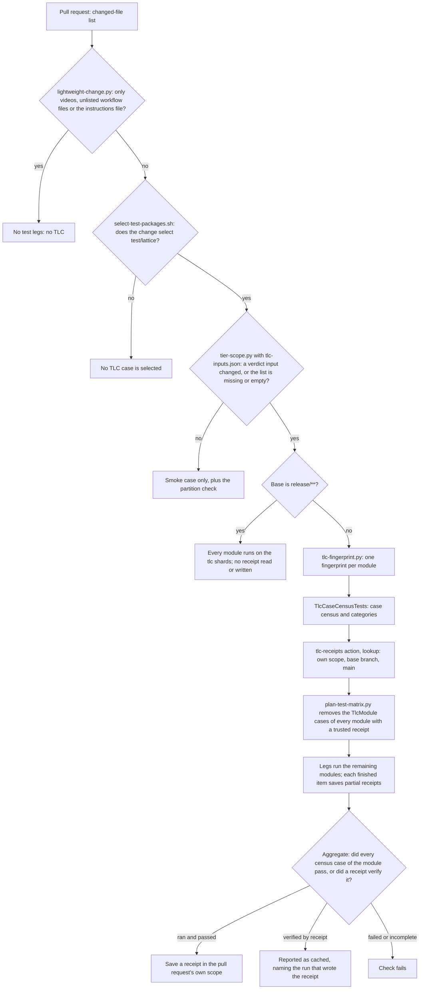
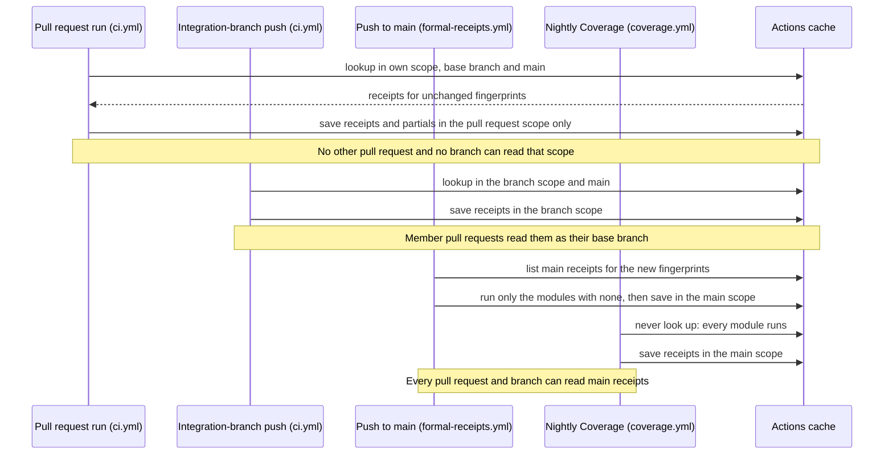
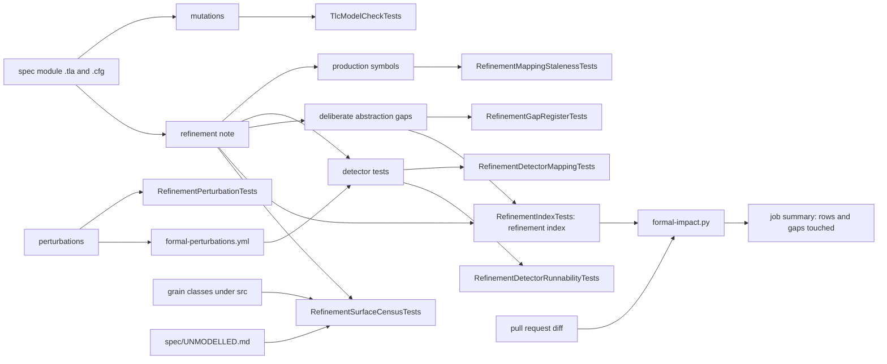

# Formal Verification Pipeline

The TLA+ specifications under [`spec/`](../../spec/README.md) are checked by TLC
through an ordinary NUnit fixture, and each one is tied to production code by a
refinement note. Several CI lanes cooperate to keep both halves honest at an
affordable cost. This page explains which lane runs what, how a pull request
decides whether to model-check, how per-module verdict receipts let unchanged
modules skip TLC, and which gates connect the specifications to the code they
describe.

[Formal Coverage](formal-coverage.md) says *what* is checked, area by area. This
page says *how and when* it is checked. The file formats and the gate list for a
module directory live in [`spec/README.md`](../../spec/README.md).

The page deliberately states no shard name, case count, runtime or price. TLC
work is routed by mechanism - the `TlcShard*` and `TlcModule_<Module>` test
categories that `TlcCiShard` attaches, and the shard partition in
[`test-shards.json`](../../.github/workflows/test-shards.json) - and the
measured costs live in
[`test-durations.tsv`](../../.github/workflows/test-durations.tsv) and in the
[module counts tables](../../spec/README.md#the-counts-table), so a rebalance
cannot make this page false.

## Lanes

Every lane below except the weekly perturbation lane runs the same harness,
`test/lattice/Formal/`. What differs is which of its pieces run, and whether a module that has already passed is
trusted instead of rerun.

| Lane | Structural Formal gates | Smoke TLC | Exhaustive TLC | Reads receipts | Writes receipts | Perturbations | Formal-impact report |
|------|-------------------------|-----------|----------------|----------------|-----------------|---------------|----------------------|
| Pull request into `main` (`ci.yml`) | Yes | Yes | Modules without a trusted receipt, only when a verdict input changed | Own scope, `main` | Own scope | Gate only | Yes (advisory) |
| Member pull request into an integration branch (`ci.yml`) | Yes | Yes | Modules without a trusted receipt, only when a verdict input changed | Own scope, the integration branch, `main` | Own scope | Gate only | Yes (advisory) |
| Integration-branch push (`ci.yml`) | Yes | Yes | Every module without a receipt | The branch, `main` | The branch | Gate only | No |
| Release-line pull request or push (`ci.yml`) | Yes | Yes | All modules | Never | Never | Gate only | Pull request only |
| Push to `main` (`formal-receipts.yml`) | No | No | Modules `main` has no receipt for; none when every module has one | `main` | `main` | No | No |
| Nightly Coverage (`coverage.yml`) | Yes, under coverlet | Yes | All modules | Never | `main` | Gate only | No |
| Weekly perturbation lane (`formal-perturbations.yml`) | No | No | No | No | No | Every perturbation, run for real | No |
| Local run | By filter | By filter | By filter | No | No | By hand | By hand |

How to read the columns:

- **Structural Formal gates** are the toolchain-free gates: discovery, manifests,
  mutation pairing, refinement mappings and every gate listed under
  [Refinement gates](#refinement-gates). In `ci.yml` they run in the content
  gates job, which selects every `Formal`, `Hygiene` and `Docs` test except the
  `Tlc` category, so they run whether or not any TLC runs.
- **Smoke TLC** is the one base-model case that the `"tlcSmoke": true` shard of
  `test-shards.json` selects. It proves the toolchain provisions and launches end
  to end.
- Every TLC case lives in the core test project, so on a pull request TLC runs
  only when the change selects `test/lattice`
  ([`select-test-packages.sh`](../../.github/workflows/select-test-packages.sh)
  derives that from the project graph). A change confined to another package,
  or to documentation, runs no TLC at all; pushes and dispatches select every
  package.
- **Exhaustive TLC** is every base, variant and mutation case of the modules
  that run, routed onto the `"tlc": true` shards.
- **Gate only** under perturbations means `RefinementPerturbationTests`, which
  checks every perturbation's anchors, row and detectors without building or
  running anything. Only the weekly lane applies the perturbations.
- A **lightweight** pull request (only `videos/`, `.github/copilot-instructions.md`
  and files under `.github/workflows/` other than the TLC selection and receipt
  scripts that
  [`lightweight-change.py`](../../.github/workflows/lightweight-change.py)
  lists) runs no test leg and no content-gate fixture at all, so it runs neither
  smoke nor exhaustive TLC. Those listed scripts, the toolchain action and pins,
  and everything under `spec/` are never lightweight; a change to `ci.yml` or
  `coverage.yml` alone is.
- `ci.yml` can also be dispatched by hand on any branch. That run is evaluated
  like a push: every package, every tier and exhaustive TLC, with an input that
  switches receipts off.

## Deciding whether a pull request model-checks

[`tlc-inputs.json`](../../.github/workflows/tlc-inputs.json) sorts every file
that can affect a TLC run into three classes, and
[`tier-scope.py`](../../.github/workflows/tier-scope.py) reads it:

- **Verdict inputs** can change a verdict or the set of TLC cases: the `.tla`,
  `.cfg`, manifest and mutation files under `spec/`; the Formal harness that
  discovers modules, builds cases and configurations, and launches and judges
  TLC; the shared hygiene code and build files it compiles against; and the TLA+
  toolchain (`tools/tlc/`, whose `toolchain.json` holds every pin, and the
  `tla-toolchain` action). A change to any of them runs exhaustive TLC.
- **Routing** files decide which job runs which existing case, or provision and
  launch legs: `test-shards.json`, the matrix planners, `tier-scope.py`,
  `TlcCiShard.cs`, the census, the receipt scripts and the workflows that launch
  TLC legs. A routing-only change runs the smoke case, and the toolchain-free
  partition check in `CiMemberPullRequestTieringTests` proves every TLC case is
  still selected by exactly one TLC shard.
- **Neutral** files never affect a TLC run: refinement notes and READMEs, the
  perturbation files, and the Formal and workflow files nothing on the TLC path
  references.

Routing and neutral are exclusions, so a path inside a verdict glob that a
routing or neutral glob also matches is not a verdict input. When unsure, a file
is a verdict input. `TlcInputClassificationTests` requires every file under
`test/lattice/Formal/`, `.github/workflows/` and `.github/actions/` to be
classified exactly once.

When exhaustive TLC is selected, receipts then decide which modules actually
run (next section). The flowchart shows the whole decision for one pull request.



For a release-line pull request, `tier-scope.py` plans exhaustive TLC whatever
the diff touches, once the run selects `test/lattice` and is neither lightweight
nor a version bump. Integration-branch and release-line pushes, and a `ci.yml`
dispatch, select every package and always plan exhaustive TLC, as does the
nightly lane. An integration-branch push is never skipped by its own diff, because the run for the previous push may
have failed or been cancelled by this push's concurrency group, so its verdict
cannot be assumed. It saves only through receipts, which exist only for
fingerprints that actually passed.

## Fingerprints and verdict receipts

A **fingerprint** ([`tlc-fingerprint.py`](../../.github/workflows/tlc-fingerprint.py))
is a content hash per module over everything that can change that module's
verdict:

- the module's specification closure (every `.tla` in its directory), its cfg and
  variant cfgs, its manifest and every file in its mutation directory;
- the **harness**: every verdict input that no module claims, such as the Formal
  harness, the build files and any stray specification file;
- the **toolchain**: the files `tlc-inputs.json` lists under `toolchain`.

Routing and neutral files are excluded, so editing a refinement note or a shard
assignment leaves every fingerprint unchanged. Every `.tla` in a module
directory belongs to each module there, so editing a specification changes the
fingerprints of the modules in that directory and no others; editing the harness
or the toolchain changes all of them, so every module reruns. Content is hashed after
normalising line endings the way git does, so a Windows and a Linux checkout
agree. `TlcFingerprintCompletenessTests` runs the script's self-test.

A **verdict receipt** records that every census case of one module passed at one
fingerprint, in one run. It is a GitHub Actions cache entry keyed
`tlc-verdict-v1-<Module>-<fingerprint>`, written by
[`tlc-receipts.py`](../../.github/workflows/tlc-receipts.py) through the
`.github/actions/tlc-receipts` action, and it names the run, attempt, commit,
event and ref that produced it. The aggregate job reports every module as ran,
cached, failed or incomplete, and an incomplete module - one with neither a
receipt nor a result for every census case - fails the check, because that is
what a receipt or routing defect would look like.

Each leg also writes a **partial receipt** per module and finished item whose
cases of that module all passed, even when the leg fails or the run is
cancelled. The next run of the same scope
assembles a full receipt from one run's partials once they cover the module's
census, so a cancelled run's completed modules are not paid for twice.

### The trust model

Receipts are read only from the run's own cache scope, its pull request's base
branch, and `main`, never from another pull request. That is the Actions cache's
own scoping rule, and the lookup lists only those refs. A pull request writes
only to its own scope, so it cannot plant a receipt that its base branch or
`main` would read.



Release-line pull requests and pushes never use receipts, so `Publish`'s
requirement of a successful release-line `build-and-test` on the exact tag
commit still means every module ran on that commit. A `ci.yml` dispatch with
`tlc_receipts: off` runs every module the same way, which is the dry run of a
release line on any branch.

What a fingerprint cannot see is runtime drift: the JDK patch level the runner
image resolves, or the runner image itself. Two runs with identical fingerprints
can in principle diverge on those, which is why the nightly lane ignores
receipts.

## Nightly exhaustive TLC

The Coverage workflow ([`coverage.yml`](../../.github/workflows/coverage.yml))
runs nightly from its schedule. When a push to `main` finds that the night's
scheduled run has not happened,
[`coverage-catch-up.yml`](../../.github/workflows/coverage-catch-up.yml)
dispatches it. Beside the coverage legs it
runs every `"tlc"` and `"tlcSmoke"` shard of `test-shards.json` on `main`,
planned by `plan-coverage-matrix.py` from CI's own partition and estimates:

- **Uninstrumented.** The TLC legs run through `run-test-leg.py` exactly as
  `ci.yml`'s legs do, not under coverlet.
- **No receipt is ever read.** This is the one lane that checks every module
  against a toolchain and runner image that can drift without a diff, and a
  receipt would turn that backstop into a check of nothing.
  `CiCoverageLaneScheduleTests` forbids a receipt lookup in it. A separate
  `tlc-receipts` job then saves a receipt in the `main` scope for every module
  whose every census case passed that night, which keeps `main` warm for the
  next pull request; a receipt-writing fault never reads as a TLC failure.
- **One tracking issue.** A failing night opens or updates one issue labelled
  `ci`, titled "Nightly exhaustive TLC failing on main", and the first green
  night closes it. Only the tracking job may write issues.
- **A quiet night skips** with the coverage legs, so TLC reruns when `main`
  moves; a manual dispatch rechecks an unchanged commit. A dispatch on another
  branch can restrict the run to named TLC shards to validate the lane itself;
  the default branch ignores that restriction.

## Push to `main`: keeping receipts warm

[`formal-receipts.yml`](../../.github/workflows/formal-receipts.yml) runs on every
push to `main`. It fingerprints the commit and lists the receipts `main` already
holds. When every module has one, it stops before building anything. Otherwise
it takes the case census, runs only the modules without a receipt on TLC legs,
and saves their receipts in the `main` scope once every census case passed. A
pull request opened just after a merge then finds `main` receipts for every
module it did not change.

## Weekly production perturbations

A refinement row says that a detector test would notice production deviating
from the specification. A **production perturbation** is the experiment behind
that claim: an anchored edit to one file under `src/` that breaks the behaviour
the row describes, plus the detectors the row cites (format: the `perturbations/`
row of the [module layout](../../spec/README.md#module-layout)).

- On every non-lightweight pull request, `RefinementPerturbationTests` checks without building
  that every anchor applies exactly once, the row and detectors resolve, and every
  behaviour row of a perturbed module is either seeded or listed with a reason.
- Weekly, [`formal-perturbations.yml`](../../.github/workflows/formal-perturbations.yml)
  runs `tools/perturbations/run-perturbations.py` over every perturbation on
  `main`. The detectors first run on the unperturbed tree as a control that must
  pass; then, per perturbation, the edit is applied, the tree rebuilt and the
  detectors run, and at least one must fail. A failing run opens or updates one
  `ci` issue, "Weekly production-perturbation lane failing", listing every
  undetected perturbation and red control; the first green full run closes it.
  A partial dispatch on the default branch never touches the issue.

Only rows that have a perturbation are re-checked this way. For every other row,
"the detector goes red when that code is perturbed" is a claim made when the row
was written, held in place by the existence and runnability gates below but not
re-run.

## Refinement gates

The refinement gates are toolchain-free, run in the content gates on every
non-lightweight pull request, and connect each module to production code. The
graph shows what each artifact is checked against.



- **Existence and staleness.** `RefinementMappingStalenessTests` requires every
  production symbol a note names to exist under `src/`, and
  `RefinementDetectorMappingTests` requires every behaviour-asserting row to cite
  at least one detector that resolves to a real test. Its acceptance census
  requires every such row to read `Yes` and no note to cite an open issue as the
  owner of a gap.
- **Runnability.** `RefinementDetectorRunnabilityTests` requires every cited
  detector to be a test some CI lane executes: not `[Ignore]` or `[Explicit]`, on
  the method, its fixture or a base fixture, and carrying categories that a
  filter of the planner's full plan selects. A detector only the Coyote or chaos
  tier runs is runnable but is not run on member pull requests, which skip those
  tiers; the census reports it rather than failing it.
- **Abstraction-gap register.** Each note's `## Deliberate abstraction gaps`
  section is a register: one bullet per gap, ending in the production symbols it
  concerns or a stated reason it names none. `RefinementGapRegisterTests`
  resolves every listed symbol and requires every production symbol the prose
  names to be listed.
- **Unmodelled grains.** `RefinementSurfaceCensusTests` requires every grain
  class under `src/` to be named by some note, by its class name or its own
  contract interface, or to be listed with a reason in
  [`spec/UNMODELLED.md`](../../spec/UNMODELLED.md). A row for a grain that is
  gone, moved or now named fails it.
- **Refinement index.** `RefinementIndexTests` writes every note's rows (with
  their production symbols and detectors) and gaps (with their symbols) as one
  JSON document when `LATTICE_REFINEMENT_INDEX` names a file. The content gates
  upload it as the `refinement-index` artifact.
- **Formal impact.** On every non-lightweight pull request,
  [`formal-impact.py`](../../.github/workflows/formal-impact.py) maps the changed
  `src/**/*.cs` types and members onto that index and writes to the job summary
  which refinement rows the change touches, and which abstraction gaps - code the
  specifications explicitly do not model. The report is **advisory**: it fails
  only when the index is missing or malformed, or git fails. Its `--gate` mode is implemented
  and self-tested but not wired, for the reasons recorded in the script.
- **Area census.** `FormalCoverageAreaCensusTests` re-derives every figure of the
  [areas table](formal-coverage.md#areas) from the manifests and notes, and
  requires every module to be counted exactly once on that page.

Trace validation - checking that a recorded production run is a behaviour the
specification allows - was evaluated for `AtomicCommit` as a spike and is not a
CI gate; see [the spike report](../../spec/atomic-commit/TraceValidation.md).

## What a green check means, and what it does not

- **A green pull request into `main` or an integration branch that changed no
  verdict input** ran the smoke case and
  the structural gates, not exhaustive TLC. Its diff could not change a verdict,
  which is what the classification guarantees.
- **A module reported as cached** was not model-checked in this run. A receipt
  says its every census case passed at the identical fingerprint in the named
  run, which the run summary links.
- **Runtime drift** - a new JDK patch release or runner image - is outside every
  fingerprint. Only the nightly lane, which ignores receipts, would see it.
- **Perturbation evidence** covers only rows that have a perturbation, and is
  refreshed weekly, not per pull request.
- **The formal-impact report never blocks.** A pull request that changes code a
  refinement row or abstraction gap names is told so in its job summary, and is
  free to merge.
- **A member pull request skips the Coyote and chaos tiers.** Detectors that only
  those tiers run are exercised on the integration branch's push lane and on its
  pull request into `main`, not on the member.
- **A pull request that does not select `test/lattice` runs no TLC**, not even
  the smoke case. Its diff touches neither a specification nor anything the
  core test project builds from.
- **A lightweight pull request runs no TLC.** That includes a change to `ci.yml`
  alone, which the workflow self-tests and its pull request's guard steps cover
  instead.

## Failure directions

Wherever the pipeline cannot tell, it runs more, never less:

- A missing or empty changed-file list runs exhaustive TLC.
- An unreadable, malformed or unknown-schema `tlc-inputs.json` fails the run;
  it never skips TLC.
- An event or base `tier-scope.py` does not recognise keeps exhaustive TLC.
- A receipt cache miss, or a fingerprint that moved, runs the module.
- A module with neither a receipt nor a result for every census case fails the
  aggregate as incomplete, rather than reading as green.
- A failed or cancelled run saves partial receipts only for items whose cases
  all passed; nothing it did not finish is trusted.
- Release lines, the nightly lane and a dispatch with `tlc_receipts: off` run
  every module and read no receipt.
- In CI a missing toolchain fails `TlcModelCheckTests`; only locally does it
  skip, as a visible `Skipped` count.

## How to

### Reproduce a lane locally

- **The structural gates** of the core project (the content gates run the same
  filter, also excluding `Explorer.UiTests`, over the whole solution):

  ```bash
  dotnet test test/lattice/Orleans.Lattice.Tests.csproj --filter "(FullyQualifiedName~Formal|FullyQualifiedName~Hygiene|FullyQualifiedName~Docs)&TestCategory!=Tlc"
  ```

- **The TLC decision** for a list of changed paths:

  ```bash
  python3 .github/workflows/tier-scope.py --event pull_request --base-ref main --changed-files changed.txt
  ```

- **Fingerprints**, to see which modules a change reruns:

  ```bash
  python3 .github/workflows/tlc-fingerprint.py --output fingerprints.json
  ```

- **One module's exhaustive TLC**, with the toolchain provisioned as
  [How to run TLC](../../spec/README.md#how-to-run-tlc) describes:

  ```bash
  dotnet test test/lattice/Orleans.Lattice.Tests.csproj --filter "TestCategory=TlcModule_AtomicCommit"
  ```

- **One area's perturbations**:

  ```bash
  python3 tools/perturbations/run-perturbations.py --area atomic-commit --output result.json
  ```

- **The formal-impact report** for a commit range, given an index written by
  `RefinementIndexTests`:

  ```bash
  python3 .github/workflows/formal-impact.py --index refinement-index.json --base <base-sha> --head <head-sha>
  ```

### Force a full run

Dispatch `ci.yml` on the branch with `tlc_receipts: off`: every package, every
tier and every module runs, and no receipt is read. Dispatching `coverage.yml`
on the default branch reruns the nightly lane, including every TLC shard,
against the current `main`.

### Add a module, mutation, variant or perturbation

- **A module.** Create `spec/<area>/` with the files the
  [module layout](../../spec/README.md#module-layout) lists. Discovery finds it
  with no code change: the module gets a `TlcModule_<Module>` category, runs in
  the TLC catch-all shard until `TlcCiShard` routes it elsewhere, and has a new
  fingerprint, so the pull request that adds it runs it exhaustively. The same
  pull request adds it to the [`spec/README.md` index](../../spec/README.md#modules)
  and to Formal Coverage's census - a row of the
  [areas table](formal-coverage.md#areas) (with
  `FormalCoverageAreaCensus.AreaModules`) or the materialised-view companions
  table - and deletes any
  [`UNMODELLED.md`](../../spec/UNMODELLED.md) row for a grain its note now names.
- **A mutation.** Add the `.mutation` file and raise `counts.mutations` in the
  manifest, the module README's counts table and the area's row of the areas
  table. The module's fingerprint changes, so that module, and only that module,
  reruns.
- **A variant.** Add `<Module>.<Variant>.cfg` and declare it under `variants` in
  the manifest with its state count. `TlcCiShard` routes variants
  automatically; the module's fingerprint changes and it reruns.
- **A perturbation.** Add `spec/<area>/perturbations/<Name>.perturbation` and
  update that directory's `## Unseeded rows` table. Perturbation files are
  TLC-neutral, so the pull request runs only the smoke TLC case; the rest of the
  suite and the content gates, `RefinementPerturbationTests` among them, run as
  for any change under `spec/`. The next weekly run applies it, and a
  `workflow_dispatch` of `formal-perturbations.yml` with that file as the
  selection applies it straight away.

## Related

- [Formal Coverage](formal-coverage.md) - what each area checks, how much, and
  what it does not cover.
- [`spec/README.md`](../../spec/README.md) - the module index, the module layout,
  the gates, and the CI decision and budget.
- [Testing instructions](../../.github/instructions/testing.instructions.md) -
  the test tiers and the filters that exclude TLC from the dev loop.
