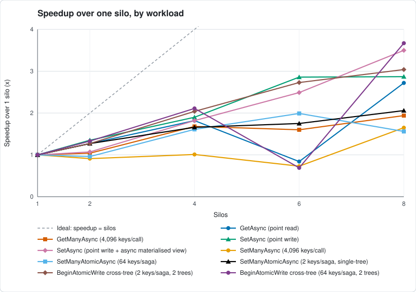
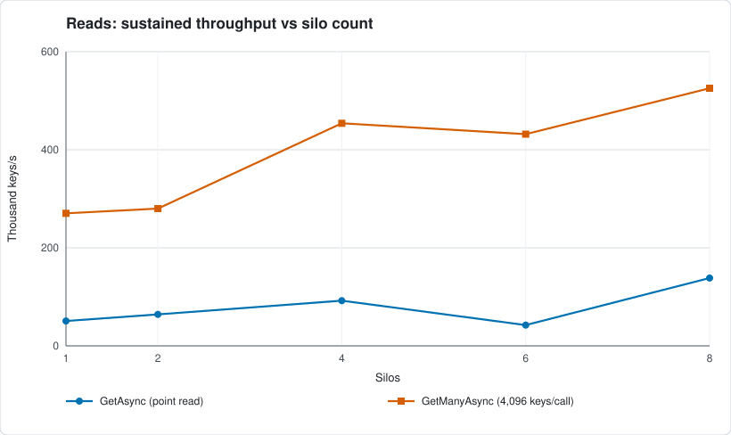
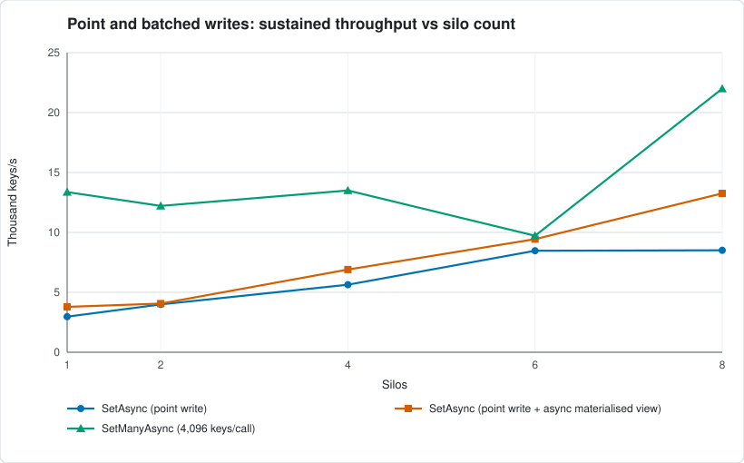
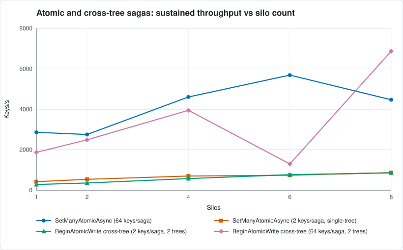

# Performance: multi-silo scaling

> [!IMPORTANT]
> **Scope: one tree, one storage account.** Every figure here comes from a cluster serving a **single tree** (two for the cross-tree rows), with its write-ahead log (WAL) and grain state on **one Azure Storage account**.
>
> - **Trees.** Some of a tree's resources have a fixed count that does not grow with the cluster: its WAL partitions ([`WalPartitions`](configuration.md#walpartitions), default 8; 16 in this sweep), its shards (64 here), and its transaction registry ([`TxRegistryShardCount`](configuration.md#txregistryshardcount), default 1; 8 here). An estate serving many trees spreads more of them across its silos, so its aggregate write and saga throughput can scale further than one tree's. Multi-tree scaling has not been measured.
> - **Storage accounts.** One account is a test constraint, not a library limit. Lattice can spread a tree's WAL partitions across several accounts; see [Multi-account fan-out](wal-storage-providers.md#multi-account-fan-out-named-providers-and-pinned-placement). [What the storage account reported](#what-the-storage-account-reported) shows what the one account did in each cell.

This page shows what adding silos buys: the same workloads as the
[single-silo](performance-single-silo.md) Layer 2 table, run on clusters of 1,
2, 4, 6 and 8 silos on Azure Container Apps. Each cell is offered more load
than the cluster can complete, so every figure is the cluster's limit at that
size. Each cell is the median of up to three 45-second runs, called cohorts;
[how Layer 3 is measured](performance-methodology-layer3.md) explains the rig,
the method and what bounds the results.

Read the shape of each curve rather than its absolute level. The rig holds
everything but the silo count constant (one storage account, a fixed shard
count, a client with bounded concurrency), which also caps the absolute
figures; a deployment tuned for throughput can beat them.

## The short version

| Workload | Shape from 1 to 8 silos | Evidence on what bounds it |
|----------|-------------------------|----------------------------|
| `GetAsync` (point read) | ~50.8 k keys/s at one silo, ~64.2 k at two, ~92.2 k at four, ~138.3 k at eight (2.72x); the six-silo cell reads ~42.4 k, below one silo, from cohorts that ranged from ~31 k to ~122 k | From two silos on, time outside the grain call: the silo-side p50 holds at ~2.9-3.5 ms while the client's calls take longer |
| `GetManyAsync` (batched read) | ~270 k keys/s at one silo, ~280 k at two, ~454 k at four, ~432 k at six, ~525 k at eight (1.94x) | A per-call time that grows with the calls in flight (p50 ~62 ms at one silo, ~398 ms at eight), over a keyspace that grows with the cluster |
| `SetAsync` | ~3 k keys/s at one silo, ~8.5 k at six and at eight (2.87x) | Not isolated; the storage account shows no throttling |
| `SetAsync` with a materialised view | ~3.8 k keys/s at one silo, ~13.3 k at eight (3.5x); at or above plain `SetAsync` at every silo count | Not isolated; the storage account shows no throttling |
| `SetManyAsync` (batched write) | ~13.4 k keys/s at one silo, 9.7-13.5 k from two to six, ~22 k at eight (1.65x) | Not isolated; each call takes longer as calls in flight grow, with no throttling |
| 64-key atomic sagas, single-tree | ~2.9 k keys/s at one silo, ~5.7 k at six, ~4.5 k at eight (1.56x) | Not isolated; each saga takes longer as silos are added |
| 64-key atomic sagas, cross-tree | ~1.9 k keys/s at one silo, ~4 k at four, ~6.9 k at eight (3.67x); the six-silo cell reads ~1.3 k from cohorts that ranged from ~0.9 k to ~6.2 k | Not isolated |
| 2-key atomic sagas | Single-tree 422 keys/s at one silo, 871 at eight (2.06x); cross-tree 281 at one silo, 855 at eight (3.04x) | Not isolated; the account's server latency rises from ~10.5 ms to ~19.7 ms (single-tree) and from ~5.2 ms to ~13.3 ms (cross-tree) |

No workload scales linearly. `GetAsync` and cross-tree 64-key sagas at six silos, and `SetManyAsync` at six silos, fall below their one-silo figure.

## The scaling curves

<!-- perf-chart:layer3:start
  schema=v1
  DO-NOT-HAND-EDIT-BETWEEN-MARKERS
-->

<!-- perf-chart:layer3:end -->

## The grid

How it is measured: [Layer 3 methodology](performance-methodology-layer3.md).

**Offered** is the load the cell was driven at, deliberately above what it
completed. **Speedup** is throughput over the same workload's one-silo
throughput, and **per-silo efficiency** is speedup divided by the silo count;
perfect scaling is a speedup equal to the silo count at 100%. Latency is the
time a call spends inside the silos, excluding the client's network hop; for
the atomic rows it is the saga's broadcast phase, not its whole commit. Every
cohort that completed work is kept, failures included: the last column gives
the failed keys of each cohort the cell used.

<!-- perf-table:layer3:start
  schema=v1
  batchSize=4096
  cohortN=3
  dotnet=10.0.x
  gitSha=35174338d
  host=Azure Container Apps (Consumption)
  maxRungEscalations=3
  region=westus3
  responseTimeoutSec=420
  rigs=ab5605a,ab5605b
  rowsMeasured=2026-11-09
  rungPerSilo=get-point=8000 veh/silo @ 5 Hz / 45s, flushConcurrency 16/silo; get-many=16000 veh/silo @ 5 Hz / 45s, flushConcurrency 8/silo; set-point=1200 veh/silo @ 5 Hz / 45s, flushConcurrency 64/silo; set-point-mv=1200 veh/silo @ 5 Hz / 45s, flushConcurrency 64/silo; set-many=2400 veh/silo @ 5 Hz / 45s, flushConcurrency 8/silo; set-many-atomic=800 veh/silo @ 5 Hz / 45s, flushConcurrency 64/silo; set-many-atomic-2=200 veh/silo @ 5 Hz / 45s, flushConcurrency 64/silo; cross-tree-atomic-2=100 veh/silo @ 5 Hz / 45s, flushConcurrency 64/silo; cross-tree-atomic-64=800 veh/silo @ 5 Hz / 45s, flushConcurrency 64/silo
  saturationRatio=0.9
  shardCount=64
  siloCounts=1,2,4,6,8
  siloSize=4 vCPU / 8 GiB
  walAccounts=1
  walMaxPendingBatches=16
  walPartitions=16
  methodology=Each cell is the median across N HEALTHY cohorts of completed-work throughput: total successfully-completed keys at FINAL divided by the engine's active elapsed time. Layer 3 deliberately does NOT use a per-second steady-state mean. On this path the client submits 4096-key batches, so a whole batch retires inside one per-second sample and the samples between retirements are exactly zero; a mean that filters the zeros away (the historical rate>0 form) averages only the spikes and reports more throughput than was offered (measured: 9,637 keys/s reported against 5,935 keys/s actually offered). The overstatement also varies with burstiness, which varies with silo count, so it would bend the scaling curve itself. Completed-ops / active-elapsed counts only work that succeeded over the wall-clock it took, so it cannot exceed the offered load and carries no windowing bias. Per-call p50/p99 merge the [phaseA] duration windows of every silo at t>=15s, weighted by call count; the silos' clocks cannot be aligned to the producer's steady-state window, so unlike Layer 2 no window is excluded as outside it. Every cell is a true-throughput measurement, not an offered-load one: offered load is scaled with the silo count (a per-silo rung driven at rung x silo count, so per-silo demand never falls as the cluster grows), and a cell whose first cohort completes at least saturationRatio of what was offered is re-run at double the rung, up to maxRungEscalations times, so the published figure is where the cluster stopped keeping up rather than what the client asked for. A cell still offer-bound after the last escalation is published as a lower bound (>=). Speedup and per-silo efficiency are derived against the measured 1-silo cell. Every cohort starts on empty storage: with the silos parked, the harness deletes every table in the storage account except the clustering table and points the silos at a freshly named WAL table and grain-state table, so no cohort inherits trees, registry rows, or WAL backlog from an earlier one. All silo counts share ONE Azure Storage account for the WAL; the storage-side table reports what that account's own Azure Monitor metrics showed for each cell.
  DO-NOT-HAND-EDIT-BETWEEN-MARKERS
-->

| Operation | Silos | Offered | Sustained throughput | Speedup vs 1 silo | Per-silo efficiency | Per-call p50 | Per-call p99 | Failed keys per cohort |
|-----------|------:|--------:|---------------------:|------------------:|--------------------:|-------------:|-------------:|-----------------------:|
| `GetAsync` (point read) | 1 | ~80 k keys/s | **~50.8 k keys/s** | 1x | 100% | ~30 us | ~6.08 ms | 0 / 0 / 0 |
| `GetAsync` (point read) | 2 | ~160 k keys/s | **~64.2 k keys/s** | 1.27x | 63% | ~3.47 ms | ~29.35 ms | 0 / 0 / 0 |
| `GetAsync` (point read) | 4 | ~320 k keys/s | **~92.2 k keys/s** | 1.82x | 45% | ~3.47 ms | ~28.21 ms | 0 / 0 / 0 |
| `GetAsync` (point read) | 6 | ~480 k keys/s | **~42.4 k keys/s** | 0.84x | 14% | ~3.5 ms | ~326.85 ms | 0 / 0 / 0 |
| `GetAsync` (point read) | 8 | ~640 k keys/s | **~138.3 k keys/s** | 2.72x | 34% | ~2.91 ms | ~60.48 ms | 0 / 0 / 0 |
| `GetManyAsync` (4,096 keys/call) | 1 | ~320 k keys/s | **~270.3 k keys/s** | 1x | 100% | ~61.77 ms | ~213.54 ms | 0 / 0 / 0 |
| `GetManyAsync` (4,096 keys/call) | 2 | ~640 k keys/s | **~279.9 k keys/s** | 1.04x | 52% | ~199.33 ms | ~382.35 ms | 0 / 0 / 0 |
| `GetManyAsync` (4,096 keys/call) | 4 | ~1.28 M keys/s | **~453.9 k keys/s** | 1.68x | 42% | ~234.91 ms | ~488.31 ms | 0 / 0 / 0 |
| `GetManyAsync` (4,096 keys/call) | 6 | ~1.92 M keys/s | **~431.8 k keys/s** | 1.6x | 27% | ~403.5 ms | ~758.68 ms | 0 / 0 / 0 |
| `GetManyAsync` (4,096 keys/call) | 8 | ~2.56 M keys/s | **~525.4 k keys/s** | 1.94x | 24% | ~398.26 ms | ~926.19 ms | 0 / 0 / 0 |
| `SetAsync` (point write) | 1 | ~6 k keys/s | **~3 k keys/s** | 1x | 100% | ~71.54 ms | ~244.83 ms | 0 / 117 / 0 |
| `SetAsync` (point write) | 2 | ~12 k keys/s | **~4 k keys/s** | 1.35x | 67% | ~91.72 ms | ~497.98 ms | 0 / 0 / 0 |
| `SetAsync` (point write) | 4 | ~24 k keys/s | **~5.6 k keys/s** | 1.9x | 48% | ~82.4 ms | ~1078.69 ms | 0 / 0 / 326 |
| `SetAsync` (point write) | 6 | ~36 k keys/s | **~8.5 k keys/s** | 2.86x | 48% | ~91.55 ms | ~1453.44 ms | 0 / 0 / 0 |
| `SetAsync` (point write) | 8 | ~48 k keys/s | **~8.5 k keys/s** | 2.87x | 36% | ~89.32 ms | ~2190.26 ms | 0 / 385 / 0 |
| `SetAsync` (point write + async materialised view) | 1 | ~6 k keys/s | **~3.8 k keys/s** | 1x | 100% | ~59.39 ms | ~192.82 ms | 0 / 0 / 0 |
| `SetAsync` (point write + async materialised view) | 2 | ~12 k keys/s | **~4.1 k keys/s** | 1.07x | 54% | ~76.01 ms | ~313.17 ms | 0 / 0 / 0 |
| `SetAsync` (point write + async materialised view) | 4 | ~24 k keys/s | **~6.9 k keys/s** | 1.82x | 46% | ~61.22 ms | ~372.42 ms | 106 / 0 / 0 |
| `SetAsync` (point write + async materialised view) | 6 | ~36 k keys/s | **~9.4 k keys/s** | 2.49x | 42% | ~85.12 ms | ~551.41 ms | 0 / 0 / 0 |
| `SetAsync` (point write + async materialised view) | 8 | ~48 k keys/s | **~13.3 k keys/s** | 3.5x | 44% | ~77.1 ms | ~750.85 ms | 0 / 0 / 0 |
| `SetManyAsync` (4,096 keys/call) | 1 | ~24 k keys/s | **~13.4 k keys/s** | 1x | 100% | ~2099.09 ms | ~4843.03 ms | 0 / 0 / 0 |
| `SetManyAsync` (4,096 keys/call) | 2 | ~48 k keys/s | **~12.2 k keys/s** | 0.91x | 46% | ~4363.13 ms | ~9023.39 ms | 36,864 / 0 / 0 |
| `SetManyAsync` (4,096 keys/call) | 4 | ~96 k keys/s | **~13.5 k keys/s** | 1.01x | 25% | ~8967.93 ms | ~18024.52 ms | 0 / 0 / 0 |
| `SetManyAsync` (4,096 keys/call) | 6 | ~144 k keys/s | **~9.7 k keys/s** | 0.73x | 12% | ~17312.35 ms | ~30011.09 ms | 0 / 0 / 0 |
| `SetManyAsync` (4,096 keys/call) | 8 | ~192 k keys/s | **~22 k keys/s** | 1.65x | 21% | ~10959.4 ms | ~24164.96 ms | 0 / 0 / 0 |
| `SetManyAtomicAsync` (64 keys/saga) | 1 | ~4 k keys/s | **~2.9 k keys/s** | 1x | 100% | ~513.98 ms | ~1120.18 ms | 0 / 0 / 0 |
| `SetManyAtomicAsync` (64 keys/saga) | 2 | ~8 k keys/s | **~2.8 k keys/s** | 0.96x | 48% | ~1030.27 ms | ~1792.93 ms | 0 / 0 / 0 |
| `SetManyAtomicAsync` (64 keys/saga) | 4 | ~16 k keys/s | **~4.6 k keys/s** | 1.61x | 40% | ~1223.7 ms | ~2419.3 ms | 0 / 0 / 0 |
| `SetManyAtomicAsync` (64 keys/saga) | 6 | ~24 k keys/s | **~5.7 k keys/s** | 1.99x | 33% | ~1761.95 ms | ~3120.04 ms | 0 / 0 / 0 |
| `SetManyAtomicAsync` (64 keys/saga) | 8 | ~32 k keys/s | **~4.5 k keys/s** | 1.56x | 20% | ~2825.83 ms | ~6206.93 ms | 0 / 0 / 0 |
| `SetManyAtomicAsync` (2 keys/saga, single-tree) | 1 | ~1 k keys/s | **422 keys/s** | 1x | 100% | ~39.61 ms | ~177.95 ms | 0 / 0 / 0 |
| `SetManyAtomicAsync` (2 keys/saga, single-tree) | 2 | ~2 k keys/s | **537 keys/s** | 1.27x | 64% | ~63.04 ms | ~198.3 ms | 0 / 0 / 0 |
| `SetManyAtomicAsync` (2 keys/saga, single-tree) | 4 | ~4 k keys/s | **701 keys/s** | 1.66x | 42% | ~78.79 ms | ~230.13 ms | 0 / 0 / 50 |
| `SetManyAtomicAsync` (2 keys/saga, single-tree) | 6 | ~6 k keys/s | **739 keys/s** | 1.75x | 29% | ~86.98 ms | ~252.08 ms | 0 / 0 / 0 |
| `SetManyAtomicAsync` (2 keys/saga, single-tree) | 8 | ~8 k keys/s | **871 keys/s** | 2.06x | 26% | ~80.96 ms | ~259.78 ms | 0 / 0 / 0 |
| `BeginAtomicWrite` cross-tree (2 keys/saga, 2 trees) | 1 | 500 keys/s | **281 keys/s** | 1x | 100% | ~30.21 ms | ~158.25 ms | 0 / 0 / 0 |
| `BeginAtomicWrite` cross-tree (2 keys/saga, 2 trees) | 2 | ~1 k keys/s | **356 keys/s** | 1.27x | 63% | ~39.91 ms | ~372.14 ms | 0 / 0 / 0 |
| `BeginAtomicWrite` cross-tree (2 keys/saga, 2 trees) | 4 | ~2 k keys/s | **574 keys/s** | 2.04x | 51% | ~38.89 ms | ~455.37 ms | 0 / 0 / 0 |
| `BeginAtomicWrite` cross-tree (2 keys/saga, 2 trees) | 6 | ~3 k keys/s | **768 keys/s** | 2.73x | 46% | ~38.05 ms | ~1021.35 ms | 0 / 0 / 0 |
| `BeginAtomicWrite` cross-tree (2 keys/saga, 2 trees) | 8 | ~4 k keys/s | **855 keys/s** | 3.04x | 38% | ~42.83 ms | ~898.65 ms | 0 / 0 / 0 |
| `BeginAtomicWrite` cross-tree (64 keys/saga, 2 trees) | 1 | ~4 k keys/s | **~1.9 k keys/s** | 1x | 100% | ~536.15 ms | ~1535.23 ms | 0 / 0 / 0 |
| `BeginAtomicWrite` cross-tree (64 keys/saga, 2 trees) | 2 | ~8 k keys/s | **~2.5 k keys/s** | 1.33x | 67% | ~181.07 ms | ~2755.61 ms | 0 / 0 / 0 |
| `BeginAtomicWrite` cross-tree (64 keys/saga, 2 trees) | 4 | ~16 k keys/s | **~4 k keys/s** | 2.11x | 53% | ~206.87 ms | ~3048.76 ms | 0 / 0 / 0 |
| `BeginAtomicWrite` cross-tree (64 keys/saga, 2 trees) | 6 | ~24 k keys/s | **~1.3 k keys/s** | 0.69x | 12% | ~195.2 ms | ~5458 ms | 0 / 0 / 0 |
| `BeginAtomicWrite` cross-tree (64 keys/saga, 2 trees) | 8 | ~32 k keys/s | **~6.9 k keys/s** | 3.67x | 46% | ~208.2 ms | ~3723.65 ms | 0 / 0 / 0 |

<!-- perf-table:layer3:end -->

> Measured 2026-11-09 on Azure Container Apps (Consumption) in westus3 (.NET 10.0.x) at git sha 35174338d, n=3 cohorts per cell, silo counts 1,2,4,6,8. Offered load scales with the silo count and is raised until each cell plateaus below it, so every figure is true throughput rather than offered load; every cohort starts on freshly emptied storage. All silo counts share one Azure Storage account for the WAL - see the storage-side table for what its metrics showed.

## What the storage account reported

How these columns are defined: [Layer 3 methodology](performance-methodology-layer3.md#how-to-read-the-grid).

A curve that stops climbing can be Lattice running out of headroom or the
storage account running out. Each run records what its account reported to
Azure Monitor: the transactions that **timed out** (`ServerTimeoutError` or
`ClientTimeoutError`) and their share of all transactions, the **storage
transactions** per second in the busiest minute (all accounts together), and
the **server** and **end-to-end** latency, whose gap is time spent on the
network and in client-side queueing. Whether any transaction was throttled is stated under
the table. The account also holds the cluster's grain state and membership
table, so its transactions are not only WAL writes.

<!-- perf-storage:layer3:start
  schema=v1
  DO-NOT-HAND-EDIT-BETWEEN-MARKERS
-->

| Operation | Silos | WAL accounts | Timed-out transactions | Storage transactions | Server latency | End-to-end latency |
|-----------|------:|-------------:|-----------------------:|---------------------:|---------------:|-------------------:|
| `GetAsync` (point read) | 1 | 1 | 0 | 244 tx/s | 6.0 ms | 7.9 ms |
| `GetAsync` (point read) | 2 | 1 | 0 | 450 tx/s | 6.6 ms | 7.9 ms |
| `GetAsync` (point read) | 4 | 1 | 0 | 882 tx/s | 6.2 ms | 7.6 ms |
| `GetAsync` (point read) | 6 | 1 | 0 | 1,434 tx/s | 6.4 ms | 7.5 ms |
| `GetAsync` (point read) | 8 | 1 | 0 | 1,877 tx/s | 7.2 ms | 8.2 ms |
| `GetManyAsync` (4,096 keys/call) | 1 | 1 | 0 | 979 tx/s | 5.5 ms | 6.7 ms |
| `GetManyAsync` (4,096 keys/call) | 2 | 1 | 0 | 1,545 tx/s | 5.2 ms | 6.5 ms |
| `GetManyAsync` (4,096 keys/call) | 4 | 1 | 0 | 3,885 tx/s | 4.1 ms | 4.7 ms |
| `GetManyAsync` (4,096 keys/call) | 6 | 1 | 0 | 3,989 tx/s | 4.5 ms | 6.4 ms |
| `GetManyAsync` (4,096 keys/call) | 8 | 1 | 0 | 6,048 tx/s | 4.4 ms | 5.4 ms |
| `SetAsync` (point write) | 1 | 1 | 0 | 3,481 tx/s | 7.0 ms | 8.6 ms |
| `SetAsync` (point write) | 2 | 1 | 0 | 4,176 tx/s | 7.4 ms | 8.4 ms |
| `SetAsync` (point write) | 4 | 1 | 0 | 3,583 tx/s | 8.4 ms | 11.0 ms |
| `SetAsync` (point write) | 6 | 1 | 0 | 3,970 tx/s | 7.7 ms | 10.0 ms |
| `SetAsync` (point write) | 8 | 1 | 0 | 7,647 tx/s | 7.5 ms | 9.1 ms |
| `SetAsync` (point write + async materialised view) | 1 | 1 | 0 | 4,106 tx/s | 4.4 ms | 5.1 ms |
| `SetAsync` (point write + async materialised view) | 2 | 1 | 0 | 5,332 tx/s | 3.8 ms | 4.9 ms |
| `SetAsync` (point write + async materialised view) | 4 | 1 | 0 | 5,818 tx/s | 3.7 ms | 5.3 ms |
| `SetAsync` (point write + async materialised view) | 6 | 1 | 0 | 5,404 tx/s | 3.9 ms | 5.4 ms |
| `SetAsync` (point write + async materialised view) | 8 | 1 | 11 (<0.01%) | 10,491 tx/s | 4.6 ms | 5.3 ms |
| `SetManyAsync` (4,096 keys/call) | 1 | 1 | 0 | 2,090 tx/s | 9.8 ms | 11.6 ms |
| `SetManyAsync` (4,096 keys/call) | 2 | 1 | 0 | 1,867 tx/s | 17.3 ms | 18.8 ms |
| `SetManyAsync` (4,096 keys/call) | 4 | 1 | 0 | 2,274 tx/s | 8.5 ms | 10.0 ms |
| `SetManyAsync` (4,096 keys/call) | 6 | 1 | 0 | 2,460 tx/s | 9.7 ms | 11.4 ms |
| `SetManyAsync` (4,096 keys/call) | 8 | 1 | 0 | 3,059 tx/s | 8.6 ms | 10.0 ms |
| `SetManyAtomicAsync` (64 keys/saga) | 1 | 1 | 0 | 1,471 tx/s | 4.8 ms | 6.2 ms |
| `SetManyAtomicAsync` (64 keys/saga) | 2 | 1 | 0 | 3,008 tx/s | 4.8 ms | 6.1 ms |
| `SetManyAtomicAsync` (64 keys/saga) | 4 | 1 | 0 | 4,024 tx/s | 5.7 ms | 6.5 ms |
| `SetManyAtomicAsync` (64 keys/saga) | 6 | 1 | 0 | 3,519 tx/s | 5.9 ms | 7.3 ms |
| `SetManyAtomicAsync` (64 keys/saga) | 8 | 1 | 0 | 3,721 tx/s | 4.0 ms | 5.4 ms |
| `SetManyAtomicAsync` (2 keys/saga, single-tree) | 1 | 1 | 0 | 2,510 tx/s | 10.5 ms | 10.9 ms |
| `SetManyAtomicAsync` (2 keys/saga, single-tree) | 2 | 1 | 0 | 3,692 tx/s | 8.6 ms | 9.1 ms |
| `SetManyAtomicAsync` (2 keys/saga, single-tree) | 4 | 1 | 0 | 4,412 tx/s | 10.6 ms | 11.4 ms |
| `SetManyAtomicAsync` (2 keys/saga, single-tree) | 6 | 1 | 0 | 3,216 tx/s | 14.6 ms | 15.6 ms |
| `SetManyAtomicAsync` (2 keys/saga, single-tree) | 8 | 1 | 0 | 3,650 tx/s | 19.7 ms | 20.8 ms |
| `BeginAtomicWrite` cross-tree (2 keys/saga, 2 trees) | 1 | 1 | 0 | 2,759 tx/s | 5.2 ms | 5.3 ms |
| `BeginAtomicWrite` cross-tree (2 keys/saga, 2 trees) | 2 | 1 | 0 | 4,735 tx/s | 5.0 ms | 5.1 ms |
| `BeginAtomicWrite` cross-tree (2 keys/saga, 2 trees) | 4 | 1 | 83 (0.02%) | 5,332 tx/s | 11.6 ms | 11.9 ms |
| `BeginAtomicWrite` cross-tree (2 keys/saga, 2 trees) | 6 | 1 | 0 | 8,722 tx/s | 9.9 ms | 10.2 ms |
| `BeginAtomicWrite` cross-tree (2 keys/saga, 2 trees) | 8 | 1 | 0 | 8,820 tx/s | 13.3 ms | 13.7 ms |
| `BeginAtomicWrite` cross-tree (64 keys/saga, 2 trees) | 1 | 1 | 0 | 2,082 tx/s | 7.1 ms | 8.7 ms |
| `BeginAtomicWrite` cross-tree (64 keys/saga, 2 trees) | 2 | 1 | 0 | 4,707 tx/s | 6.3 ms | 7.6 ms |
| `BeginAtomicWrite` cross-tree (64 keys/saga, 2 trees) | 4 | 1 | 0 | 5,477 tx/s | 6.9 ms | 8.0 ms |
| `BeginAtomicWrite` cross-tree (64 keys/saga, 2 trees) | 6 | 1 | 0 | 3,446 tx/s | 7.5 ms | 9.0 ms |
| `BeginAtomicWrite` cross-tree (64 keys/saga, 2 trees) | 8 | 1 | 0 | 5,076 tx/s | 10.7 ms | 11.7 ms |

Azure Monitor recorded no throttled transactions (`ServerBusy` or `ClientThrottling`) in any cohort of any cell.

<!-- perf-storage:layer3:end -->

Timed-out transactions are rare. Only two cells recorded any: `SetAsync` with a view at eight silos (11, under 0.01% of transactions) and the 2-key cross-tree saga at four silos (83, 0.02%). No cell recorded throttling.

## Workload by workload

### `GetAsync`

Point reads deliver ~50.8 k keys/s at one silo, ~64.2 k at two, ~92.2 k at four, ~42.4 k at six and ~138.3 k at eight (2.72x). Every cohort reports zero failures. The six-silo cell is the median of three cohorts that ranged from ~31 k to ~122 k keys/s, with a p99 of ~327 ms against ~28-60 ms at four and eight silos, so treat it as noise rather than a trend.

The silo-side p50 is ~30 us at one silo, where the whole read is in-process, and ~2.9-3.5 ms from two silos to eight, where the shard root usually lives on another host. Dividing the 256 calls in flight per silo by the throughput gives the mean time a read takes as the client sees it: about 5 ms at one silo, 8 ms at two and 15 ms at eight. The growth from two silos on is therefore outside the grain call, in the client-to-gateway hop and the messaging layer.

### `GetManyAsync`

Batched reads deliver ~270 k keys/s at one silo, ~280 k at two, ~454 k at four, ~432 k at six and ~525 k at eight (1.94x), with zero failures. The silo-side p50 is ~62 ms at one silo, ~199 ms at two, ~235 ms at four and ~398-404 ms at six and eight, so it grows almost as fast as the calls in flight. A batch completes only when its slowest shard answers, and each added host puts more of its shards across the network; the cause is not isolated further.

**The read keyspace grows with the cell.** The harness seeds as many keys as the producer has vehicles, and the vehicle count also sets the offered load. The settled rung is 64,000 vehicles per silo, so the keyspace is 64 k keys at one silo and 512 k at eight. This curve varies the silo count and the keyspace size together.

### `SetAsync` and `SetAsync` with a materialised view

Point writes deliver ~3 k keys/s at one silo, ~4 k at two, ~5.6 k at four and ~8.5 k at both six and eight (2.87x). The median time a write spends inside the silo is ~72 ms at one silo and ~82-92 ms from two to eight, so the gain comes from more writes in flight across more hosts rather than from faster writes. The cell at two silos and the cell at six rest on three HEALTHY cohorts out of five; the other two cohorts of each froze for longer than the 60 s limit and are excluded. Cohorts lost 117 keys at one silo, 326 at four and 385 at eight.

With a materialised view the writes deliver ~3.8 k keys/s at one silo, ~4.1 k at two, ~6.9 k at four, ~9.4 k at six and ~13.3 k at eight (3.5x). The variant is at or above plain `SetAsync` at every silo count in this run, so a view cost is not visible here. The view variant's server latency on the storage account is lower (3.7-4.6 ms against 7.0-8.4 ms), which is not explained by these data.

The storage account shows no sign of being the limit for either variant: no throttling, and server latency flat across silo counts. Its busiest minute reaches ~7.6 k transactions/s (plain) and ~10.5 k (with a view) at eight silos. The pace-setter is not isolated further.

### `SetManyAsync`

Batched writes deliver ~13.4 k keys/s at one silo, ~12.2 k at two, ~13.5 k at four, ~9.7 k at six and ~22 k at eight (1.65x). The median call takes ~2.1 s at one silo, ~4.4 s at two, ~9 s at four, ~17 s at six and ~11 s at eight, so extra silos mostly add calls in flight without completing more of them.

The six-silo cell is the median of three cohorts that ranged from ~7.7 k to ~18.3 k keys/s, and two of them hit the WAL saturation back-off (`satRetries` 9 and 41), so the dip below one silo should not be read as a trend. One cohort at two silos failed 36,864 keys (nine calls of 4,096). What limits the curve is not isolated: the storage account's busiest minute stays at ~1.9-3.1 k transactions/s with server latency of 8.5-17 ms, and it recorded no throttling and no timed-out transactions.

### Atomic and cross-tree sagas

| Workload | Keys per saga | Keys/s at 1 / 2 / 4 / 6 / 8 silos |
|----------|--------------:|:----------------------------------|
| `SetManyAtomicAsync` | 64 | ~2.9 k / ~2.8 k / ~4.6 k / ~5.7 k / ~4.5 k |
| `SetManyAtomicAsync` | 2 | 422 / 537 / 701 / 739 / 871 |
| `BeginAtomicWrite` cross-tree | 64 | ~1.9 k / ~2.5 k / ~4 k / ~1.3 k / ~6.9 k |
| `BeginAtomicWrite` cross-tree | 2 | 281 / 356 / 574 / 768 / 855 |

At eight silos the speedups are 1.56x (single-tree, 64 keys), 2.06x (single-tree, 2 keys), 3.67x (cross-tree, 64 keys) and 3.04x (cross-tree, 2 keys). The cost is mostly per saga rather than per key: a 2-key saga delivers far fewer keys per second than a 64-key one but runs many more sagas per second.

The two 64-key curves are the least stable. Single-tree peaks at six silos (1.99x) and falls back at eight. Cross-tree at six silos is the median of three cohorts that ranged from ~0.9 k to ~6.2 k keys/s, so its 0.69x speedup is within the cohort spread; its p99 there is ~5.5 s against ~3.0-3.7 s at four and eight silos.

For the 2-key sagas, the storage account's server latency rises with the silo count: from ~10.5 ms at one silo to ~19.7 ms at eight for single-tree, and from ~5.2 ms to ~13.3 ms for cross-tree. One cohort lost keys: 50 at four silos for the 2-key single-tree saga. Separately, the cross-tree 2-key cell at four silos recorded 83 timed-out transactions.
