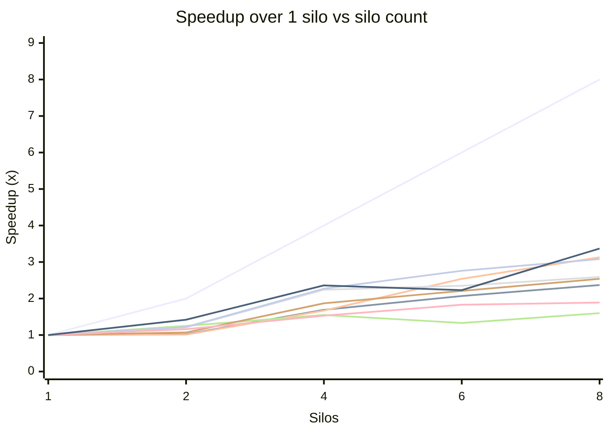
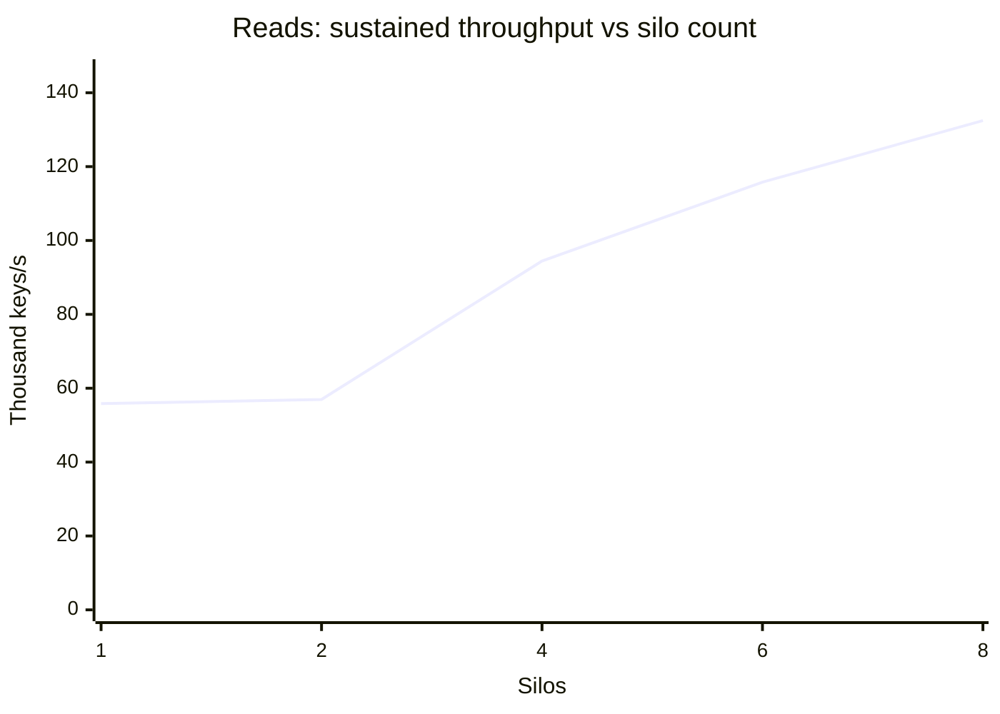
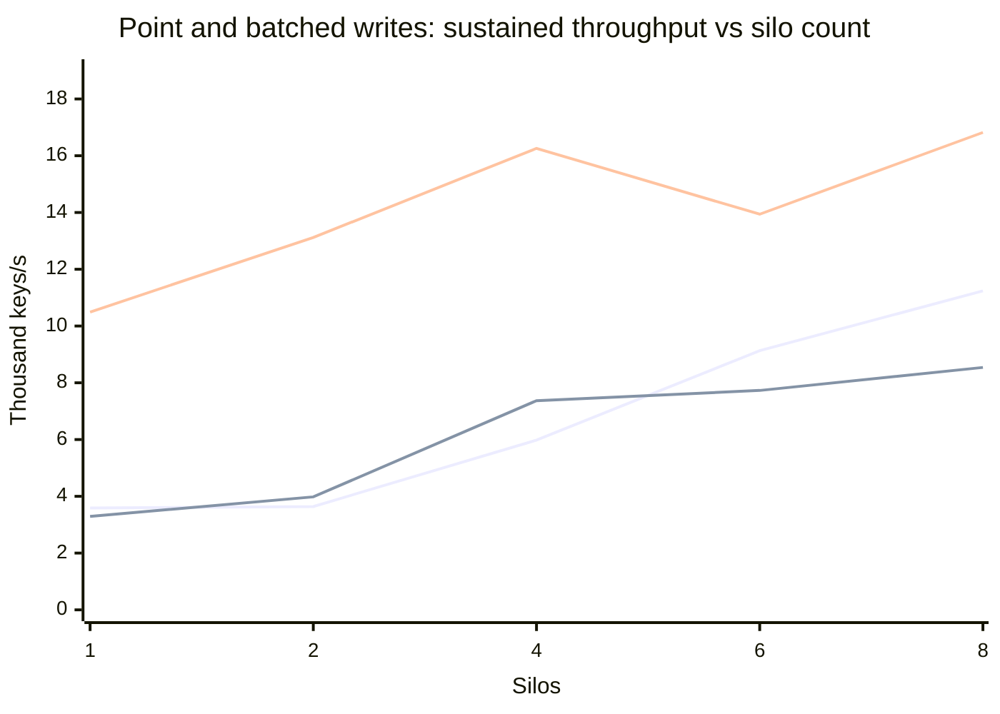
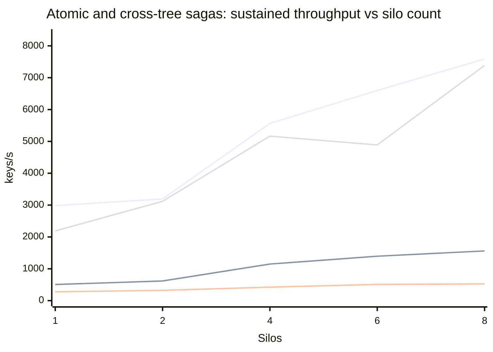

# Performance: multi-silo scaling guide

> [!IMPORTANT]
> **Scope: one tree, one storage account.** Every figure here comes from a cluster serving a **single tree** (two for the cross-tree saga rows), with its write-ahead log and grain state on **one Azure Storage account**.
>
> - **Trees.** Some of a tree's resources have a fixed count that does not grow with the cluster: its WAL partitions ([`WalPartitions`](configuration.md#walpartitions), default 8), its shards, and its transaction registry ([`TxRegistryShardCount`](configuration.md#txregistryshardcount), default 1). An estate serving many trees spreads more of them across its silos, so its aggregate write and atomic-saga throughput can scale further than one tree's. Reads, whose bound here lies outside the tree, would gain little. Multi-tree scaling has not been measured.
> - **Storage accounts.** One account is a test constraint, not a library limit. Lattice can spread a tree's WAL partitions across several storage accounts; see [Multi-account fan-out](wal-storage-providers.md#multi-account-fan-out-named-providers-and-pinned-placement). The [storage-side metrics](#storage-side-metrics) show what that one account reported for each cell.

This document is an **approximate guide** to how Orleans.Lattice throughput
responds when you add silos. It is the horizontal-scaling companion to
[Performance: single-silo guide](performance-single-silo.md), which remains
the authority on what one silo delivers and on the per-operation call
shapes; read that first. Everything here answers one question that the
single-silo document deliberately does not: **when you put N hosts behind
the same tree, what do you actually get?**

The numbers come from a third benchmark tier ("Layer 3") that stands up a
fixed-size Orleans cluster on **Azure Container Apps**, drives it from an
out-of-cluster Orleans client, and records one cell per (workload, silo
count). It covers the same workloads as the single-silo Layer 2 table
and is regenerated by `benchmark/performance-report.ps1 -Layer3`, the same
harness that produces the Layer 1 and Layer 2 tables, either against a rig
it provisions and deletes itself or against one deployed beforehand and
named with `-ReuseAca` (see [Re-running it yourself](#re-running-it-yourself)).

**Read the curve, not the absolute numbers.** The point of this tier is the
*shape* - where throughput stops rewarding extra hosts - and the shape is
robust in a way the absolute figures are not. Several deliberate choices
below (one shared storage account per rig, a fixed shard count, ACA's memory
ceiling, a client with bounded concurrency) hold the topology constant so
the silo count is the only variable; each of them also caps the absolute
ceiling. A production deployment tuned for throughput rather than for
comparability will beat these figures.

## The short version

| Workload | Shape from 1 to 8 silos | What the evidence says bounds it |
|----------|-------------------------|----------------------------------|
| `GetAsync` (point read) | ~55.8 k keys/s at one silo, ~57 k at two, then rising to ~132.5 k at eight (2.37x) | From two silos on, time spent outside the grain call: the silo-side call time holds at ~4-5 ms while the client's calls take longer |
| `GetManyAsync` (batched read) | ~316.5 k keys/s at one silo, ~193 k at two and ~216 k at four; no six- or eight-silo cell | A per-call time that grows almost as fast as the calls in flight, over a keyspace that doubles with each step; the larger keyspaces could not be seeded |
| `SetAsync`, with or without a view | ~3.3-3.6 k keys/s at one silo, ~8.5-11.2 k at eight (2.6-3.1x) | Not isolated; not the storage account, which shows no throttling and flat server latency |
| `SetManyAsync` (batched write) | ~10.5 k keys/s at one silo, ~13-17 k from two to eight, no sustained gain after four | Most likely the write path to the one shared account, whose transaction rate stays flat while timeouts grow; it never reported throttling |
| 64-key atomic sagas (single-tree and cross-tree) | ~34-47 sagas/s at one silo, ~115-119 at eight (2.5-3.4x) | Per-saga latency under the client's bounded concurrency |
| 2-key atomic sagas (single-tree and cross-tree) | ~253 and ~139 sagas/s at one silo, ~781 and ~263 at eight (3.1x and 1.9x) | Single-tree: the saga registry's admission budget, reached at eight silos. Cross-tree: storage server latency, which rises fourfold ([#3591](https://github.com/NSTA1/Orleans.Lattice/issues/3591)) |

No workload scales linearly, and only `GetManyAsync` falls below its
one-silo figure. The rest of this
document gives the grid, how it was measured, and the evidence behind each
row of that table.

## The scaling curve

<!-- perf-chart:layer3:start
  schema=v1
  DO-NOT-HAND-EDIT-BETWEEN-MARKERS
-->



Series order (xychart-beta renders no legend): ideal linear scaling (y = silos), then `GetAsync` (point read), then `SetAsync` (point write), then `SetAsync` (point write + async materialised view), then `SetManyAsync` (4,096 keys/call), then `SetManyAtomicAsync` (64 keys/saga), then `SetManyAtomicAsync` (2 keys/saga, single-tree), then `BeginAtomicWrite` cross-tree (2 keys/saga, 2 trees), then `BeginAtomicWrite` cross-tree (64 keys/saga, 2 trees).

Not drawn, because it was not measured at every silo count above (its cells are in the table): `GetManyAsync` (4,096 keys/call).



Series order (xychart-beta renders no legend): `GetAsync` (point read).

Not drawn, because it was not measured at every silo count above (its cells are in the table): `GetManyAsync` (4,096 keys/call).



Series order (xychart-beta renders no legend): `SetAsync` (point write), then `SetAsync` (point write + async materialised view), then `SetManyAsync` (4,096 keys/call).



Series order (xychart-beta renders no legend): `SetManyAtomicAsync` (64 keys/saga), then `SetManyAtomicAsync` (2 keys/saga, single-tree), then `BeginAtomicWrite` cross-tree (2 keys/saga, 2 trees), then `BeginAtomicWrite` cross-tree (64 keys/saga, 2 trees).

<!-- perf-chart:layer3:end -->

## The grid

**How it was run.** For each cohort the harness scales the silo
Container App to N replicas, waits for every replica to report running,
retires the superseded revision, settles for cluster membership, then runs
the producer as a Container Apps **job** that joins the cluster as an
Orleans *client* over the same Azure Table clustering store. The client
opens several connections per silo (four by default) so grain calls spread
across every gateway rather than funnelling through one, seeds the keyspace
for the read workloads, warms the tree, and then drives the measurement
window. Offered load is **per-silo rung x N**, so the demand presented to
the cluster grows with the cluster: a flat line on the chart means extra
hosts absorbed nothing, not that the load ran out.

**Every cohort starts on empty storage.** Before each cohort, with the silos
parked at zero replicas, the harness deletes every table in the storage
account except the clustering table and points the silos at a freshly named
WAL table and grain-state table. No cohort inherits trees, tree-registry
rows, or WAL backlog from an earlier one.

**Every figure is true throughput, not offered load.** A cell whose first
cohort completes at least 90% of what was offered has not found the
cluster's limit, so the harness discards that cohort as a probe, doubles
the per-silo rung and runs it again, up to three times. The rung a workload
settles on carries forward to the larger silo counts, so demand never falls
as the cluster grows. A cell still keeping up with its offered load after
the last escalation is published as a lower bound, marked `>=`, and so is a
cell whose producer could not generate the load it was asked for: that
measures the client, not the cluster. Each cell is the median of three
cohorts at the settled rung (two where one was excluded; the metadata's
`cohortN` gives the range). Between cells the silo app is parked at zero
replicas.

**The client's concurrency is sized per workload.** The client runs a fixed
number of flush slots per silo, recorded as `flushConcurrency` in the
table's metadata. Batched workloads need few, because one call carries 4,096
keys, and run 8 per silo. Point and saga workloads carry one key or one saga
per call, so at that default the client, not the cluster, would be the
limit; `GetAsync` runs 16 slots per silo and the point-write and atomic
workloads 64, and each atomic saga is its own flush unit. The point
workloads fan each slot out into that many individual calls, so their
in-flight call count is the slot count squared times N: it grows linearly
with the cluster, keeping per-silo demand constant.

**Five identical rigs, split by workload.** To cut the wall-clock, the
sweep ran on five identically deployed rigs in the same region
(`-Layer3Rigs 5`), each with its own storage account, and every workload's
curve came from one rig, so no line mixes rigs; the metadata's `rigs` key
names them. No workload was repeated on a second rig, so this sweep has no
cross-rig check on its absolute figures.

**The code measured.** Every cell ran the library at the commit recorded as
`gitSha` below. Two harness fixes landed during the sweep without touching
the library. The read preseed's budget now scales with its key count; the
rig carrying `GetManyAsync` and the 2-key `SetManyAtomicAsync` saga was
resumed with it for their four-silo and larger cells. A cohort that kept
completing work but ended with a backlog still in flight is no longer
graded a wedge; five cohorts graded before that change were re-graded from
their logs by the same rule.

<!-- perf-table:layer3:start
  schema=v1
  batchSize=4096
  cohortN=2/3
  dotnet=10.0.x
  gitSha=376a3eae7
  host=Azure Container Apps (Consumption)
  maxRungEscalations=3
  region=westus3
  responseTimeoutSec=420
  rigs=fl31,fl32,fl33,fl34,fl35
  rowsMeasured=2026-10-27
  rungPerSilo=get-point=8000 veh/silo @ 5 Hz / 45s, flushConcurrency 16/silo; get-many=16000 veh/silo @ 5 Hz / 45s, flushConcurrency 8/silo; set-point=1200 veh/silo @ 5 Hz / 45s, flushConcurrency 64/silo; set-point-mv=1200 veh/silo @ 5 Hz / 45s, flushConcurrency 64/silo; set-many=2400 veh/silo @ 5 Hz / 45s, flushConcurrency 8/silo; set-many-atomic=800 veh/silo @ 5 Hz / 45s, flushConcurrency 64/silo; set-many-atomic-2=200 veh/silo @ 5 Hz / 45s, flushConcurrency 64/silo; cross-tree-atomic-2=100 veh/silo @ 5 Hz / 45s, flushConcurrency 64/silo; cross-tree-atomic-64=800 veh/silo @ 5 Hz / 45s, flushConcurrency 64/silo
  saturationRatio=0.9
  shardCount=64
  siloCounts=1,2,4,6,8
  siloSize=4 vCPU / 8 GiB
  walAccounts=1
  walMaxPendingBatches=16
  walPartitions=16
  methodology=Each cell is the median across N HEALTHY cohorts of completed-work throughput: total successfully-completed keys at FINAL divided by the engine's active elapsed time. Layer 3 deliberately does NOT use a per-second steady-state mean. On this path the client submits 4096-key batches, so a whole batch retires inside one per-second sample and the samples between retirements are exactly zero; a mean that filters the zeros away (the historical rate>0 form) averages only the spikes and reports more throughput than was offered (measured: 9,637 keys/s reported against 5,935 keys/s actually offered). The overstatement also varies with burstiness, which varies with silo count, so it would bend the scaling curve itself. Completed-ops / active-elapsed counts only work that succeeded over the wall-clock it took, so it cannot exceed the offered load and carries no windowing bias. Per-call p50/p99 merge the [phaseA] duration windows of every silo at t>=15s, weighted by call count; the silos' clocks cannot be aligned to the producer's steady-state window, so unlike Layer 2 no window is excluded as outside it. Every cell is a true-throughput measurement, not an offered-load one: offered load is scaled with the silo count (a per-silo rung driven at rung x silo count, so per-silo demand never falls as the cluster grows), and a cell whose first cohort completes at least saturationRatio of what was offered is re-run at double the rung, up to maxRungEscalations times, so the published figure is where the cluster stopped keeping up rather than what the client asked for. A cell still offer-bound after the last escalation is published as a lower bound (>=). Speedup and per-silo efficiency are derived against the measured 1-silo cell. Every cohort starts on empty storage: with the silos parked, the harness deletes every table in the storage account except the clustering table and points the silos at a freshly named WAL table and grain-state table, so no cohort inherits trees, registry rows, or WAL backlog from an earlier one. All silo counts share ONE Azure Storage account for the WAL; the storage-side table reports what that account's own Azure Monitor metrics showed for each cell.
  DO-NOT-HAND-EDIT-BETWEEN-MARKERS
-->

| Operation | Silos | Offered | Sustained throughput | Speedup vs 1 silo | Per-silo efficiency | Per-call p50 | Per-call p99 |
|-----------|------:|--------:|---------------------:|------------------:|--------------------:|-------------:|-------------:|
| `GetAsync` (point read) | 1 | ~80 k keys/s | **~55.8 k keys/s** | 1x | 100% | ~30 us | ~3.26 ms |
| `GetAsync` (point read) | 2 | ~160 k keys/s | **~57 k keys/s** | 1.02x | 51% | ~4.25 ms | ~19.81 ms |
| `GetAsync` (point read) | 4 | ~320 k keys/s | **~94.5 k keys/s** | 1.69x | 42% | ~4.17 ms | ~18.7 ms |
| `GetAsync` (point read) | 6 | ~480 k keys/s | **~115.8 k keys/s** | 2.07x | 35% | ~4.89 ms | ~24.27 ms |
| `GetAsync` (point read) | 8 | ~640 k keys/s | **~132.5 k keys/s** | 2.37x | 30% | ~4.82 ms | ~23.77 ms |
| `GetManyAsync` (4,096 keys/call) | 1 | ~640 k keys/s | **~316.5 k keys/s** | 1x | 100% | ~52.1 ms | ~190.76 ms |
| `GetManyAsync` (4,096 keys/call) | 2 | ~1.28 M keys/s | **~193 k keys/s** | 0.61x | 30% | ~304.24 ms | ~607.98 ms |
| `GetManyAsync` (4,096 keys/call) | 4 | ~2.56 M keys/s | **~215.6 k keys/s** | 0.68x | 17% | ~544.08 ms | ~1130.6 ms |
| `SetAsync` (point write) | 1 | ~6 k keys/s | **~3.6 k keys/s** | 1x | 100% | ~59.58 ms | ~208.47 ms |
| `SetAsync` (point write) | 2 | ~12 k keys/s | **~3.6 k keys/s** | 1.01x | 51% | ~82.25 ms | ~450.67 ms |
| `SetAsync` (point write) | 4 | ~24 k keys/s | **~6 k keys/s** | 1.67x | 42% | ~75.38 ms | ~551.04 ms |
| `SetAsync` (point write) | 6 | ~36 k keys/s | **~9.1 k keys/s** | 2.54x | 42% | ~82.16 ms | ~669.22 ms |
| `SetAsync` (point write) | 8 | ~48 k keys/s | **~11.2 k keys/s** | 3.13x | 39% | ~89.98 ms | ~1344.91 ms |
| `SetAsync` (point write + async materialised view) | 1 | ~6 k keys/s | **~3.3 k keys/s** | 1x | 100% | ~67.01 ms | ~208.68 ms |
| `SetAsync` (point write + async materialised view) | 2 | ~12 k keys/s | **~4 k keys/s** | 1.21x | 60% | ~87.41 ms | ~396.8 ms |
| `SetAsync` (point write + async materialised view) | 4 | ~24 k keys/s | **~7.4 k keys/s** | 2.24x | 56% | ~85.47 ms | ~679.89 ms |
| `SetAsync` (point write + async materialised view) | 6 | ~36 k keys/s | **~7.7 k keys/s** | 2.35x | 39% | ~87.25 ms | ~1885.39 ms |
| `SetAsync` (point write + async materialised view) | 8 | ~48 k keys/s | **~8.5 k keys/s** | 2.59x | 32% | ~83.31 ms | ~1684.13 ms |
| `SetManyAsync` (4,096 keys/call) | 1 | ~12 k keys/s | **~10.5 k keys/s** | 1x | 100% | ~1785.27 ms | ~7912.26 ms |
| `SetManyAsync` (4,096 keys/call) | 2 | ~24 k keys/s | **~13.1 k keys/s** | 1.25x | 63% | ~4120.23 ms | ~13086.44 ms |
| `SetManyAsync` (4,096 keys/call) | 4 | ~48 k keys/s | **~16.3 k keys/s** | 1.55x | 39% | ~7415.27 ms | ~10610.35 ms |
| `SetManyAsync` (4,096 keys/call) | 6 | ~72 k keys/s | **~13.9 k keys/s** | 1.33x | 22% | ~10670.81 ms | ~27760.06 ms |
| `SetManyAsync` (4,096 keys/call) | 8 | ~96 k keys/s | **~16.8 k keys/s** | 1.6x | 20% | ~11879.08 ms | ~34041.1 ms |
| `SetManyAtomicAsync` (64 keys/saga) | 1 | ~4 k keys/s | **~3 k keys/s** | 1x | 100% | ~511.42 ms | ~1126.08 ms |
| `SetManyAtomicAsync` (64 keys/saga) | 2 | ~8 k keys/s | **~3.2 k keys/s** | 1.07x | 54% | ~915.69 ms | ~1602.5 ms |
| `SetManyAtomicAsync` (64 keys/saga) | 4 | ~16 k keys/s | **~5.6 k keys/s** | 1.87x | 47% | ~1231.15 ms | ~2003.95 ms |
| `SetManyAtomicAsync` (64 keys/saga) | 6 | ~24 k keys/s | **~6.6 k keys/s** | 2.21x | 37% | ~1318.82 ms | ~2289.47 ms |
| `SetManyAtomicAsync` (64 keys/saga) | 8 | ~32 k keys/s | **~7.6 k keys/s** | 2.54x | 32% | ~1647.95 ms | ~2840.51 ms |
| `SetManyAtomicAsync` (2 keys/saga, single-tree) | 1 | ~1 k keys/s | **506 keys/s** | 1x | 100% | ~45.74 ms | ~149.41 ms |
| `SetManyAtomicAsync` (2 keys/saga, single-tree) | 2 | ~2 k keys/s | **618 keys/s** | 1.22x | 61% | ~72.66 ms | ~202.36 ms |
| `SetManyAtomicAsync` (2 keys/saga, single-tree) | 4 | ~4 k keys/s | **~1.1 k keys/s** | 2.27x | 57% | ~74.99 ms | ~206.42 ms |
| `SetManyAtomicAsync` (2 keys/saga, single-tree) | 6 | ~6 k keys/s | **~1.4 k keys/s** | 2.76x | 46% | ~87.06 ms | ~462.39 ms |
| `SetManyAtomicAsync` (2 keys/saga, single-tree) | 8 | ~8 k keys/s | **~1.6 k keys/s** | 3.08x | 39% | ~84.27 ms | ~319.78 ms |
| `BeginAtomicWrite` cross-tree (2 keys/saga, 2 trees) | 1 | 500 keys/s | **278 keys/s** | 1x | 100% | ~29.51 ms | ~243.22 ms |
| `BeginAtomicWrite` cross-tree (2 keys/saga, 2 trees) | 2 | ~1 k keys/s | **323 keys/s** | 1.16x | 58% | ~46.97 ms | ~209.62 ms |
| `BeginAtomicWrite` cross-tree (2 keys/saga, 2 trees) | 4 | ~2 k keys/s | **425 keys/s** | 1.53x | 38% | ~42.7 ms | ~824.16 ms |
| `BeginAtomicWrite` cross-tree (2 keys/saga, 2 trees) | 6 | ~3 k keys/s | **510 keys/s** | 1.83x | 31% | ~45.06 ms | ~783.45 ms |
| `BeginAtomicWrite` cross-tree (2 keys/saga, 2 trees) | 8 | ~4 k keys/s | **526 keys/s** | 1.89x | 24% | ~52.78 ms | ~1968.29 ms |
| `BeginAtomicWrite` cross-tree (64 keys/saga, 2 trees) | 1 | ~4 k keys/s | **~2.2 k keys/s** | 1x | 100% | ~423.26 ms | ~1546.46 ms |
| `BeginAtomicWrite` cross-tree (64 keys/saga, 2 trees) | 2 | ~8 k keys/s | **~3.1 k keys/s** | 1.42x | 71% | ~179.34 ms | ~2037.01 ms |
| `BeginAtomicWrite` cross-tree (64 keys/saga, 2 trees) | 4 | ~16 k keys/s | **~5.2 k keys/s** | 2.36x | 59% | ~235.93 ms | ~2910.06 ms |
| `BeginAtomicWrite` cross-tree (64 keys/saga, 2 trees) | 6 | ~24 k keys/s | **~4.9 k keys/s** | 2.23x | 37% | ~1742.24 ms | ~5341.72 ms |
| `BeginAtomicWrite` cross-tree (64 keys/saga, 2 trees) | 8 | ~32 k keys/s | **~7.4 k keys/s** | 3.37x | 42% | ~282.44 ms | ~5220.34 ms |

<!-- perf-table:layer3:end -->

> Measured 2026-10-27 on Azure Container Apps (Consumption) in westus3 (.NET 10.0.x) at git sha 376a3eae7, n=2/3 cohorts per cell, silo counts 1,2,4,6,8. Offered load scales with the silo count and is raised until each cell plateaus below it, so every figure is true throughput rather than offered load; every cohort starts on freshly emptied storage. All silo counts share one Azure Storage account for the WAL - see the storage-side table and the caveats below for what its metrics showed.

## Storage-side metrics

A curve that stops climbing can be Lattice running out of headroom or the
storage account behind it running out. The grid alone cannot tell the two
apart, so each cohort also records what its storage accounts reported to
Azure Monitor while it ran, and this table gives the median per cell:

- **Throttled transactions**: the share of all storage transactions answered
  `ServerBusy` or `ClientThrottling`, across every account the cohort used.
  A share that rises with the silo count while throughput flattens means
  the account is the limit.
- **Busiest account**: the busiest minute of the busiest account, in
  transactions per second. Compare it with the per-account Tables
  scalability target.
- **Server latency** and **End-to-end latency**: Azure Monitor's
  `SuccessServerLatency` and `SuccessE2ELatency` for the worst account. The
  gap between them is time spent outside the storage service, on the network
  and in client-side queueing.

The first account also holds the Orleans clustering table and grain state,
so its transactions are not WAL-only. `WAL accounts` is how many accounts
the tree's WAL partitions were spread across; see
[Re-running it yourself](#re-running-it-yourself).

<!-- perf-storage:layer3:start
  schema=v1
  DO-NOT-HAND-EDIT-BETWEEN-MARKERS
-->

| Operation | Silos | WAL accounts | Throttled transactions | Busiest account | Server latency | End-to-end latency |
|-----------|------:|-------------:|-----------------------:|----------------:|---------------:|-------------------:|
| `GetAsync` (point read) | 1 | 1 | 0.00% | 197 tx/s | 6.0 ms | 8.2 ms |
| `GetAsync` (point read) | 2 | 1 | 0.00% | 398 tx/s | 6.5 ms | 7.8 ms |
| `GetAsync` (point read) | 4 | 1 | 0.00% | 1,017 tx/s | 5.6 ms | 6.7 ms |
| `GetAsync` (point read) | 6 | 1 | 0.00% | 1,793 tx/s | 6.7 ms | 7.7 ms |
| `GetAsync` (point read) | 8 | 1 | 0.00% | 3,146 tx/s | 6.0 ms | 6.8 ms |
| `GetManyAsync` (4,096 keys/call) | 1 | 1 | 0.00% | 2,588 tx/s | 5.2 ms | 6.3 ms |
| `GetManyAsync` (4,096 keys/call) | 2 | 1 | 0.00% | 3,811 tx/s | 5.4 ms | 6.2 ms |
| `GetManyAsync` (4,096 keys/call) | 4 | 1 | 0.00% | 6,715 tx/s | 4.9 ms | 5.3 ms |
| `SetAsync` (point write) | 1 | 1 | 0.00% | 2,581 tx/s | 6.2 ms | 7.8 ms |
| `SetAsync` (point write) | 2 | 1 | 0.00% | 3,030 tx/s | 6.7 ms | 8.4 ms |
| `SetAsync` (point write) | 4 | 1 | 0.00% | 3,172 tx/s | 5.9 ms | 8.3 ms |
| `SetAsync` (point write) | 6 | 1 | 0.00% | 3,567 tx/s | 6.9 ms | 9.6 ms |
| `SetAsync` (point write) | 8 | 1 | 0.00% | 8,529 tx/s | 7.0 ms | 8.2 ms |
| `SetAsync` (point write + async materialised view) | 1 | 1 | 0.00% | 2,804 tx/s | 7.9 ms | 9.8 ms |
| `SetAsync` (point write + async materialised view) | 2 | 1 | 0.00% | 2,883 tx/s | 6.9 ms | 8.7 ms |
| `SetAsync` (point write + async materialised view) | 4 | 1 | 0.00% | 3,192 tx/s | 8.2 ms | 10.1 ms |
| `SetAsync` (point write + async materialised view) | 6 | 1 | 0.00% | 3,458 tx/s | 8.6 ms | 11.0 ms |
| `SetAsync` (point write + async materialised view) | 8 | 1 | 0.00% | 7,764 tx/s | 7.7 ms | 8.7 ms |
| `SetManyAsync` (4,096 keys/call) | 1 | 1 | 0.00% | 1,654 tx/s | 8.6 ms | 9.7 ms |
| `SetManyAsync` (4,096 keys/call) | 2 | 1 | 0.00% | 1,681 tx/s | 8.8 ms | 10.6 ms |
| `SetManyAsync` (4,096 keys/call) | 4 | 1 | 0.00% | 1,470 tx/s | 8.9 ms | 10.1 ms |
| `SetManyAsync` (4,096 keys/call) | 6 | 1 | 0.00% | 1,722 tx/s | 10.0 ms | 11.2 ms |
| `SetManyAsync` (4,096 keys/call) | 8 | 1 | 0.00% | 2,305 tx/s | 12.9 ms | 14.5 ms |
| `SetManyAtomicAsync` (64 keys/saga) | 1 | 1 | 0.00% | 1,802 tx/s | 6.8 ms | 9.4 ms |
| `SetManyAtomicAsync` (64 keys/saga) | 2 | 1 | 0.00% | 1,893 tx/s | 6.6 ms | 8.0 ms |
| `SetManyAtomicAsync` (64 keys/saga) | 4 | 1 | 0.00% | 2,879 tx/s | 6.3 ms | 7.9 ms |
| `SetManyAtomicAsync` (64 keys/saga) | 6 | 1 | 0.00% | 2,985 tx/s | 6.1 ms | 8.2 ms |
| `SetManyAtomicAsync` (64 keys/saga) | 8 | 1 | 0.00% | 2,859 tx/s | 6.1 ms | 7.3 ms |
| `SetManyAtomicAsync` (2 keys/saga, single-tree) | 1 | 1 | 0.00% | 1,887 tx/s | 4.2 ms | 4.8 ms |
| `SetManyAtomicAsync` (2 keys/saga, single-tree) | 2 | 1 | 0.00% | 2,453 tx/s | 5.0 ms | 5.4 ms |
| `SetManyAtomicAsync` (2 keys/saga, single-tree) | 4 | 1 | 0.00% | 4,433 tx/s | 5.3 ms | 5.9 ms |
| `SetManyAtomicAsync` (2 keys/saga, single-tree) | 6 | 1 | 0.00% | 3,961 tx/s | 5.8 ms | 6.4 ms |
| `SetManyAtomicAsync` (2 keys/saga, single-tree) | 8 | 1 | 0.00% | 4,144 tx/s | 6.2 ms | 6.7 ms |
| `BeginAtomicWrite` cross-tree (2 keys/saga, 2 trees) | 1 | 1 | 0.00% | 3,192 tx/s | 6.7 ms | 6.8 ms |
| `BeginAtomicWrite` cross-tree (2 keys/saga, 2 trees) | 2 | 1 | 0.00% | 3,341 tx/s | 11.0 ms | 11.3 ms |
| `BeginAtomicWrite` cross-tree (2 keys/saga, 2 trees) | 4 | 1 | 0.00% | 3,779 tx/s | 16.9 ms | 17.1 ms |
| `BeginAtomicWrite` cross-tree (2 keys/saga, 2 trees) | 6 | 1 | 0.00% | 6,015 tx/s | 23.1 ms | 23.5 ms |
| `BeginAtomicWrite` cross-tree (2 keys/saga, 2 trees) | 8 | 1 | 0.00% | 5,507 tx/s | 28.4 ms | 28.9 ms |
| `BeginAtomicWrite` cross-tree (64 keys/saga, 2 trees) | 1 | 1 | 0.00% | 2,108 tx/s | 8.0 ms | 9.7 ms |
| `BeginAtomicWrite` cross-tree (64 keys/saga, 2 trees) | 2 | 1 | 0.00% | 3,712 tx/s | 6.8 ms | 7.9 ms |
| `BeginAtomicWrite` cross-tree (64 keys/saga, 2 trees) | 4 | 1 | 0.00% | 3,655 tx/s | 8.1 ms | 9.5 ms |
| `BeginAtomicWrite` cross-tree (64 keys/saga, 2 trees) | 6 | 1 | 0.00% | 4,254 tx/s | 9.9 ms | 11.8 ms |
| `BeginAtomicWrite` cross-tree (64 keys/saga, 2 trees) | 8 | 1 | 0.00% | 3,711 tx/s | 11.0 ms | 12.5 ms |

<!-- perf-storage:layer3:end -->

## How to read this

**`Speedup vs 1 silo` is the headline and `Per-silo efficiency` is the
warning light.** Speedup is the cell's throughput over the same workload's
N=1 throughput; efficiency is that speedup divided by N. Perfect scaling is
speedup = N and efficiency = 100%. The **knee** is the silo count after
which efficiency falls away sharply - past it you are paying for hosts that
contend rather than contribute.

**The one-silo cell is a different machine from the rest.** At one silo
every grain is local, so a call from the router to a shard root and from the
shard root to a leaf never leaves the process. From two silos on, most of
those hops cross the network. The step from one to two silos therefore
carries a one-off latency cost that no later step repeats, and for the
workloads dominated by per-call latency it shows as a speedup well below 2x
at two silos (or, for `GetManyAsync`, below 1x). Reading speedup
from two silos onwards, as well as from one, separates that one-off cost
from how the cluster scales.

**`Offered` is the load the cell was driven at, and it is above the
result by design.** The harness raises the offered load until the cluster
stops keeping up, so a cell well below its `Offered` figure is the
cluster's limit, not load that was lost: the client is closed-loop and
bounds how much work it has in flight, so when the cluster cannot keep up
the producer is held back rather than queueing without limit. A `>=` cell
is the exception - either the cluster was still keeping up at the highest
load the harness offered, or the producer could not generate that load - so
the true ceiling is higher.

**Throughput is counted at the client; the latency quantiles are
estimated from the silos.** The throughput column counts every key the
whole cluster retired. Each silo logs its duration histogram as quantiles
per 10-second reporter window, not raw samples, so the p50/p99 columns
merge every window of every silo, weighted by its call count, by treating
each window as a piecewise-linear distribution through its logged
quantiles. That makes them an estimate of the distribution across the
cluster, not an exact one. Read the latency columns as the time
spent inside the silo, not the round trip the client sees. For the atomic rows the instrument is the saga's terminal
broadcast phase (`saga.broadcast.duration`), not its end-to-end commit time.

**Failures are data here, and they are storage timeouts.** The engine
retries a WAL saturation refusal on its own back-off ladder, so
back-pressure is absorbed rather than counted, and the FINAL line carries
`satRetries` / `satRecovered` / `satExhausted` to make it readable.
`satExhausted` is zero in every cohort but two: one eight-silo 2-key
`SetManyAtomicAsync` cohort, whose 250 failed sagas the saga registry
refused (see the saga section), and an excluded eight-silo `SetManyAsync`
cohort. Otherwise `failed` counts Azure Tables operations that did not
report success. In every cohort checked they are almost all server-side
timeouts ("Operation could not be
completed within the specified time"), with a handful of
`The specified entity already exists` conflicts - a transaction retried
after it had in fact landed, so those keys are durable. A point workload books a failure per key; a batched
workload books the whole 4,096-key batch the timeout hit, which is why the
batched failure counts are much larger. Most cells report zero; the non-zero
ones are called out below. The harness grades a cohort a wedge, and leaves
it out of the cell, only when its producer never finished, no measurement
window was productive, or completions stopped for a minute with work still
in flight; otherwise it carries the failure count, and any backlog still in
flight when the run ended, through rather than discarding the cell. The
throughput counts completed work only, so a backlog does not inflate it.

## Workload by workload

### `GetAsync`: scales from two silos, on client round-trip time

Point reads deliver ~55.8 k keys/s at one silo, ~57 k at two, and then
~94.5 k, ~115.8 k and ~132.5 k at four, six and eight: 2.37x at eight
silos, or 2.33x for the fourfold step from two to eight. Every cohort
reports zero failures.

The client is closed-loop at 256 calls in flight per silo. Dividing the
calls in flight by the throughput gives the mean time a read takes as the
client sees it: about 4.6 ms at one silo, 9 ms at two and 15.5 ms at eight.
The silo-side time is far smaller: a p50 of ~30 us at one silo, where the
whole read is in-process, and ~4.2-4.9 ms from two to eight, where the
shard root usually lives on another host. So from two silos on, the growth
is not inside the grain call; it is in the client-to-gateway hop, the
messaging layer and the queueing in front of them. Shard-root point reads
are interleavable ([#3474](https://github.com/NSTA1/Orleans.Lattice/issues/3474)),
so the fixed pool of 64 shard roots is not a serialisation point for them.

### `GetManyAsync`: below its one-silo figure, over a growing keyspace

Batched reads deliver ~316.5 k keys/s at one silo, ~193 k at two and
~216 k at four, with zero failures. Each call reads a 4,096-key batch whose
keys land on shards on every host, and the client holds eight calls in
flight per silo. The silo-side median call time is ~52 ms at one silo,
~304 ms at two and ~544 ms at four: from two silos to four it grows almost
as fast as the calls in flight, so throughput barely moves. A batch
completes only when its slowest shard answers, and each added host puts
more of its shards across the network; the cause is not isolated further.

**The read keyspace grows with the cell.** The harness seeds as many keys
as the producer has vehicles, and the vehicle count also sets the offered
load. The one-silo cell escalated to 128,000 vehicles per silo and that
rung carries forward, so the keyspace doubles with every step: 128 k keys
at one silo, 256 k at two and 512 k at four. Keyspace size affects the
result, so this curve mixes silo count with keyspace size.

**There are no six- or eight-silo cells.** At this rung they need 768 k and
1.02 M keys seeded through the rig's one storage account before measuring.
The six-silo seed reached 536 k keys before its batch writes were refused as
saturated (`LatticeSaturatedException`: the per-shard fan-out did not settle
within its budget) until its retries ran out, so the harness refused those
cohorts as unseeded rather than measure an empty keyspace. A lower rung or
a multi-account WAL (`-Layer3WalAccounts`) would let them seed.

### `SetAsync` and `SetAsync` with a materialised view

Point writes deliver ~3.6 k keys/s at one and two silos, then ~6 k,
~9.1 k and ~11.2 k at four, six and eight: 3.13x at eight silos. The median
time a write spends inside the silo rises from ~60 ms at one silo to
75-90 ms from two to eight, so the gain comes from more writes in flight
across more hosts rather than from faster writes. Failures stay small (at
most 167 keys in a cohort), all Azure Tables server timeouts.

The storage account is not the limit: its busiest minute climbs from
~2.6 k to ~8.5 k transactions/s at eight silos with no throttling and
server latency flat at 6-7 ms. The pace-setter is not isolated further.
Three cohorts at four and eight silos ended with up to ~420 k offered writes
still queued, which is the offered load running far ahead of the cluster;
they count only the writes they completed.

The materialised-view variant tracks plain `SetAsync` within about a
quarter: below it at one silo (~3.3 k), above it at two and four (~4 k and
~7.4 k), and 15-24% below it at six and eight (~7.7 k and ~8.5 k, 2.59x),
where it also loses more keys to timeouts (up to 1,023 in a cohort).
Maintaining the view costs write throughput only at the largest cluster
sizes measured here.

### `SetManyAsync`: no sustained gain after four silos

Batched writes deliver ~10.5 k keys/s at one silo, ~13.1 k at two and
~16.3 k at four, then ~13.9 k and ~16.8 k at six and eight. The median call
takes ~1.8 s at one silo and 7-12 s from four silos on, so each call is
waiting on the WAL rather than on compute, and extra silos add calls in
flight without adding commit capacity.

The most likely limit is the write path to the one storage account the
whole rig shares. Its busiest minute stays between ~1.5 k and ~2.3 k
transactions/s at every silo count while the offered load grows eightfold,
its server latency rises from ~9 ms to ~13 ms, and the failures grow with
the load, up to ~191 k keys in a six-silo cohort. Those failures are
storage timeouts, not WAL back-pressure refusals. The account never
reported throttling, though, so the cap is not shown to be the account
itself rather than how much WAL work the cluster keeps in flight against it.
The six- and eight-silo cells each rest on two cohorts: one six-silo
cohort's log has no FINAL line, and one eight-silo cohort stalled for 208 s
and was graded a wedge. The lever to test is the multi-account WAL fan-out
(`-Layer3WalAccounts`), held out of this sweep so the silo count stays the
only variable.

### Atomic and cross-tree sagas: per-saga latency

The four atomic workloads read most clearly in sagas per second:

| Workload | Keys per saga | Sagas/s at 1 / 2 / 4 / 6 / 8 silos |
|----------|--------------:|:-----------------------------------|
| `SetManyAtomicAsync` | 64 | 47 / 50 / 87 / 103 / 119 |
| `SetManyAtomicAsync` | 2 | 253 / 309 / 575 / 698 / 781 |
| `BeginAtomicWrite` cross-tree | 64 | 34 / 49 / 81 / 76 / 115 |
| `BeginAtomicWrite` cross-tree | 2 | 139 / 162 / 213 / 255 / 263 |

All four rise with the silo count: at eight silos the single-tree sagas
reach 2.5x (64 keys) and 3.1x (2 keys), the 64-key cross-tree saga 3.4x and
the 2-key cross-tree saga 1.9x. The cost is mostly per saga rather than per
key: a 2-key saga runs five to seven times as many sagas per second as a
64-key one, not thirty-two times. Spanning two trees costs a 64-key saga
about a quarter of its rate at one silo and almost nothing at eight, and a
2-key saga 45% at one silo and two thirds at eight.

**The saga registry's admission budget is reached at eight silos.** Each
completed saga leaves a tombstone in its tree's transaction registry for
`TxDecisionRetention`, and `LatticeOptions.TxRegistryAdmissionBudgetBytes`
refuses new sagas with `LatticeSaturatedException` (source
`TxRegistryCapacity`) once a registry shard's row reaches the budget. The
sweep runs eight registry shards (`LatticeOptions.TxRegistryShardCount`,
default 1), which the option documents as about 800 sagas/s per tree. The
2-key single-tree saga reached that at eight silos (~781 sagas/s), and one
cohort had 250 sagas refused after their retries; no other atomic cohort was
refused. A tree that needs more sagas per second can raise the shard count;
a refusal shows up as non-zero `satRetries` and `satExhausted` on the FINAL
line.

Below that budget, what sets the rate is how long each saga takes: the
client keeps 64 sagas in flight per silo and no cell was producer-bound, so
each saga's end-to-end time grows with the silo count. For the 2-key
cross-tree saga the storage account shows where: its server latency rises
from ~7 ms at one silo to ~28 ms at eight, against 4-6 ms for the 2-key
single-tree saga, so the chain of serial durable writes behind a cross-tree
commit slows as silos are added
([#3591](https://github.com/NSTA1/Orleans.Lattice/issues/3591)). The 64-key
sagas carry a 64-key WAL write on top of that chain; their failures (up to
~19 k keys in one cross-tree cohort at eight silos) are Azure Tables server
timeouts.

## Caveats that bound these numbers

**The N=1 cell is not a like-for-like control for Layer 2.** Layer 2
publishes most of its rows at a fixed offered load (for example `GetAsync`
at ~18.1 k keys/s against 20 k offered), because its question is what one
host costs per call, not where it stops keeping up. Every Layer 3 cell is
driven until the cluster stops keeping up, so most N=1 cells here sit well
above the Layer 2 figure for the same workload, and the two are not
directly comparable.

**The throughput basis differs from Layer 2's, deliberately.** Layer 2
publishes the mean of the silo's per-second rate samples. That works when
the producer is co-located and work retires smoothly. It does **not** work
here: the Layer 3 client submits large batches, so a whole batch retires
inside one sample and the samples between retirements are exactly zero.
Layer 2's filter discards those zeros, which averages only the spikes - on a
real warmed single-silo cohort that reported 9,637 keys/s against an offered
load of 5,935 keys/s, a rate higher than the load, which cannot be a
sustained throughput. Worse, the overstatement scales with burstiness, and
burstiness varies with silo count, so it would bend the very curve this tier
exists to measure. Layer 3 therefore publishes **completed operations
divided by the active measurement window**. A Layer 3 cell and a Layer 2
cell are consequently *not* computed the same way; the Layer 3 figure is the
conservative one.

**One storage account per rig backs the whole cluster.** Every silo's WAL
writes and grain state land in the same Azure Tables account, so a
flattening write curve can be measuring that account rather than the
cluster. The storage-side table shows what the account reported: no
throttling in any cell, a flat transaction rate for `SetManyAsync`, and
rising server latency for the 2-key cross-tree saga. The harness can also
spread this tier's WAL across several accounts (`-Layer3WalAccounts`); this
sweep did not, so the silo count stays the only variable. There is no
equivalent fan-out for grain state yet.

**The shard count is fixed across every cell.** All cells use the same
64-shard tree topology, so a change in the curve is a change in host count
and not in shard granularity. At eight silos that leaves eight shard roots
per silo.

**The client's concurrency is bounded and scales with the silo count.** The
client runs a fixed number of flush slots per silo, sized per workload. The
rung escalation raises the offered rate, not the slot count, so a cell
where the client was pinned at its slot cap measures the cluster's response
time under that concurrency, not an open-loop ceiling. Each section above
says where that applies.

**Silo sizing matches Layer 2 on CPU, not on memory.** The Layer 2 host is a
`Standard_D4as_v5` (4 vCPU / 16 GiB). ACA Consumption caps a replica at 4
vCPU / 8 GiB with a fixed 1:2 CPU-to-memory ratio, so CPU parity is exact
and memory is **half**. This mostly affects cache-resident read workloads,
whose absolute numbers are correspondingly conservative; it does not affect
the scaling shape.

**There is a residual per-call latency cost against Layer 2.** The Layer 2
producer streams its events to the silo over a local TCP socket and the silo
issues the `ILattice` calls from inside its own process, so those calls
never leave the host.
The Layer 3 producer is a separate container reaching silo gateways over the
container environment's network, so every call pays a real network hop that
Layer 2 does not. Compare Layer 3 latencies to each other across silo
counts; compare them to Layer 2's only with that hop in mind.

**The replay admission queue is widened for this tier.** A cohort opens
against a cold tree and the warm-up needs every shard root live at once. The
replay admission gate sizes its queue from the host's CPU grant, which on a
4-vCPU replica refuses a fan-out that wide - it exists to stop a foreground
read queueing behind a background corpus walk, and the benchmark has no
foreground reader to protect. The harness raises
`LatticeOptions.WalReplayPermitQueueDepthPerPermit` on the Layer 3 silos
accordingly, to 64 against a library default of 4. The single-silo tiers do
not set it and are unaffected.

**Two saturation budgets are finite on this tier.** From 10.0 the library
ships `LatticeOptions.SetManyFanOutBudget` and
`LatticeOptions.WalAdmissionSaturationCallBudget` finite (30 s and 15 s), and
the Layer 3 harness inherits those defaults, set with `-SetManyFanOutBudgetSec`
and `-WalAdmissionCallBudgetSec`. Pass `0` for both to measure the pre-10.0
unbounded configuration instead.

## Re-running it yourself

The sweep is a single switch, `-Layer3`, on the same harness that produces
the other two tiers. Run with no rig named,
`pwsh benchmark/performance-report.ps1 -Layer3` provisions a rig, sweeps it
and deletes it; `-NamePrefix <prefix>` names that rig, and without it the
sweep mints a fresh prefix. To sweep a rig you have deployed yourself
instead, point the sweep at it with `-ReuseAca`.

Give the rig a prefix of three to nine lowercase letters and digits.
`deploy-aca.ps1` needs at least three letters or digits, and the sweep
lowercases a `-ReuseAca` prefix, strips its hyphens and refuses one longer
than nine characters, so only that form is guaranteed to name the same rig in
both scripts. Run both from the same checkout: the rig's context file is
written locally, under `benchmark/.run/aca/`, and the sweep cannot find the
rig without it.

```powershell
pwsh benchmark/azure-throughput/scripts/deploy-aca.ps1 -NamePrefix l3ab12cd3
pwsh benchmark/performance-report.ps1 -Layer3 -ReuseAca l3ab12cd3
```

`deploy-aca.ps1` creates the resource group `rg-<prefix>` holding the storage
account, container registry, log workspace, container environment, silo app
and producer job. The sweep then runs every workload at 1, 2, 4, 6 and 8
silos and parks the cluster at zero replicas between cells and when it ends,
but it never deletes a rig it did not provision: remove the resource group
with `az group delete --name rg-<prefix> --yes` when you are done.
The switches that matter for a partial or resumed run:

- `-ReuseAca <prefix>` runs against an already deployed rig instead of
  provisioning one, and leaves it in place (parked) afterwards.
- `-KeepAca` keeps a rig the sweep provisioned itself: the resource group is
  preserved with the silos parked at zero, ready for a later `-ReuseAca` run.
  It applies only to the self-provisioning form; a rig passed with
  `-ReuseAca` is never deleted.
- `-Workloads` and `-SiloCounts` restrict the sweep. `pwsh -File` passes an
  array argument as a single string, so to pass a list use `pwsh -Command "&
  ./benchmark/performance-report.ps1 -Layer3 -ReuseAca <prefix> -SiloCounts 6,8"`.
- `-Resume` skips cells that the rig's own run state
  (`benchmark/.run/performance-report/<prefix>/state.json`) already holds, so
  it applies to a re-run against the same rig with `-ReuseAca <prefix>`;
  combined with a larger `-N` it tops an existing cell up with extra cohorts
  rather than re-running it.
- `-SaturationRatio` (default 0.9) is the completed-to-offered ratio at or
  above which a cell counts as still keeping up and is re-run at double the
  load; `-MaxRungEscalations` (default 3) bounds how many times that
  happens before the cell is published as a `>=` lower bound.
- `-Layer3ClientsPerSilo` (default 4) sets how many Orleans client
  connections the producer opens per silo, capped at 64 in total. Raise it
  when a cell is graded producer-bound, which means the producer could not
  generate the load it was asked for.
- `-Layer3Rigs <K>` runs the sweep on K identical rigs in parallel. The
  harness splits the work between them itself: by workload, keeping every
  silo count of a workload on one rig so no curve mixes rigs, or - with more
  rigs than workloads - by dealing a workload's silo counts into one
  contiguous run per rig, in which case the metadata's `splitCurves` key
  names the curves that span rigs. It provisions the rigs
  concurrently (or uses a comma-separated `-ReuseAca` list), runs one sweep
  per rig with its log in `benchmark/.run/performance-report/<prefix>/sweep.log`,
  then merges the cells and renders this document once. Each rig has its
  own storage, so the sweeps do not contend for the account being measured.
  K rigs can hold K times the largest silo count of 4-vCPU replicas at once,
  so check the region's quota.
- `-Layer3OverlapHarvest` harvests a cohort's logs from Log Analytics in the
  background while the next cohort runs. Only cohorts whose result cannot
  change what the sweep does next are deferred: not a cell's first cohort,
  whose throughput decides the escalation, and not a read cohort, which is
  re-run at once if its keyspace was not seeded.
- `-Layer3WalAccounts <N>` spreads every cohort's WAL partitions across N
  storage accounts, provisioning the extra WAL-only accounts with the rig
  (`deploy-aca.ps1 -WalAccountCount`); a reused rig must already have them.
- `-DryRun` re-renders this document without touching Azure, from the most
  recently written `state.json` under `benchmark/.run/performance-report/`
  that holds a Layer 3 sweep (the replay throws if there is none). Either
  `-Layer3 -DryRun` or `-Layer 3 -DryRun` works.

See [Benchmarks](benchmarks.md) for the runbook and prerequisites, and
`benchmark/azure-throughput/throughput.md` for the engine's own
documentation.
