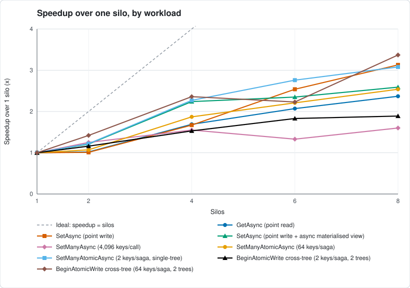
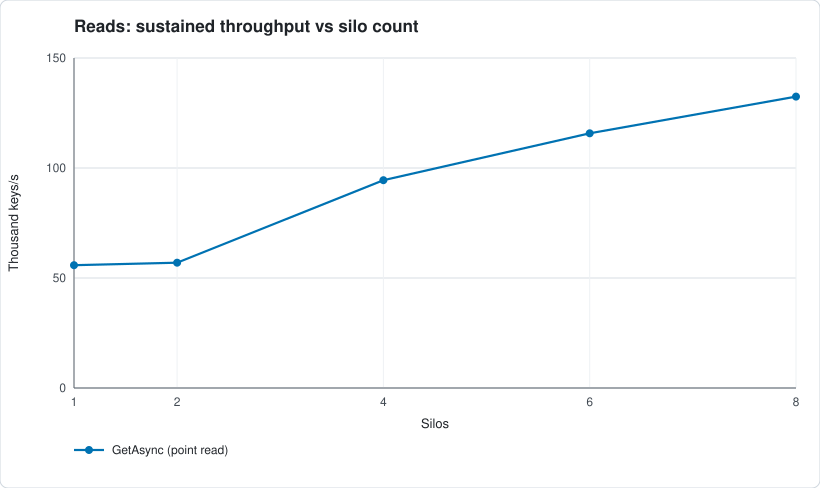
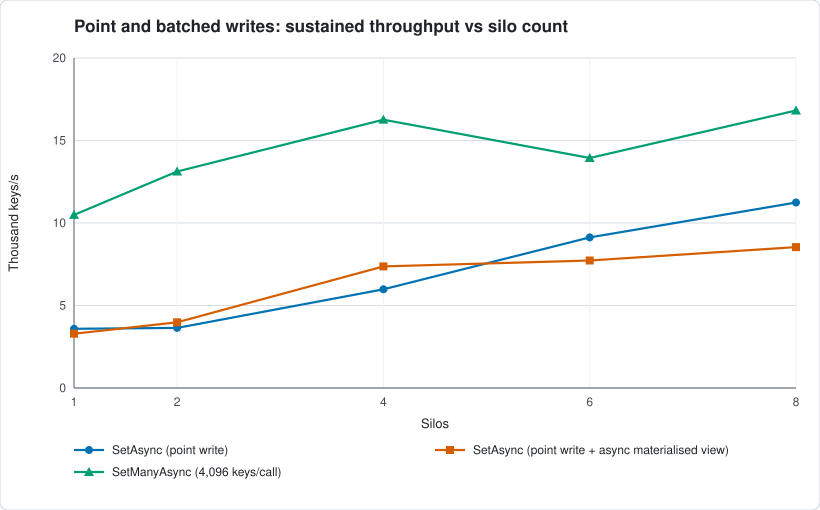
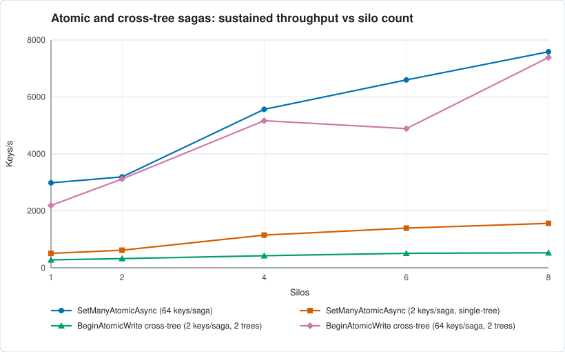

# Performance: multi-silo scaling

> [!IMPORTANT]
> **Scope: one tree, one storage account.** Every figure here comes from a cluster serving a **single tree** (two for the cross-tree rows), with its write-ahead log (WAL) and grain state on **one Azure Storage account**.
>
> - **Trees.** Some of a tree's resources have a fixed count that does not grow with the cluster: its WAL partitions ([`WalPartitions`](configuration.md#walpartitions), default 8; 16 in this sweep), its shards (64 here), and its transaction registry ([`TxRegistryShardCount`](configuration.md#txregistryshardcount), default 1; 8 here). An estate serving many trees spreads more of them across its silos, so its aggregate write and saga throughput can scale further than one tree's. Multi-tree scaling has not been measured.
> - **Storage accounts.** One account is a test constraint, not a library limit. Lattice can spread a tree's WAL partitions across several accounts; see [Multi-account fan-out](wal-storage-providers.md#multi-account-fan-out-named-providers-and-pinned-placement). [What the storage account reported](#what-the-storage-account-reported) shows what the one account did in each cell.

This page shows what adding silos buys: the same workloads as the
[single-silo](performance-single-silo.md) Layer 2 table, run on clusters of 1,
2, 4, 6 and 8 silos on Azure Container Apps. Each cell is offered more load
than the cluster can complete, so every figure is the cluster's limit at that
size. Each cell is the median of up to three 45-second runs, called cohorts;
[how Layer 3 is measured](performance-methodology-layer3.md) explains the rig,
the method and what bounds the results.

These results come from a later commit (`b544209cf`) than the
[single-silo](performance-single-silo.md) page (`376a3eae7`). In between,
[#5102](https://github.com/NSTA1/Orleans.Lattice/pull/5102) stopped the WAL
clean-up sweep re-reading every leaf's stored state once per partition
([#5097](https://github.com/NSTA1/Orleans.Lattice/issues/5097)),
[#5103](https://github.com/NSTA1/Orleans.Lattice/pull/5103) stopped leaves
calling grain types that a stopping cluster has withdrawn
([#5100](https://github.com/NSTA1/Orleans.Lattice/issues/5100)), and three
other performance changes landed
([#5093](https://github.com/NSTA1/Orleans.Lattice/pull/5093),
[#5089](https://github.com/NSTA1/Orleans.Lattice/pull/5089) and
[#5082](https://github.com/NSTA1/Orleans.Lattice/pull/5082)). Compare the two
pages only approximately.

Read the shape of each curve rather than its absolute level. The rig holds
everything but the silo count constant (one storage account, a fixed shard
count, a client with bounded concurrency), which also caps the absolute
figures; a deployment tuned for throughput can beat them.

## The short version

| Workload | Shape from 1 to 8 silos | What the evidence says bounds it |
|----------|-------------------------|----------------------------------|
| `GetAsync` (point read) | ~60.9 k keys/s at one and two silos, then rising to ~143.8 k at eight (2.36x) | From two silos on, time spent outside the grain call: the silo-side call time holds at ~3-4 ms while the client's calls take longer |
| `GetManyAsync` (batched read) | ~341 k keys/s at one silo, ~265 k at two, ~329 k at four and ~442-445 k at six and eight (1.3x) | A per-call time that grows almost as fast as the calls in flight, over a keyspace that grows with the cluster (128 k keys at one silo, 1.02 M at eight) |
| `SetAsync`, with or without a view | ~3.3 k keys/s at one silo; ~11.5 k at eight without a view (3.49x) and ~7.3 k with one (2.19x) | Not isolated; the storage account shows no throttling and flat server latency. The view costs 6-36% of the write rate from two silos up |
| `SetManyAsync` (batched write) | ~12.6 k keys/s at one silo, ~11-14 k from two to six, ~21.6 k at eight (1.71x) | Not isolated; each call takes longer as calls in flight grow, with no throttling and no timed-out storage transactions |
| 64-key atomic sagas (single-tree and cross-tree) | ~37-47 sagas/s at one silo, ~89-112 at eight (2.4x) | Not isolated; each saga takes longer as silos are added, under the client's bounded concurrency |
| 2-key atomic sagas (single-tree and cross-tree) | ~241 and ~157 sagas/s at one silo, ~774 and ~502 at eight (3.2x both) | Single-tree: the saga registry's admission budget, reached at eight silos. Cross-tree: not isolated; the account's server latency rises from ~4.6 ms to ~10.4 ms |

No workload scales linearly. At two silos `GetManyAsync`, `SetManyAsync` and
the 64-key single-tree saga fall below their one-silo figure, and recover at
larger clusters.

## The scaling curves

<!-- perf-chart:layer3:start
  schema=v1
  DO-NOT-HAND-EDIT-BETWEEN-MARKERS
-->

<!-- perf-chart:layer3:end -->

## The grid

How it is measured: [Layer 3 methodology](performance-methodology-layer3.md).

**Offered** is the load the cell was driven at, deliberately above what it
completed. **Speedup** is throughput over the same workload's one-silo
throughput, and **per-silo efficiency** is speedup divided by the silo count;
perfect scaling is a speedup equal to the silo count at 100%. Latency is the
time a call spends inside the silos, excluding the client's network hop; for
the atomic rows it is the saga's broadcast phase, not its whole commit. Every
cohort that completed work is kept, failures included: the last column gives
the failed keys of each cohort the cell used. Every cohort that lost keys also
recorded timed-out storage transactions ([What the storage account reported](#what-the-storage-account-reported)).

<!-- perf-table:layer3:start
  schema=v1
  batchSize=4096
  carryVehiclesPerSilo=get-many=128000,get-point=16000
  cohortN=2/3
  dotnet=10.0.x
  gitSha=b544209cf
  host=Azure Container Apps (Consumption)
  maxRungEscalations=3
  region=westus3
  responseTimeoutSec=420
  rigs=fl31,fl32,fl33,fl34,fl35,fl36,fl37,fl38,fl39
  rowsMeasured=2026-10-27
  rungPerSilo=get-point=8000 veh/silo @ 5 Hz / 45s, flushConcurrency 16/silo; get-many=16000 veh/silo @ 5 Hz / 45s, flushConcurrency 8/silo; set-point=1200 veh/silo @ 5 Hz / 45s, flushConcurrency 64/silo; set-point-mv=1200 veh/silo @ 5 Hz / 45s, flushConcurrency 64/silo; set-many=2400 veh/silo @ 5 Hz / 45s, flushConcurrency 8/silo; set-many-atomic=800 veh/silo @ 5 Hz / 45s, flushConcurrency 64/silo; set-many-atomic-2=200 veh/silo @ 5 Hz / 45s, flushConcurrency 64/silo; cross-tree-atomic-2=100 veh/silo @ 5 Hz / 45s, flushConcurrency 64/silo; cross-tree-atomic-64=800 veh/silo @ 5 Hz / 45s, flushConcurrency 64/silo
  saturationRatio=0.9
  shardCount=64
  siloCounts=1,2,4,6,8
  siloSize=4 vCPU / 8 GiB
  walAccounts=1
  walMaxPendingBatches=16
  walPartitions=16
  methodology=Each cell is the median across N HEALTHY cohorts of completed-work throughput: total successfully-completed keys at FINAL divided by the engine's active elapsed time. Layer 3 deliberately does NOT use a per-second steady-state mean. On this path the client submits 4096-key batches, so a whole batch retires inside one per-second sample and the samples between retirements are exactly zero; a mean that filters the zeros away (the historical rate>0 form) averages only the spikes and reports more throughput than was offered (measured: 9,637 keys/s reported against 5,935 keys/s actually offered). The overstatement also varies with burstiness, which varies with silo count, so it would bend the scaling curve itself. Completed-ops / active-elapsed counts only work that succeeded over the wall-clock it took, so it cannot exceed the offered load and carries no windowing bias. Per-call p50/p99 merge the [phaseA] duration windows of every silo at t>=15s, weighted by call count; the silos' clocks cannot be aligned to the producer's steady-state window, so unlike Layer 2 no window is excluded as outside it. Every cell is a true-throughput measurement, not an offered-load one: offered load is scaled with the silo count (a per-silo rung driven at rung x silo count, so per-silo demand never falls as the cluster grows), and a cell whose first cohort completes at least saturationRatio of what was offered is re-run at double the rung, up to maxRungEscalations times, so the published figure is where the cluster stopped keeping up rather than what the client asked for. A cell still offer-bound after the last escalation is published as a lower bound (>=). Speedup and per-silo efficiency are derived against the measured 1-silo cell. Every cohort starts on empty storage: with the silos parked, the harness deletes every table in the storage account except the clustering table and points the silos at a freshly named WAL table and grain-state table, so no cohort inherits trees, registry rows, or WAL backlog from an earlier one. All silo counts share ONE Azure Storage account for the WAL; the storage-side table reports what that account's own Azure Monitor metrics showed for each cell.
  DO-NOT-HAND-EDIT-BETWEEN-MARKERS
-->

| Operation | Silos | Offered | Sustained throughput | Speedup vs 1 silo | Per-silo efficiency | Per-call p50 | Per-call p99 | Failed keys per cohort |
|-----------|------:|--------:|---------------------:|------------------:|--------------------:|-------------:|-------------:|-----------------------:|
| `GetAsync` (point read) | 1 | ~80 k keys/s | **~60.9 k keys/s** | 1x | 100% | ~30 us | ~2.67 ms | 0 / 0 / 0 |
| `GetAsync` (point read) | 2 | ~160 k keys/s | **~60.8 k keys/s** | 1x | 50% | ~4.32 ms | ~22.58 ms | 0 / 0 / 0 |
| `GetAsync` (point read) | 4 | ~320 k keys/s | **~107.3 k keys/s** | 1.76x | 44% | ~3.18 ms | ~23.28 ms | 0 / 0 / 0 |
| `GetAsync` (point read) | 6 | ~480 k keys/s | **~131 k keys/s** | 2.15x | 36% | ~2.81 ms | ~15.54 ms | 0 / 0 / 0 |
| `GetAsync` (point read) | 8 | ~640 k keys/s | **~143.8 k keys/s** | 2.36x | 30% | ~2.88 ms | ~19.62 ms | 0 / 0 / 0 |
| `GetManyAsync` (4,096 keys/call) | 1 | ~640 k keys/s | **~341.2 k keys/s** | 1x | 100% | ~47.61 ms | ~153.88 ms | 0 / 0 / 0 |
| `GetManyAsync` (4,096 keys/call) | 2 | ~1.28 M keys/s | **~264.9 k keys/s** | 0.78x | 39% | ~210.8 ms | ~402.36 ms | 0 / 0 / 0 |
| `GetManyAsync` (4,096 keys/call) | 4 | ~2.56 M keys/s | **~329 k keys/s** | 0.96x | 24% | ~355.04 ms | ~648.29 ms | 0 / 0 / 0 |
| `GetManyAsync` (4,096 keys/call) | 6 | ~3.84 M keys/s | **~444.7 k keys/s** | 1.3x | 22% | ~381.68 ms | ~825.26 ms | 0 / 0 / 0 |
| `GetManyAsync` (4,096 keys/call) | 8 | ~5.12 M keys/s | **~442.1 k keys/s** | 1.3x | 16% | ~525.28 ms | ~1025.88 ms | 0 / 0 / 0 |
| `SetAsync` (point write) | 1 | ~6 k keys/s | **~3.3 k keys/s** | 1x | 100% | ~60 ms | ~450.33 ms | 21 / 46 / 0 |
| `SetAsync` (point write) | 2 | ~12 k keys/s | **~3.9 k keys/s** | 1.18x | 59% | ~85.55 ms | ~427.66 ms | 0 / 0 / 0 |
| `SetAsync` (point write) | 4 | ~24 k keys/s | **~7 k keys/s** | 2.13x | 53% | ~88.59 ms | ~582.55 ms | 0 / 0 / 0 |
| `SetAsync` (point write) | 6 | ~36 k keys/s | **~7.4 k keys/s** | 2.25x | 38% | ~89.31 ms | ~1129.33 ms | 0 / 0 / 0 |
| `SetAsync` (point write) | 8 | ~48 k keys/s | **~11.5 k keys/s** | 3.49x | 44% | ~91.32 ms | ~1708.96 ms | 0 / 0 / 0 |
| `SetAsync` (point write + async materialised view) | 1 | ~6 k keys/s | **~3.3 k keys/s** | 1x | 100% | ~66.56 ms | ~205.06 ms | 0 / 0 / 0 |
| `SetAsync` (point write + async materialised view) | 2 | ~12 k keys/s | **~3.6 k keys/s** | 1.1x | 55% | ~96.46 ms | ~397.88 ms | 0 / 0 / 0 |
| `SetAsync` (point write + async materialised view) | 4 | ~24 k keys/s | **~5.8 k keys/s** | 1.74x | 44% | ~85.22 ms | ~633.2 ms | 0 / 245 / 0 |
| `SetAsync` (point write + async materialised view) | 6 | ~36 k keys/s | **~6.7 k keys/s** | 2.01x | 33% | ~90.26 ms | ~1125.12 ms | 0 / 0 / 0 |
| `SetAsync` (point write + async materialised view) | 8 | ~48 k keys/s | **~7.3 k keys/s** | 2.19x | 27% | ~87.99 ms | ~1162.87 ms | 0 / 0 / 445 |
| `SetManyAsync` (4,096 keys/call) | 1 | ~24 k keys/s | **~12.6 k keys/s** | 1x | 100% | ~2364.01 ms | ~4271.77 ms | 0 / 0 / 0 |
| `SetManyAsync` (4,096 keys/call) | 2 | ~48 k keys/s | **~11.4 k keys/s** | 0.9x | 45% | ~5211.97 ms | ~9111.5 ms | 0 / 0 / 0 |
| `SetManyAsync` (4,096 keys/call) | 4 | ~96 k keys/s | **~14.4 k keys/s** | 1.14x | 28% | ~8438.62 ms | ~26297.09 ms | 0 / 0 / 0 |
| `SetManyAsync` (4,096 keys/call) | 6 | ~144 k keys/s | **~13.9 k keys/s** | 1.1x | 18% | ~11885.34 ms | ~26722.34 ms | 0 / 0 / 0 |
| `SetManyAsync` (4,096 keys/call) | 8 | ~192 k keys/s | **~21.6 k keys/s** | 1.71x | 21% | ~10935.68 ms | ~24917.26 ms | 0 / 0 |
| `SetManyAtomicAsync` (64 keys/saga) | 1 | ~4 k keys/s | **~3 k keys/s** | 1x | 100% | ~520.62 ms | ~1133.26 ms | 320 / 0 / 0 |
| `SetManyAtomicAsync` (64 keys/saga) | 2 | ~8 k keys/s | **~2.7 k keys/s** | 0.9x | 45% | ~1034.56 ms | ~1932.84 ms | 3,520 / 0 / 0 |
| `SetManyAtomicAsync` (64 keys/saga) | 4 | ~16 k keys/s | **~4.9 k keys/s** | 1.64x | 41% | ~1163.89 ms | ~1993.77 ms | 0 / 0 / 0 |
| `SetManyAtomicAsync` (64 keys/saga) | 6 | ~24 k keys/s | **~4.7 k keys/s** | 1.55x | 26% | ~1978.14 ms | ~3455.07 ms | 0 / 0 / 0 |
| `SetManyAtomicAsync` (64 keys/saga) | 8 | ~32 k keys/s | **~7.2 k keys/s** | 2.39x | 30% | ~1698.22 ms | ~2581.38 ms | 0 / 0 / 0 |
| `SetManyAtomicAsync` (2 keys/saga, single-tree) | 1 | ~1 k keys/s | **481 keys/s** | 1x | 100% | ~50.18 ms | ~239.83 ms | 12 / 2 / 0 |
| `SetManyAtomicAsync` (2 keys/saga, single-tree) | 2 | ~2 k keys/s | **691 keys/s** | 1.44x | 72% | ~70.48 ms | ~190.53 ms | 0 / 0 / 0 |
| `SetManyAtomicAsync` (2 keys/saga, single-tree) | 4 | ~4 k keys/s | **735 keys/s** | 1.53x | 38% | ~94.43 ms | ~360.28 ms | 0 / 0 / 0 |
| `SetManyAtomicAsync` (2 keys/saga, single-tree) | 6 | ~6 k keys/s | **~1.4 k keys/s** | 2.94x | 49% | ~86.89 ms | ~231 ms | 0 / 0 / 0 |
| `SetManyAtomicAsync` (2 keys/saga, single-tree) | 8 | ~8 k keys/s | **~1.5 k keys/s** | 3.22x | 40% | ~87.02 ms | ~598.8 ms | 0 / 0 / 0 |
| `BeginAtomicWrite` cross-tree (2 keys/saga, 2 trees) | 1 | 500 keys/s | **314 keys/s** | 1x | 100% | ~27.01 ms | ~163.99 ms | 0 / 0 / 0 |
| `BeginAtomicWrite` cross-tree (2 keys/saga, 2 trees) | 2 | ~1 k keys/s | **388 keys/s** | 1.24x | 62% | ~47.78 ms | ~471.29 ms | 0 / 0 / 0 |
| `BeginAtomicWrite` cross-tree (2 keys/saga, 2 trees) | 4 | ~2 k keys/s | **646 keys/s** | 2.06x | 51% | ~48.89 ms | ~561.87 ms | 0 / 0 / 78 |
| `BeginAtomicWrite` cross-tree (2 keys/saga, 2 trees) | 6 | ~3 k keys/s | **817 keys/s** | 2.6x | 43% | ~44.57 ms | ~1233.82 ms | 0 / 0 / 0 |
| `BeginAtomicWrite` cross-tree (2 keys/saga, 2 trees) | 8 | ~4 k keys/s | **~1 k keys/s** | 3.19x | 40% | ~43.52 ms | ~1200.46 ms | 0 / 0 / 0 |
| `BeginAtomicWrite` cross-tree (64 keys/saga, 2 trees) | 1 | ~4 k keys/s | **~2.3 k keys/s** | 1x | 100% | ~423.51 ms | ~1529.71 ms | 1,024 / 0 / 1,152 |
| `BeginAtomicWrite` cross-tree (64 keys/saga, 2 trees) | 2 | ~8 k keys/s | **~2.6 k keys/s** | 1.13x | 56% | ~156.47 ms | ~2266.73 ms | 0 / 0 / 0 |
| `BeginAtomicWrite` cross-tree (64 keys/saga, 2 trees) | 4 | ~16 k keys/s | **~4.5 k keys/s** | 1.91x | 48% | ~163.65 ms | ~3297.63 ms | 0 / 0 / 0 |
| `BeginAtomicWrite` cross-tree (64 keys/saga, 2 trees) | 6 | ~24 k keys/s | **~5.6 k keys/s** | 2.39x | 40% | ~171.4 ms | ~1922.03 ms | 15,872 / 0 / 0 |
| `BeginAtomicWrite` cross-tree (64 keys/saga, 2 trees) | 8 | ~32 k keys/s | **~5.7 k keys/s** | 2.43x | 30% | ~1997.66 ms | ~4851.27 ms | 14,784 / 19,072 / 0 |

<!-- perf-table:layer3:end -->

> Measured 2026-10-27 on Azure Container Apps (Consumption) in westus3 (.NET 10.0.x) at git sha b544209cf, n=2/3 cohorts per cell, silo counts 1,2,4,6,8. Offered load scales with the silo count and is raised until each cell plateaus below it, so every figure is true throughput rather than offered load; every cohort starts on freshly emptied storage. All silo counts share one Azure Storage account for the WAL - see the storage-side table for what its metrics showed.

## What the storage account reported

How these columns are defined: [Layer 3 methodology](performance-methodology-layer3.md#how-to-read-the-grid).

A curve that stops climbing can be Lattice running out of headroom or the
storage account running out. Each run records what its account reported to
Azure Monitor: the transactions that **timed out** (`ServerTimeoutError` or
`ClientTimeoutError`) and their share of all transactions, the **storage
transactions** per second in the busiest minute (all accounts together), and
the **server** and **end-to-end** latency, whose gap is time spent on the
network and in client-side queueing. Whether any transaction was throttled is stated under
the table. The account also holds the cluster's grain state and membership
table, so its transactions are not only WAL writes.

<!-- perf-storage:layer3:start
  schema=v1
  DO-NOT-HAND-EDIT-BETWEEN-MARKERS
-->

| Operation | Silos | WAL accounts | Timed-out transactions | Storage transactions | Server latency | End-to-end latency |
|-----------|------:|-------------:|-----------------------:|---------------------:|---------------:|-------------------:|
| `GetAsync` (point read) | 1 | 1 | 0 | 166 tx/s | 5.9 ms | 7.8 ms |
| `GetAsync` (point read) | 2 | 1 | 0 | 298 tx/s | 6.4 ms | 8.2 ms |
| `GetAsync` (point read) | 4 | 1 | 0 | 668 tx/s | 5.4 ms | 7.0 ms |
| `GetAsync` (point read) | 6 | 1 | 0 | 1,139 tx/s | 6.2 ms | 7.6 ms |
| `GetAsync` (point read) | 8 | 1 | 0 | 1,382 tx/s | 6.0 ms | 7.9 ms |
| `GetManyAsync` (4,096 keys/call) | 1 | 1 | 0 | 1,227 tx/s | 4.1 ms | 5.3 ms |
| `GetManyAsync` (4,096 keys/call) | 2 | 1 | 0 | 2,599 tx/s | 4.5 ms | 5.3 ms |
| `GetManyAsync` (4,096 keys/call) | 4 | 1 | 0 | 3,471 tx/s | 4.6 ms | 6.0 ms |
| `GetManyAsync` (4,096 keys/call) | 6 | 1 | 0 | 3,544 tx/s | 4.1 ms | 5.4 ms |
| `GetManyAsync` (4,096 keys/call) | 8 | 1 | 0 | 3,769 tx/s | 4.2 ms | 5.4 ms |
| `SetAsync` (point write) | 1 | 1 | 4 (<0.01%) | 2,022 tx/s | 6.6 ms | 7.7 ms |
| `SetAsync` (point write) | 2 | 1 | 0 | 2,818 tx/s | 6.2 ms | 7.3 ms |
| `SetAsync` (point write) | 4 | 1 | 0 | 2,919 tx/s | 6.4 ms | 8.9 ms |
| `SetAsync` (point write) | 6 | 1 | 0 | 3,372 tx/s | 6.4 ms | 9.0 ms |
| `SetAsync` (point write) | 8 | 1 | 3 (<0.01%) | 8,388 tx/s | 6.2 ms | 7.3 ms |
| `SetAsync` (point write + async materialised view) | 1 | 1 | 0 | 2,542 tx/s | 7.6 ms | 8.3 ms |
| `SetAsync` (point write + async materialised view) | 2 | 1 | 0 | 2,658 tx/s | 7.5 ms | 9.0 ms |
| `SetAsync` (point write + async materialised view) | 4 | 1 | 0 | 3,026 tx/s | 8.4 ms | 10.5 ms |
| `SetAsync` (point write + async materialised view) | 6 | 1 | 0 | 3,282 tx/s | 9.2 ms | 12.2 ms |
| `SetAsync` (point write + async materialised view) | 8 | 1 | 18 (<0.01%) | 7,710 tx/s | 8.1 ms | 9.5 ms |
| `SetManyAsync` (4,096 keys/call) | 1 | 1 | 0 | 1,210 tx/s | 10.3 ms | 12.0 ms |
| `SetManyAsync` (4,096 keys/call) | 2 | 1 | 0 | 1,946 tx/s | 9.4 ms | 10.5 ms |
| `SetManyAsync` (4,096 keys/call) | 4 | 1 | 0 | 2,612 tx/s | 8.2 ms | 9.3 ms |
| `SetManyAsync` (4,096 keys/call) | 6 | 1 | 0 | 2,891 tx/s | 8.9 ms | 10.1 ms |
| `SetManyAsync` (4,096 keys/call) | 8 | 1 | 0 | 3,547 tx/s | 9.3 ms | 10.1 ms |
| `SetManyAtomicAsync` (64 keys/saga) | 1 | 1 | 0 | 1,349 tx/s | 5.5 ms | 7.1 ms |
| `SetManyAtomicAsync` (64 keys/saga) | 2 | 1 | 0 | 1,733 tx/s | 6.1 ms | 7.7 ms |
| `SetManyAtomicAsync` (64 keys/saga) | 4 | 1 | 0 | 2,004 tx/s | 5.8 ms | 7.7 ms |
| `SetManyAtomicAsync` (64 keys/saga) | 6 | 1 | 0 | 1,955 tx/s | 6.4 ms | 7.8 ms |
| `SetManyAtomicAsync` (64 keys/saga) | 8 | 1 | 0 | 2,056 tx/s | 6.9 ms | 8.6 ms |
| `SetManyAtomicAsync` (2 keys/saga, single-tree) | 1 | 1 | 2 (<0.01%) | 2,435 tx/s | 4.5 ms | 4.8 ms |
| `SetManyAtomicAsync` (2 keys/saga, single-tree) | 2 | 1 | 0 | 2,444 tx/s | 4.2 ms | 4.6 ms |
| `SetManyAtomicAsync` (2 keys/saga, single-tree) | 4 | 1 | 0 | 2,954 tx/s | 4.7 ms | 5.3 ms |
| `SetManyAtomicAsync` (2 keys/saga, single-tree) | 6 | 1 | 0 | 5,260 tx/s | 6.0 ms | 6.4 ms |
| `SetManyAtomicAsync` (2 keys/saga, single-tree) | 8 | 1 | 0 | 6,093 tx/s | 6.0 ms | 6.6 ms |
| `BeginAtomicWrite` cross-tree (2 keys/saga, 2 trees) | 1 | 1 | 1 (<0.01%) | 3,404 tx/s | 4.6 ms | 4.7 ms |
| `BeginAtomicWrite` cross-tree (2 keys/saga, 2 trees) | 2 | 1 | 1 (<0.01%) | 3,328 tx/s | 5.1 ms | 5.3 ms |
| `BeginAtomicWrite` cross-tree (2 keys/saga, 2 trees) | 4 | 1 | 2 (<0.01%) | 5,531 tx/s | 6.3 ms | 6.7 ms |
| `BeginAtomicWrite` cross-tree (2 keys/saga, 2 trees) | 6 | 1 | 0 | 7,307 tx/s | 8.9 ms | 9.2 ms |
| `BeginAtomicWrite` cross-tree (2 keys/saga, 2 trees) | 8 | 1 | 0 | 8,364 tx/s | 10.4 ms | 10.8 ms |
| `BeginAtomicWrite` cross-tree (64 keys/saga, 2 trees) | 1 | 1 | 9 (<0.01%) | 2,437 tx/s | 6.3 ms | 7.6 ms |
| `BeginAtomicWrite` cross-tree (64 keys/saga, 2 trees) | 2 | 1 | 0 | 3,926 tx/s | 4.3 ms | 5.4 ms |
| `BeginAtomicWrite` cross-tree (64 keys/saga, 2 trees) | 4 | 1 | 0 | 4,915 tx/s | 5.2 ms | 6.6 ms |
| `BeginAtomicWrite` cross-tree (64 keys/saga, 2 trees) | 6 | 1 | 4 (<0.01%) | 4,174 tx/s | 5.4 ms | 6.9 ms |
| `BeginAtomicWrite` cross-tree (64 keys/saga, 2 trees) | 8 | 1 | 5 (<0.01%) | 4,480 tx/s | 5.9 ms | 7.3 ms |

Azure Monitor recorded no throttled transactions (`ServerBusy` or `ClientThrottling`) in any cohort of any cell.

<!-- perf-storage:layer3:end -->

Timed-out transactions are rare (at most 0.01% of a cell's transactions), and
every cohort that lost keys recorded some. The reverse does not hold: 14 of the
135 cohorts, mostly sagas, recorded timeouts (1 to 206) and lost nothing. One
timed-out transaction can cost many keys, because the grid counts every key of
a call that failed: a failed `SetManyAsync` call counts all 4,096 of its keys.

In every read cell both runs measured, the busiest storage minute is lower than
the previous run's at `376a3eae7`: 44-84% of it (for example ~3.5 k against
~6.7 k transactions/s for `GetManyAsync` at four silos). That fits
[#5102](https://github.com/NSTA1/Orleans.Lattice/pull/5102) removing the WAL
clean-up sweep's repeated leaf-state reads, but the difference is not isolated,
and `GetManyAsync` now reads a differently built tree (see its section).

## Workload by workload

### `GetAsync`: scales from two silos, on client round-trip time

Point reads deliver ~60.9 k keys/s at one silo, ~60.8 k at two, and then
~107.3 k, ~131 k and ~143.8 k at four, six and eight: 2.36x at eight silos, or
2.37x for the fourfold step from two to eight. Every cohort reports zero
failures.

The client is closed-loop at 256 calls in flight per silo. Dividing the calls
in flight by the throughput gives the mean time a read takes as the client sees
it: about 4.2 ms at one silo, 8.4 ms at two and 14.2 ms at eight. The silo-side
time is far smaller: a p50 of ~30 us at one silo, where the whole read is
in-process, and ~2.8-4.3 ms from two to eight, where the shard root usually
lives on another host. So from two silos on, the growth is not inside the grain
call; it is in the client-to-gateway hop, the messaging layer and the queueing
in front of them. Shard-root point reads are interleavable
([#3474](https://github.com/NSTA1/Orleans.Lattice/issues/3474)), so the fixed
pool of 64 shard roots is not a serialisation point for them.

### `GetManyAsync`: little gain over one silo

Batched reads deliver ~341 k keys/s at one silo, ~265 k at two, ~329 k at four,
~445 k at six and ~442 k at eight, with zero failures. Each call reads a
4,096-key batch whose keys land on shards on every host, and the client holds
eight calls in flight per silo. The silo-side median call time is ~48 ms at one
silo, ~211 ms at two, ~355 ms at four, ~382 ms at six and ~525 ms at eight: it
grows almost as fast as the calls in flight, so throughput barely moves. A batch
completes only when its slowest shard answers, and each added host puts more of
its shards across the network; the cause is not isolated further.

**The read keyspace grows with the cell.** The harness seeds as many keys as the
producer has vehicles, and the vehicle count also sets the offered load. Each
cell runs at 128,000 vehicles per silo, so the keyspace grows with the cluster:
128 k keys at one silo and 1.02 M at eight. This curve therefore varies the silo
count and the keyspace size together.

**The keyspace is bulk-loaded.** Every cohort starts from an empty tree, and
the harness now seeds it with Lattice's resumable bulk load, which packs every
leaf to capacity. The previous run seeded with batched writes, which could not
seed the six- and eight-silo keyspaces
([#5095](https://github.com/NSTA1/Orleans.Lattice/issues/5095)) and left leaves
part-filled, so this curve is not directly comparable with that run's.

### `SetAsync` and `SetAsync` with a materialised view

Point writes deliver ~3.3 k keys/s at one silo, ~3.9 k at two, ~7 k at four,
~7.4 k at six and ~11.5 k at eight: 3.49x at eight silos. The median time a
write spends inside the silo rises from ~60 ms at one silo to 86-91 ms from two
to eight, so the gain comes from more writes in flight across more hosts rather
than from faster writes. Only two one-silo cohorts lost keys (21 and 46).

The storage account shows no sign of being the limit: its busiest minute climbs
from ~2 k to ~8.4 k transactions/s at eight silos with no throttling and server
latency flat at 6.2-6.6 ms. The pace-setter is not isolated further. Ten
cohorts at four to eight silos, with and without the view, ended with ~160-715 k
offered writes still queued, which is the offered load running far ahead of the
cluster; they count only the writes they completed.

The materialised-view variant matches plain `SetAsync` at one silo (~3.3 k) and
falls behind from two silos up: 6-17% below it at two to six silos (~3.6 k,
~5.8 k and ~6.7 k) and 36% below at eight (~7.3 k against ~11.5 k, 2.19x). Its
server latency is also higher, 7.5-9.2 ms against 6.2-6.6 ms, and it lost up
to 445 keys in a cohort. Maintaining the view costs write throughput at every
cluster size above one silo, most at eight.

### `SetManyAsync`: gains only at eight silos

Batched writes deliver ~12.6 k keys/s at one silo, ~11.4 k at two, ~14.4 k at
four, ~13.9 k at six and ~21.6 k at eight (1.71x). The median call takes ~2.4 s
at one silo, ~5.2 s at two and 8.4-11.9 s from four silos on, so extra silos
mostly add calls in flight without completing more of them.

What limits it is not isolated. The storage account's busiest minute rises from
~1.2 k to ~3.5 k transactions/s while the offered load grows eightfold, its
server latency stays at 8-10 ms, and it recorded neither throttling nor a
single timed-out transaction. No cohort the grid kept lost a key; the previous
run lost up to ~191 k keys per cohort to storage timeouts. The eight-silo cell
rests on two cohorts: the third stopped completing work for 263 s with calls in
flight, gave up 262,144 keys to WAL back-pressure, and was excluded. The next
experiment is the multi-account WAL fan-out (`-Layer3WalAccounts`), which this
sweep held out so that the silo count stayed the only variable.

### Atomic and cross-tree sagas: per-saga latency

The four atomic workloads read most clearly in sagas per second:

| Workload | Keys per saga | Sagas/s at 1 / 2 / 4 / 6 / 8 silos |
|----------|--------------:|:-----------------------------------|
| `SetManyAtomicAsync` | 64 | 47 / 42 / 77 / 73 / 112 |
| `SetManyAtomicAsync` | 2 | 241 / 346 / 368 / 707 / 774 |
| `BeginAtomicWrite` cross-tree | 64 | 37 / 41 / 70 / 88 / 89 |
| `BeginAtomicWrite` cross-tree | 2 | 157 / 194 / 323 / 409 / 502 |

All four rise with the silo count: at eight silos the single-tree sagas reach
2.39x (64 keys) and 3.22x (2 keys), the 64-key cross-tree saga 2.43x and the
2-key cross-tree saga 3.19x. The cost is mostly per saga rather than per key: a
2-key saga runs five to seven times as many sagas per second as a 64-key one,
not thirty-two times. Spanning two trees costs a 64-key saga about a fifth of
its rate and a 2-key saga about a third, at one silo and at eight alike.

**The saga registry's admission budget is reached at eight silos.** Each
completed saga leaves a tombstone in its tree's transaction registry for
`TxDecisionRetention`, and `LatticeOptions.TxRegistryAdmissionBudgetBytes`
refuses new sagas with `LatticeSaturatedException` (source
`TxRegistryCapacity`) once a registry shard's row reaches the budget. The sweep
runs eight registry shards (`LatticeOptions.TxRegistryShardCount`, default 1),
which the option documents as about 800 sagas/s per tree. The 2-key
single-tree saga reached that at eight silos (~774 sagas/s): two of its three
eight-silo cohorts were refused admission repeatedly (`satRetries` 1,840 and
2,034), and every refused saga succeeded on retry. No other atomic cohort was
refused. A tree that needs more sagas per second can raise the shard count;
refusals show up in a run's final report as `satRetries`, and those that ran
out of retries as `satExhausted`.

Below that budget, what sets the rate is how long each saga takes: the client
keeps 64 sagas in flight per silo and no cell was producer-bound, so each
saga's end-to-end time grows with the silo count. For the 2-key cross-tree saga
the storage account's server latency rises from ~4.6 ms at one silo to
~10.4 ms at eight, against ~4.2-6 ms for the 2-key single-tree saga. In the
previous run, at `376a3eae7`, the same rise was ~7 ms to ~28 ms and the saga
reached ~263 sagas/s at eight silos
([#3591](https://github.com/NSTA1/Orleans.Lattice/issues/3591)); the smaller
rise here fits #5102 removing reads that competed for the account, but it is
not isolated. The 64-key sagas carry a 64-key WAL write on top of that chain;
their failed keys (up to ~19 k in one cross-tree cohort at eight silos, where
the median broadcast takes ~2 s against ~0.17 s at six) came with timed-out
storage transactions in the same cohorts.
