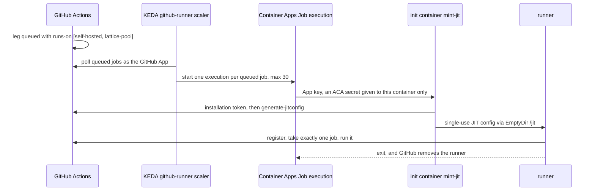

# CI runner pool (self-hosted, elastic overflow)

An elastic pool of single-use GitHub Actions runners on Azure Container Apps Jobs. It
absorbs the matrix legs GitHub-hosted runners have no room for. The account's hosted
runners share one 20-job concurrency cap; when this repository's hosted jobs (running
plus queued) reach a budget of 18, further legs run here instead of queueing.
Self-hosted jobs do not count against the cap.

It scales from zero: with nothing queued for it there are no replicas and no compute bill.

## Routing: hosted first, the pool on overflow

Every matrix lane routes its legs at plan time with
[`.github/workflows/runner-overflow.py`](../../.github/workflows/runner-overflow.py):
`ci.yml` (pull requests and pushes), the nightly `coverage.yml` (coverage and TLC legs)
and `formal-receipts.yml` (TLC legs).

- The planner counts this repository's hosted jobs that are running or queued (a queued
  hosted job is waiting behind the cap, so a new hosted leg would wait behind it).
- Legs stay on `ubuntu-latest` while that count is under `HOSTED_RUNNER_BUDGET`
  (default 18, two short of the cap so lanes planning at the same moment do not tip into
  a queue). The rest go to the pool, longest first, since a long leg holds a slot longest.
- A pool leg's check name starts with `[pool] `. It skips the Azurite service container
  (Container Apps runs no Docker) and starts the Azurite baked into the image instead.
- It fails toward hosted: with `RUNNER_POOL` unset, or if the API cannot be read, every
  leg stays hosted.

Repository variables:

| Variable | Value | Effect |
|---|---|---|
| `RUNNER_POOL` | `["self-hosted","lattice-pool"]` | The pool's labels. Unset turns overflow off. |
| `HOSTED_RUNNER_BUDGET` | `18` (default when unset) | Hosted jobs in flight before legs overflow. |

The count covers this repository only; the cap is account-wide, so jobs in other
repositories of the account are invisible to it.

## How a runner starts



A runner whose job never arrives (cancelled while queued, or taken by another runner)
exits after `RUNNER_IDLE_TIMEOUT_SEC` (10 minutes) rather than holding a node until the
Job's replica timeout.

| Resource | Purpose |
|---|---|
| `rg-<prefix>` | Everything below. |
| `vnet-<prefix>` / `aca-infra` | Subnet delegated to `Microsoft.App/environments`. |
| `nat-<prefix>` + `pip-nat-<prefix>` | Outbound-only egress (GitHub, NuGet, Maven, npm, Codecov). |
| `id-<prefix>` | User-assigned identity with `AcrPull` on the registry only. |
| `acr<prefix>` | Registry with the admin user disabled; the image is built remotely (`az acr build`). |
| `law-<prefix>` | Log Analytics for the environment. |
| `cae-<prefix>` | Internal-only workload-profiles environment: no ingress, no public IP. |
| `d4` profile | Dedicated D4 nodes (4 vCPU / 16 GiB), 0..30, one runner per node. |
| `job-<prefix>` | Event-triggered Job, scale 0..30, 3.5 vCPU / 13 GiB per runner. |

**Why Dedicated D4, not Consumption.** Consumption caps a replica at 4 vCPU / 8 GiB. A
measured full suite ran out of memory there in the `bplustree` cluster fixtures, and the
other legs peaked at 6.5-7 GiB; GitHub's hosted runners have 16 GiB. D4 nodes scale from
zero but take about three minutes to start cold (node plus a 1 GB image pull), against
about forty seconds on Consumption.

The image is the GitHub runner base plus what hosted runners provide and the test legs
use: the .NET 10 SDK, Python, jq, PowerShell, the Docker CLI with compose v2 (for
`docker compose config`; no daemon), and Node with Azurite.

The network shape follows `benchmark/azure-throughput`'s `-PrivateNetwork` option, for
subscriptions whose policy blocks public IPs on workloads and requires identity-based
registry pulls. Nothing listens; runners only make outbound calls.

## Security model

The repository is public and owned by a user account, so runners cannot be limited to
chosen workflows (that needs an organisation runner group): any workflow naming the
pool's labels can reach it, including a fork's pull request that edits a workflow. The
boundaries:

- **Fork approval.** The repository requires approval before running workflows from any
  external contributor (`all_external_contributors`). Nothing from a fork runs, on the pool
  or anywhere, until the owner approves it.
- **Single use.** Each execution registers one JIT runner for one job; the container and
  the registration are discarded afterwards. Nothing persists between jobs.
- **No credentials in the job.** The GitHub App key is an ACA secret referenced only by
  the init container. The runner container has no environment variables or secrets, and
  the identity it could reach holds only `AcrPull`.
- **No `pull_request_target`.** It runs with the base repository's secrets and a
  write-capable token. `CiSelfHostedRunnerScopeTests` fails the build if any workflow that
  can target the pool triggers on it.
- **No inbound surface.** Internal-only environment, no ingress.

Trusted and pull-request jobs share the pool. TLC verdict receipts written from pool legs
are test evidence, not a security boundary, so no separate pool is kept for them. Egress
is not allow-listed (that would need Azure Firewall), and an approved malicious job could
spend pool compute up to the replica timeout; keep an Azure budget alert on the group.

## Setup

1. **GitHub App** (once). Run `python3 tools/ci-runners/create-github-app.py`, confirm
   the App in the browser, then install it on this repository only. The App ID,
   installation ID and private key go to `~/.lattice-ci-runners/`, never the repository.
   It needs repository permissions Administration (read and write), Actions (read) and
   Metadata (read).
2. **Deploy** with the logged-in `az` account:

   ```powershell
   ./tools/ci-runners/deploy.ps1 -NamePrefix latrun
   ```

   The script is idempotent: rerun it to rebuild the image (tagged by the hash of its
   inputs) and update the Job. `-SkipImageBuild` reuses the current image;
   `-WorkloadProfileType`, `-MaxExecutions`, `-RunnerCpu`, `-RunnerMemory`, `-RunnerLabels`
   and `-ReplicaTimeoutSec` tune it.
3. **Turn overflow on** by setting the repository variables:

   ```powershell
   gh variable set RUNNER_POOL --body '["self-hosted","lattice-pool"]' -R NSTA1/Orleans.Lattice
   gh variable set HOSTED_RUNNER_BUDGET --body 18 -R NSTA1/Orleans.Lattice
   ```

   Delete `RUNNER_POOL` to keep every leg on hosted runners, for example while the pool
   is down: a leg routed to a pool that is not there queues until GitHub times it out.

## Operating it

- **Where legs ran:** the plan job's summary has a `Runner routing:` line; pool legs are
  named `[pool] ...`.
- **Executions:** `az containerapp job execution list -g rg-latrun -n job-latrun -o table`
- **Registered runners:** `gh api repos/NSTA1/Orleans.Lattice/actions/runners`
- **Logs:** `ContainerAppConsoleLogs_CL` (init output names the minted runner and its
  labels) and `ContainerAppSystemLogs_CL` (KEDA decisions, node scale-up, image pulls) in
  `law-latrun`.
- **Stranded runner:** the idle watchdog stops a runner whose job never arrived. To clear
  one by hand, stop the execution with `az containerapp job stop --job-execution-name
  <name>`, then `gh api -X DELETE repos/NSTA1/Orleans.Lattice/actions/runners/<id>`.
- **Labels:** a JIT config's labels are the runner's complete set, so `mint-jit.py`
  always adds `self-hosted`, `linux` and `x64` to the configured ones.

## Cost

Dedicated D4 nodes bill while allocated (roughly the price of a 4 vCPU / 16 GiB VM per
hour each) and scale back to zero when the Job is idle. While idle, the NAT gateway
(about $32 a month plus data), the Basic registry (about $5) and Log Analytics ingestion
remain.

## Teardown

```powershell
gh variable delete RUNNER_POOL -R NSTA1/Orleans.Lattice
az group delete --name rg-latrun --yes --no-wait
```
