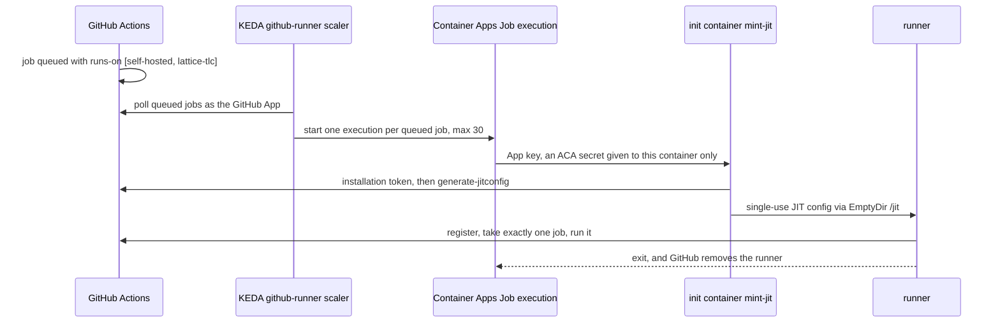

# CI runner pool (self-hosted, elastic)

An elastic pool of single-use GitHub Actions runners on Azure Container Apps Jobs. It
takes the long, CPU-bound TLC legs of the trusted lanes (`formal-receipts.yml` on push to
`main` and the nightly `coverage.yml`) off GitHub's hosted runners, so they no longer
compete with pull-request CI for the account's 20 concurrent hosted jobs. Self-hosted
jobs do not count against that cap.

It scales from zero: with nothing queued there are no replicas and no compute bill.

## How it works



| Resource | Purpose |
|---|---|
| `rg-<prefix>` | Everything below. |
| `vnet-<prefix>` / `aca-infra` | Subnet delegated to `Microsoft.App/environments`. |
| `nat-<prefix>` + `pip-nat-<prefix>` | Outbound-only egress (GitHub, NuGet, Maven, Codecov). |
| `id-<prefix>` | User-assigned identity with `AcrPull` on the registry only. |
| `acr<prefix>` | Registry with the admin user disabled; the image is built remotely (`az acr build`). |
| `law-<prefix>` | Log Analytics for the environment. |
| `cae-<prefix>` | Internal-only workload-profiles environment: no ingress, no public IP. |
| `job-<prefix>` | Event-triggered Job, scale 0..30, 4 vCPU / 8 GiB per execution. |

The network shape follows `benchmark/azure-throughput`'s `-PrivateNetwork` option, for
subscriptions whose policy blocks public IPs on workloads and requires identity-based
registry pulls. Nothing listens; runners only make outbound calls.

## Security model

The repository is public and owned by a user account, so runners cannot be limited to
chosen workflows (that needs an organisation runner group): any workflow naming the
pool's labels can reach it. The defences:

- **Trusted workflows only.** Only `formal-receipts.yml` and `coverage.yml` opt in, and
  `CiSelfHostedRunnerScopeTests` fails the build if any workflow that can target the pool
  also triggers on `pull_request` or `pull_request_target` (a pull-request run executes
  the workflow file from the pull request, so a fork could aim it at the pool).
- **Fork approval.** The repository requires approval before running workflows from any
  external contributor (`all_external_contributors`), so a fork that edits a workflow to
  target the pool cannot run without the owner approving it.
- **Single use.** Each execution registers one JIT runner for one job; the container and
  the registration are discarded afterwards. Nothing persists between jobs.
- **No credentials in the job.** The GitHub App key is an ACA secret referenced only by
  the init container. The runner container has no environment variables or secrets, and
  the identity it could reach holds only `AcrPull`.
- **No inbound surface.** Internal-only environment, no ingress.

Egress is not allow-listed (that would need Azure Firewall); a compromised job could make
arbitrary outbound calls from a throwaway container holding no secrets.

## Setup

1. **GitHub App** (once). Run `python3 tools/ci-runners/create-github-app.py`, confirm
   the App in the browser, then install it on this repository only. The App ID,
   installation ID and private key go to `~/.lattice-ci-runners/`, never the repository.
   It needs repository permissions Administration (read and write), Actions (read) and
   Metadata (read).
2. **Deploy** with the logged-in `az` account:

   ```powershell
   ./tools/ci-runners/deploy.ps1 -NamePrefix latrun
   ```

   The script is idempotent: rerun it to rebuild the image (tagged by the hash of its
   inputs) and update the Job. `-SkipImageBuild` reuses the current image;
   `-MaxExecutions`, `-RunnerCpu`, `-RunnerMemory` and `-ReplicaTimeoutSec` tune the Job.
3. **Opt the TLC legs in** by setting the repository variable:

   ```powershell
   gh variable set TLC_RUNNER --body '["self-hosted","lattice-tlc"]' -R NSTA1/Orleans.Lattice
   ```

   Delete it (`gh variable delete TLC_RUNNER`) to send the legs back to `ubuntu-latest`,
   for example while the pool is down: with the variable set and no pool, the jobs queue
   until GitHub times them out.

## Operating it

- **Executions:** `az containerapp job execution list -g rg-latrun -n job-latrun -o table`
- **Registered runners:** `gh api repos/NSTA1/Orleans.Lattice/actions/runners`
- **Logs:** query `ContainerAppConsoleLogs_CL` in `law-latrun` (init output shows the
  minted runner name and labels).
- **Stranded runner** (an execution whose runner never got a job): stop the execution with
  `az containerapp job stop --job-execution-name <name>`, then delete the runner with
  `gh api -X DELETE repos/NSTA1/Orleans.Lattice/actions/runners/<id>`. An unused
  execution otherwise ends at `-ReplicaTimeoutSec` (3 hours).
- **Labels:** a JIT config's labels are the runner's complete set, so `mint-jit.py`
  always adds `self-hosted`, `linux` and `x64` to the configured ones.

## Cost

Compute bills per second only while an execution runs (Consumption rates, roughly $0.43
per hour per 4 vCPU / 8 GiB runner). While idle, the NAT gateway (about $32 a month plus
data), the Basic registry (about $5) and Log Analytics ingestion remain.

## Teardown

```powershell
gh variable delete TLC_RUNNER -R NSTA1/Orleans.Lattice
az group delete --name rg-latrun --yes --no-wait
```
